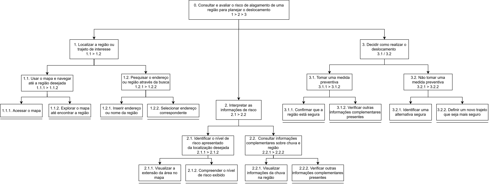
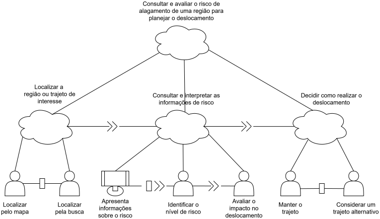
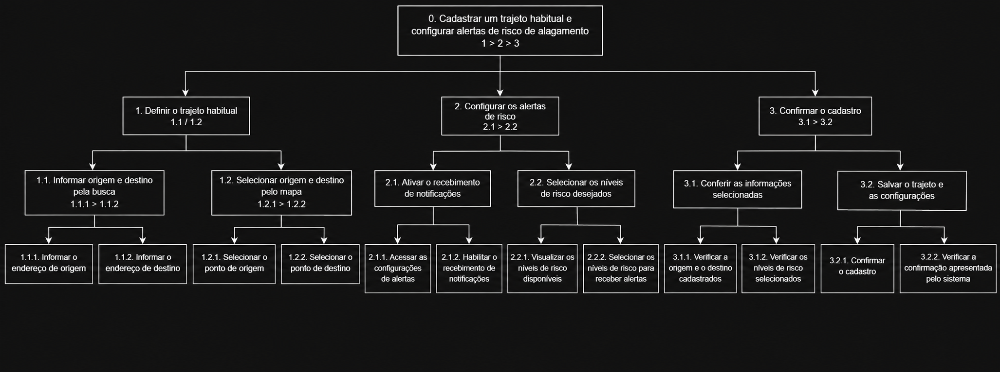
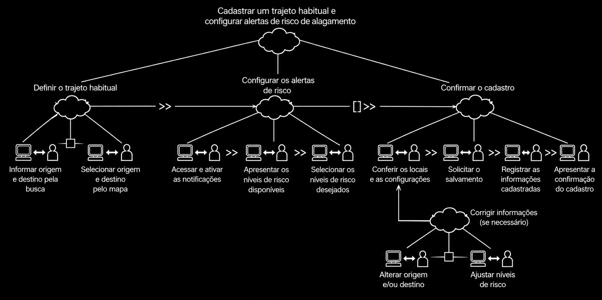
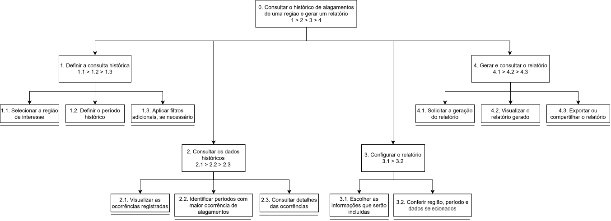
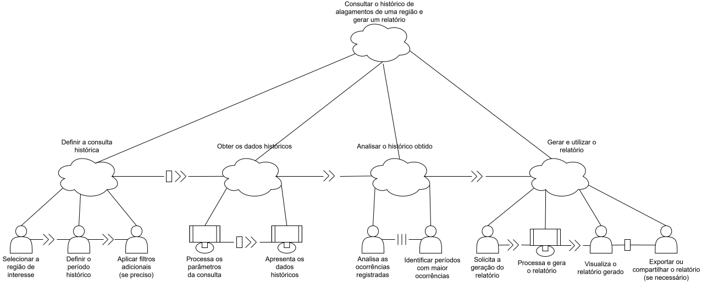
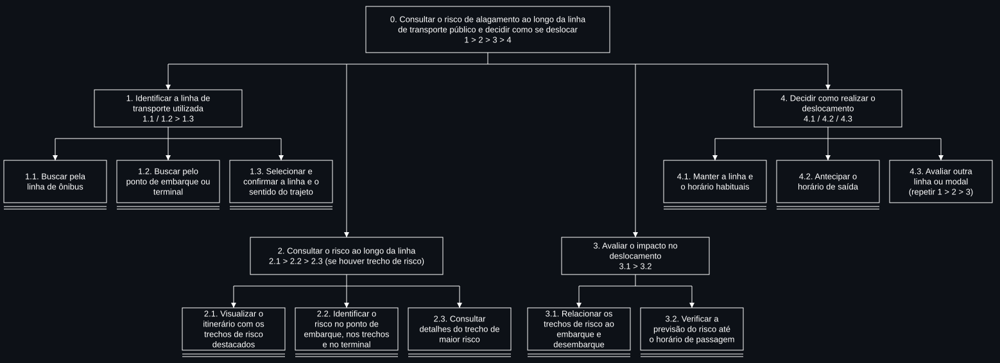
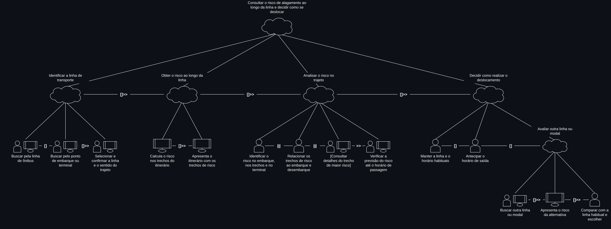

# Entrega 5 — Análise de tarefas: HTA, GOMS e CTT

**Data:** 08/10/2026
**Status:** 🟨 em andamento  
**Responsabilidade:** cada integrante modela pelo menos 1 HTA, 1 GOMS e 1 CTT. As três técnicas podem abordar a mesma funcionalidade ou funcionalidades distintas, conforme a orientação da disciplina.

## Objetivo da atividade

Modelar tarefas importantes sob perspectivas complementares: decomposição hierárquica (HTA), estrutura de metas/métodos/operações (GOMS) e relações temporais entre tarefas (CTT). O diagrama deve ser acompanhado de interpretação textual.

## Para projetos cujo TCC não previa interface

Modele **tarefas humanas relacionadas ao uso da contribuição técnica**, e não a implementação interna do algoritmo. Exemplos de boas tarefas para análise:

- investigar uma consulta de baixo desempenho;
- configurar uma análise e selecionar parâmetros;
- submeter um dataset e verificar sua validade;
- acompanhar uma execução demorada;
- comparar dois resultados/modelos;
- interpretar uma recomendação e decidir se a aceita;
- localizar uma execução anterior usando busca/filtros;
- gerar e compartilhar um relatório;
- administrar papéis/permissões quando isso for parte do trabalho real;
- revisar um alerta e registrar uma decisão.

Um CRUD pode gerar tarefas relevantes, mas “cadastrar usuário” só merece modelagem se tiver significado no domínio (papéis, validações, riscos, permissões, dependências).

## Seleção das tarefas

| ID | Tarefa | Persona/cenário de origem | Frequência/criticidade | Autor responsável |
|---|---|---|---|---|
| T01 | Consultar e interpretar o risco de alagamento de uma região para planejar o deslocamento | P01 / C01 | Frequência: depende da época do ano e de chuvas / Criticidade: alta, pois a informação pode apoiar decisões preventivas e evitar possíveis riscos à vida e financeiros. | Rafael Iamashita Becsei - 22.225.037-5 |
| T02 | {{...}} | {{P01/C01}} | {{...}} | {{...}} |
| T03 | Consultar o histórico de alagamentos de uma região e gerar um relatório | P01 / C01 | Frequência: eventual, principalmente quando o usuário deseja conhecer o histórico de uma região / Criticidade: média, pois permite compreender ocorrências anteriores e apoiar o planejamento de deslocamentos futuros. | Eric Song Watanabe - 22.125.086-3 |
| T04 | Consultar o risco de alagamento ao longo da linha de transporte público utilizada e decidir como realizar o deslocamento | P04 / C04 | Frequência: eventual, concentrada em dias com previsão de chuva intensa, antes de sair de casa ou já no ponto/terminal / Criticidade: alta, pois o trecho de ônibus é o mais exposto a alagamentos e a decisão precisa ser tomada com pouco tempo, envolvendo risco de atraso em compromissos importantes e de ficar retida em um veículo afetado. | Henrique Hodel Babler — 22.125.084-8 |
 

> Priorize tarefas necessárias para que o usuário alcance objetivos centrais. Não desperdice a modelagem em ações triviais isoladas, como “clicar em login”, se o objetivo relevante é maior. Da mesma forma, não modele o funcionamento interno do algoritmo como se fosse uma tarefa humana.

---

## HTA — T01 Consultar e interpretar o risco de alagamento de uma região para planejar o deslocamento

**Autor(a):** Rafael Iamashita Becsei - 22.225.037-5

### Descrição da tarefa

A tarefa tem como objetivo permitir que Paulo consulte as informações disponíveis sobre o risco de alagamento nas regiões por onde pretende passar e, a partir da interpretação dessas informações, decida se deve manter seu trajeto habitual ou considerar um caminho alternativo para evitar possíveis áreas de risco.
A tarefa começa quando Paulo identifica a necessidade de verificar as condições das regiões de seu trajeto antes ou durante um período de chuva intensa, e termina quando ele consegue avaliar os riscos apresentados e decidir como realizará seu deslocamento.

### Diagrama

### Decomposição e planos

| ID | Objetivo/operação | Plano/ordem | Problema ou decisão de design observada |
|---|---|---|---|
| 0 | Consultar e avaliar o risco de alagamento de uma região para planejar o deslocamento | 1 > 2 > 3 | O sistema deve apresentar informações claras para apoiar o planejamento do deslocamento. |
| 1 | Localizar a região ou trajeto de interesse | 1.1 > 1.2 | A interface deve permitir localizar a região de forma simples e rápida, seja pelo mapa ou pela busca. |
| 1.1 | Usar o mapa e navegar até a região desejada | 1.1.1 > 1.1.2 | A navegação pelo mapa deve facilitar a localização da região desejada. |
| 1.1.1 | Acessar o mapa | — | O mapa deve ser facilmente acessível. |
| 1.1.2 | Explorar o mapa até encontrar a região | — | A navegação deve permitir identificar a região sem dificuldade. |
| 1.2 | Pesquisar o endereço ou região através da busca | 1.2.1 > 1.2.2 | A busca deve permitir localizar a região por endereço ou nome. |
| 1.2.1 | Inserir endereço ou nome da região | — | O campo de busca deve ser fácil de identificar e utilizar. |
| 1.2.2 | Selecionar endereço correspondente | — | Os resultados devem permitir identificar o endereço correto. |
| 2 | Interpretar as informações de risco | 2.1 > 2.2 | Informações técnicas podem dificultar a compreensão do risco. |
| 2.1 | Identificar o nível de risco apresentado da localização desejada | 2.1.1 > 2.1.2 | O nível de risco deve ser apresentado de forma clara e associado à região consultada. |
| 2.1.1 | Visualizar a extensão da área no mapa | — | A área de risco deve ser facilmente identificada no mapa. |
| 2.1.2 | Compreender o nível de risco exibido | — | O risco deve ser apresentado em linguagem simples e com indicadores compreensíveis. |
| 2.2 | Consultar informações complementares sobre chuva e região | 2.2.1 > 2.2.2 | As informações adicionais devem ajudar na interpretação sem sobrecarregar o usuário. |
| 2.2.1 | Visualizar informações da chuva na região | — | As informações sobre chuva devem ser claras e relacionadas à região consultada. |
| 2.2.2 | Verificar outras informações complementares presentes | — | As informações complementares devem ser relevantes e organizadas. |
| 3 | Decidir como realizar o deslocamento | 3.1 / 3.2 | As informações devem apoiar a decisão do usuário sobre seu deslocamento. |
| 3.1 | Tomar uma medida preventiva | 3.1.1 > 3.1.2 | A interface deve ajudar o usuário a avaliar se pode manter seu planejamento. |
| 3.1.1 | Confirmar que a região está segura | — | O nível de risco deve permitir avaliar as condições da região. |
| 3.1.2 | Verificar outras informações complementares presentes | — | Informações adicionais podem apoiar a decisão de manter o deslocamento. |
| 3.2 | Não tomar uma medida preventiva | 3.2.1 > 3.2.2 | O usuário deve conseguir identificar quando precisa considerar alternativas ao trajeto. |
| 3.2.1 | Identificar uma alternativa segura | — | O mapa deve facilitar a identificação de regiões com menor risco. |
| 3.2.2 | Definir um novo trajeto que seja mais seguro | — | As informações de risco devem apoiar a escolha de outro trajeto, sem exigir que o sistema calcule rotas. |

**Verificação do HTA:**

- O objetivo 0 representa uma meta do usuário?
- As subtarefas são necessárias e suficientes?
- Os **planos** indicam ordem, alternativa, repetição ou condição?
- A decomposição parou em nível útil para projeto de interação?

---

## GOMS — T01 Consultar e interpretar o risco de alagamento na região do comércio

**Autor(a):** Rafael Iamashita Becsei - 22.225.037-5

### Goal

`G0: Consultar e avaliar o risco de alagamento para planejar o deslocamento`

### Métodos, operadores e regras de seleção

GOAL 1: Localizar a região ou trajeto de interesse
- **Method M1:** Localizar a região pelo mapa
  - OP 1.1: Acessar o mapa
  - OP 1.2: Observar a região apresentada inicialmente
  - OP 1.3: Navegar pelo mapa, movimentando ou aproximando a visualização quando necessário
  - OP 1.4: Identificar a região por onde pretende passar.
  - OP 1.5: Selecionar a região desejada
  - OP 1.6: Verificar se a localização selecionada está correta
- **Method M2:** Localizar a região pela busca
  - OP 2.1: Identificar o campo de busca
  - OP 2.2: Selecionar o campo de busca
  - OP 2.3: Digitar o endereço ou nome da região
  - OP 2.4: Verificar os resultados apresentados
  - OP 2.5: Selecionar o endereço correspondente
  - OP 2.6: Confirmar se a região localizada está correta
- **Selection Rule SR1:**
  - Utilizar M1 quando Paulo conseguir reconhecer visualmente a região desejada no mapa
  - Utilizar M2 quando Paulo souber o endereço ou nome da região e preferir realizar uma pesquisa
GOAL 2: Interpretar as informações de risco da região
- **Method M3:** Consultar e interpretar o risco apresentado
  - OP 3.1: Visualizar a extensão da área de risco no mapa
  - OP 3.2: Identificar o nível de risco apresentado para a região
  - OP 3.3: Ler as informações associadas ao nível de risco
  - OP 3.4: Consultar informações complementares sobre chuva e condições da região
  - OP 3.5: Relacionar as informações apresentadas com as regiões por onde pretende passar
  - OP 3.6: Avaliar se o risco identificado pode afetar seu deslocamento
GOAL 3: Decidir como realizar o deslocamento
- **Method M4:** Manter o trajeto planejado
  - OP 4.1: Considerar o nível de risco apresentado para a região
  - OP 4.2: Verificar se as informações consultadas indicam algum risco relevante
  - OP 4.3: Concluir que não há necessidade de alterar o planejamento
  - OP 4.4: Manter o trajeto previsto
- **Method M5:** Considerar um trajeto alternativo
  - OP 5.1: Identificar regiões do trajeto que apresentam maior risco de alagamento
  - OP 5.2: Consultar outras regiões que possam ser utilizadas no deslocamento
  - OP 5.3: Comparar os níveis de risco das regiões consultadas
  - OP 5.4: Identificar uma alternativa que apresente menor risco
  - OP 5.5: Decidir se deve alterar o trajeto ou adiar o deslocamento
- **Selection Rule SR2:**
  - Utilizar M4 quando as informações consultadas não indicarem risco relevante para o deslocamento planejado.
  - Utilizar M5 quando as informações indicarem possibilidade de alagamento em regiões que possam comprometer o deslocamento.

> Não chame qualquer passo de “método”. Em GOMS, métodos são sequências alternativas capazes de atingir uma meta; regras de seleção explicam quando escolher entre eles.

---

## CTT — T01 Consultar e interpretar o risco de alagamento na região do comércio

**Autor(a):** Rafael Iamashita Becsei - 22.225.037-5

### Descrição

O CTT representa a sequência e as relações temporais envolvidas na consulta do risco de alagamento das regiões por onde Paulo pretende passar durante seu deslocamento. A tarefa envolve a localização da região de interesse, a apresentação das informações pelo sistema, a interpretação do risco e a decisão sobre manter o trajeto planejado ou considerar um caminho alternativo para evitar possíveis áreas de risco.

### Diagrama

### Legenda e relações temporais usadas

| Operador/relação | Significado no diagrama | Exemplo no modelo |
|---|---|---|
| >> | Ativação sequencial: uma tarefa começa após a conclusão da anterior | Após localizar a região de interesse, Paulo consulta e interpreta as informações de risco. Em seguida, decide como realizar o deslocamento |
| [] | Escolha: o usuário realiza uma entre duas tarefas alternativas | Paulo pode localizar a região pelo mapa ou pela busca. Depois de avaliar o risco, pode manter o trajeto ou considerar um caminho alternativo |
| []>> | Ativação com passagem de informação: a tarefa seguinte utiliza informações disponibilizadas pela anterior | O sistema apresenta as informações sobre o risco, que são utilizadas por Paulo para identificar o nível de risco da região |

Identifique, quando aplicável, tarefas de usuário, sistema, interação e tarefas abstratas. Verifique se concorrência, escolha, habilitação, desabilitação e repetição estão representadas corretamente segundo a notação adotada em aula.

---

## HTA — T02 Cadastrar um trajeto habitual e configurar alertas de risco de alagamento

**Autor(a):** Victor Pimentel Lario - 22.125.064-0

### Descrição da tarefa

A tarefa tem como objetivo permitir que Paulo cadastre seu trajeto habitual entre casa e trabalho e configure alertas para ser notificado quando houver risco de alagamento nas regiões relacionadas ao seu deslocamento.

A tarefa começa quando Paulo acessa a funcionalidade de cadastro de trajetos e termina quando ele define os locais de origem e destino, escolhe os níveis de risco para os quais deseja receber alertas e salva as configurações. Dessa forma, ele poderá receber avisos sem precisar consultar manualmente as condições das regiões a todo momento.

### Diagrama

### Decomposição e planos

| ID | Objetivo/operação | Plano/ordem | Problema ou decisão de design observada |
|---|---|---|---|
| 0 | Cadastrar trajeto habitual e configurar alertas de risco de alagamento | 1 > 2 > 3 | O sistema deve permitir cadastrar locais de deslocamento e configurar alertas de maneira simples. |
| 1 | Definir o trajeto habitual | 1.1 / 1.2 | Paulo deve conseguir informar os locais de origem e destino de forma prática. |
| 1.1 | Informar origem e destino pela busca | 1.1.1 > 1.1.2 | A busca deve facilitar a localização dos endereços desejados. |
| 1.1.1 | Informar o endereço de origem | — | O campo de busca deve permitir identificar corretamente o local de partida. |
| 1.1.2 | Informar o endereço de destino | — | O sistema deve facilitar a seleção do destino correspondente. |
| 1.2 | Selecionar origem e destino pelo mapa | 1.2.1 > 1.2.2 | O mapa deve permitir localizar os pontos visualmente. |
| 1.2.1 | Selecionar o ponto de origem | — | A navegação pelo mapa deve ser simples e intuitiva. |
| 1.2.2 | Selecionar o ponto de destino | — | O destino deve ser facilmente identificado no mapa. |
| 2 | Configurar os alertas de risco | 2.1 > 2.2 | Paulo deve conseguir personalizar os alertas de acordo com sua necessidade. |
| 2.1 | Ativar o recebimento de notificações | — | A interface deve indicar claramente quando os alertas estão ativados. |
| 2.2 | Selecionar os níveis de risco desejados | — | Os níveis devem ser apresentados em linguagem simples e compreensível. |
| 3 | Confirmar o cadastro | 3.1 > 3.2 | O usuário deve conseguir conferir as informações antes de finalizar. |
| 3.1 | Conferir os locais e alertas selecionados | — | As informações devem ser apresentadas de forma organizada para evitar erros. |
| 3.2 | Salvar o trajeto e as configurações | — | O sistema deve apresentar uma confirmação de que o cadastro foi realizado. |

### Verificação do HTA

- O objetivo 0 representa a meta de Paulo de cadastrar um trajeto habitual e configurar alertas de risco de alagamento.
- As subtarefas contemplam a definição dos locais, a configuração dos alertas e a confirmação do cadastro.
- Os planos apresentam a ordem das ações e as alternativas disponíveis para definir o trajeto.
- A decomposição foi interrompida em operações relevantes para o projeto da interface, sem detalhar o processamento interno do sistema.

---

## GOMS — T02 Cadastrar um trajeto habitual e configurar alertas de risco de alagamento

**Autor(a):** Victor Pimentel Lario - 22.125.064-0

### Goal

`G0: Cadastrar um trajeto habitual e configurar alertas de risco de alagamento para acompanhar as regiões relacionadas ao deslocamento.`

### Métodos, operadores e regras de seleção

**GOAL 1: Definir o trajeto habitual**

**Method M1: Definir origem e destino pela busca**

- OP 1.1: Acessar a funcionalidade de cadastro de trajetos.
- OP 1.2: Identificar o campo de busca da origem.
- OP 1.3: Digitar o endereço ou nome da região de origem.
- OP 1.4: Selecionar o resultado correspondente.
- OP 1.5: Digitar o endereço ou nome da região de destino.
- OP 1.6: Selecionar o destino correspondente.

**Method M2: Definir origem e destino pelo mapa**

- OP 2.1: Acessar a funcionalidade de cadastro de trajetos.
- OP 2.2: Visualizar o mapa apresentado.
- OP 2.3: Navegar até encontrar o ponto de origem.
- OP 2.4: Selecionar o ponto de origem.
- OP 2.5: Navegar até encontrar o ponto de destino.
- OP 2.6: Selecionar o ponto de destino.

**Selection Rule SR1:**

- Utilizar M1 quando Paulo souber o endereço ou nome das regiões e preferir realizar uma busca.
- Utilizar M2 quando Paulo preferir localizar visualmente a origem e o destino pelo mapa.

**GOAL 2: Configurar os alertas de risco de alagamento**

**Method M3: Ativar e personalizar as notificações**

- OP 3.1: Acessar as configurações de alertas.
- OP 3.2: Identificar a opção de recebimento de notificações.
- OP 3.3: Ativar os alertas.
- OP 3.4: Visualizar os níveis de risco disponíveis.
- OP 3.5: Selecionar os níveis de risco para os quais deseja receber notificações.

**GOAL 3: Confirmar o cadastro**

**Method M4: Conferir e salvar as informações**

- OP 4.1: Visualizar os locais de origem e destino selecionados.
- OP 4.2: Verificar se os locais estão corretos.
- OP 4.3: Conferir os níveis de risco configurados.
- OP 4.4: Selecionar a opção de salvar.
- OP 4.5: Verificar a mensagem de confirmação apresentada pelo sistema.

**Selection Rule SR2:**

- Se os locais e as configurações estiverem corretos, Paulo confirma e salva o cadastro.
- Se identificar alguma informação incorreta, retorna à etapa correspondente para realizar a correção antes de salvar.

---

## CTT — T02 Cadastrar um trajeto habitual e configurar alertas de risco de alagamento

**Autor(a):** Victor Pimentel Lario - 22.125.064-0

### Descrição

O CTT representa a sequência e as relações temporais envolvidas no cadastro de um trajeto habitual e na configuração de alertas de risco de alagamento realizados por Paulo Andre Oliveira.

Inicialmente, Paulo define os locais de origem e destino, podendo utilizar a busca por endereços ou selecionar os pontos diretamente no mapa. Em seguida, acessa as configurações de alertas, ativa as notificações e seleciona os níveis de risco que deseja acompanhar.

Por fim, Paulo confere os locais e as preferências selecionadas e confirma o cadastro. Caso encontre alguma informação incorreta, pode retornar à etapa correspondente para realizar a correção. Após o salvamento, o sistema registra as informações e apresenta uma mensagem de confirmação.

### Diagrama

### Tarefas identificadas

| ID | Tarefa | Tipo |
|---|---|---|
| T0 | Cadastrar trajeto habitual e configurar alertas | Abstrata |
| T1 | Definir origem e destino | Abstrata |
| T1.1 | Informar origem e destino pela busca | Interação |
| T1.2 | Selecionar origem e destino pelo mapa | Interação |
| T2 | Configurar os alertas de risco | Abstrata |
| T2.1 | Acessar e ativar as notificações | Interação |
| T2.2 | Apresentar os níveis de risco disponíveis | Sistema |
| T2.3 | Selecionar os níveis de risco desejados | Interação |
| T3 | Confirmar o cadastro | Abstrata |
| T3.1 | Conferir os locais e as configurações | Usuário |
| T3.2 | Corrigir informações, caso necessário | Interação |
| T3.3 | Solicitar o salvamento | Interação |
| T3.4 | Registrar as informações cadastradas | Sistema |
| T3.5 | Apresentar a confirmação do cadastro | Sistema |

### Legenda e relações temporais usadas

| Operador/relação | Significado no diagrama | Exemplo no modelo |
|---|---|---|
| `>>` | Ativação sequencial: uma tarefa começa após a conclusão da anterior. | Após definir os locais, Paulo configura os alertas e confirma o cadastro. |
| `[]` | Escolha: apenas uma das tarefas alternativas é realizada. | Paulo pode informar os locais pela busca ou selecioná-los diretamente no mapa. |
| `[]>>` | Ativação com passagem de informação: a tarefa seguinte recebe informações da anterior. | Os locais definidos e os níveis de risco selecionados são utilizados na confirmação do cadastro. |

### Relação temporal principal

`T0 = T1 >> T2 []>> T3`

**Decomposição das tarefas:**

- `T1 = T1.1 [] T1.2`
- `T2 = T2.1 >> T2.2 >> T2.3`
- `T3 = T3.1 >> (T3.2 [] T3.3)`
- Caso seja necessário corrigir informações (T3.2), Paulo retorna à conferência antes de salvar.
- Após a conferência correta: `T3.3 >> T3.4 >> T3.5`.

Caso Paulo encontre algum erro durante T3.1, realiza T3.2 e retorna à conferência antes de executar T3.3. Esse retorno deve ser representado como uma condição de correção no diagrama, não como uma etapa obrigatória.

---

## HTA — T03 Consultar o histórico de alagamentos de uma região e gerar um relatório

**Autor(a):** Eric Song Watanabe — 22.125.086-3

### Descrição da tarefa

A tarefa tem como objetivo permitir que Paulo Andre Oliveira consulte registros históricos de alagamentos de uma região e organize essas informações em um relatório que possa ser utilizado como apoio para compreender melhor o histórico do local.

Essa funcionalidade representa uma possibilidade adicional de interação a ser investigada, diferente da consulta do risco atual. A tarefa começa quando Paulo deseja conhecer ocorrências anteriores de alagamento em determinada região e termina quando consegue gerar e visualizar um relatório com as informações históricas selecionadas.

### Diagrama

### Decomposição e planos

| ID | Objetivo/operação | Plano/ordem | Problema ou decisão de design observada |
|---|---|---|---|
| 0 | Consultar o histórico de alagamentos de uma região e gerar um relatório | 1 > 2 > 3 > 4 | O processo deve permitir que o usuário encontre dados históricos, selecione informações relevantes e compreenda o relatório gerado. |
| 1 | Definir a consulta histórica | 1.1 > 1.2 > 1.3 | A configuração da consulta deve ser simples e permitir que o usuário determine claramente o que deseja analisar. |
| 1.1 | Selecionar a região de interesse | — | O usuário precisa conseguir identificar facilmente a região que deseja consultar. |
| 1.2 | Definir o período histórico | — | O período deve ser compreensível e permitir consultas de diferentes intervalos de tempo. |
| 1.3 | Aplicar filtros adicionais, se necessário | Opcional | Muitos filtros podem aumentar a complexidade da consulta, por isso devem ser utilizados apenas quando forem úteis para o usuário. |
| 2 | Consultar os dados históricos | 2.1 > 2.2 > 2.3 | As informações históricas precisam ser apresentadas de maneira compreensível, sem exigir conhecimento técnico. |
| 2.1 | Visualizar as ocorrências registradas | — | O usuário deve conseguir identificar quantas ocorrências foram registradas no período selecionado. |
| 2.2 | Identificar períodos com maior ocorrência de alagamentos | — | A apresentação deve facilitar a identificação de possíveis padrões no histórico. |
| 2.3 | Consultar detalhes das ocorrências | Opcional | Informações adicionais devem estar disponíveis sem sobrecarregar a visualização principal. |
| 3 | Configurar o relatório | 3.1 > 3.2 | O usuário deve compreender quais informações serão incluídas antes de gerar o documento. |
| 3.1 | Escolher as informações que serão incluídas | — | A seleção deve ser simples para evitar relatórios com informações desnecessárias. |
| 3.2 | Conferir região, período e dados selecionados | — | O usuário deve conseguir verificar a configuração antes da geração do relatório. |
| 4 | Gerar e consultar o relatório | 4.1 > 4.2 > 4.3 | O resultado deve deixar claro que o relatório foi criado a partir dos filtros e dados selecionados pelo usuário. |
| 4.1 | Solicitar a geração do relatório | — | A ação de geração deve ser facilmente identificada. |
| 4.2 | Visualizar o relatório gerado | — | O relatório precisa apresentar as informações históricas de forma organizada e compreensível. |
| 4.3 | Exportar ou compartilhar o relatório | Opcional | O usuário pode desejar utilizar o relatório fora do sistema ou compartilhá-lo com outra pessoa. |

**Plano 0:** Realizar 1, depois 2, 3 e 4.

**Plano 1:** Realizar 1.1 e 1.2. Realizar 1.3 apenas caso Paulo queira restringir ou detalhar a consulta histórica.

**Plano 2:** Realizar 2.1 e 2.2. Realizar 2.3 caso Paulo queira consultar informações mais detalhadas sobre alguma ocorrência.

**Plano 3:** Realizar 3.1 e depois 3.2.

**Plano 4:** Realizar 4.1 e 4.2. Realizar 4.3 caso Paulo queira salvar ou compartilhar o relatório.

### Verificação do HTA

- O objetivo 0 representa uma meta do usuário: conhecer o histórico de alagamentos de uma região e gerar um relatório com as informações consideradas relevantes.
- As subtarefas contemplam a definição da consulta, análise do histórico, configuração e geração do relatório.
- Os planos representam sequência e operações opcionais.
- A decomposição foi interrompida em operações úteis para identificar possíveis problemas e decisões de interação.

---

## GOMS — T03 Consultar o histórico de alagamentos de uma região e gerar um relatório

**Autor(a):** Eric Song Watanabe — 22.125.086-3

### Goal

`G0: Consultar o histórico de alagamentos de uma região e gerar um relatório com as informações desejadas.`

### Métodos, operadores e regras de seleção

**GOAL 1: Definir a consulta histórica**

**Method M1: Realizar uma consulta utilizando apenas região e período**

- OP 1.1: Acessar a consulta de histórico.
- OP 1.2: Selecionar a região desejada.
- OP 1.3: Selecionar o período histórico.
- OP 1.4: Confirmar a consulta.
- OP 1.5: Verificar os resultados apresentados.

**Method M2: Realizar uma consulta utilizando filtros adicionais**

- OP 2.1: Acessar a consulta de histórico.
- OP 2.2: Selecionar a região desejada.
- OP 2.3: Selecionar o período histórico.
- OP 2.4: Acessar as opções de filtros.
- OP 2.5: Selecionar os filtros desejados.
- OP 2.6: Confirmar a consulta.
- OP 2.7: Verificar os resultados apresentados.

**Selection Rule SR1:**

- Utilizar M1 quando Paulo deseja obter uma visão geral do histórico de alagamentos da região.
- Utilizar M2 quando Paulo deseja restringir ou detalhar as informações apresentadas.

**GOAL 2: Analisar as informações históricas**

**Method M3: Analisar o resumo histórico apresentado**

- OP 3.1: Observar a quantidade de ocorrências registradas.
- OP 3.2: Identificar o período analisado.
- OP 3.3: Observar a distribuição das ocorrências ao longo do período.
- OP 3.4: Identificar períodos com maior número de registros.
- OP 3.5: Consultar detalhes adicionais quando necessário.

**GOAL 3: Gerar o relatório**

**Method M4: Gerar um relatório utilizando as informações padrão**

- OP 4.1: Selecionar a opção de gerar relatório.
- OP 4.2: Verificar região e período selecionados.
- OP 4.3: Confirmar a geração.
- OP 4.4: Aguardar o processamento.
- OP 4.5: Visualizar o relatório gerado.

**Method M5: Personalizar o conteúdo antes de gerar o relatório**

- OP 5.1: Selecionar a opção de gerar relatório.
- OP 5.2: Acessar as opções de personalização.
- OP 5.3: Selecionar as informações que serão incluídas.
- OP 5.4: Conferir região, período e informações selecionadas.
- OP 5.5: Confirmar a geração.
- OP 5.6: Aguardar o processamento.
- OP 5.7: Visualizar o relatório gerado.

**Selection Rule SR2:**

- Utilizar M4 quando Paulo deseja gerar rapidamente um relatório com as informações padrão da consulta.
- Utilizar M5 quando Paulo deseja escolher quais informações devem aparecer no relatório.

**GOAL 4: Utilizar o relatório gerado**

**Method M6: Consultar o relatório dentro do sistema**

- OP 6.1: Visualizar o relatório.
- OP 6.2: Examinar as informações apresentadas.
- OP 6.3: Finalizar a consulta.

**Method M7: Exportar o relatório**

- OP 7.1: Visualizar o relatório.
- OP 7.2: Selecionar a opção de exportação.
- OP 7.3: Selecionar o formato disponível.
- OP 7.4: Confirmar a exportação.
- OP 7.5: Verificar se o arquivo foi gerado.

**Selection Rule SR3:**

- Utilizar M6 quando Paulo deseja apenas consultar as informações dentro do sistema.
- Utilizar M7 quando deseja guardar ou utilizar o relatório posteriormente fora do sistema.

### Considerações sobre o modelo

O modelo GOMS apresenta diferentes métodos para realizar a consulta e gerar o relatório. Paulo pode realizar uma consulta mais simples, utilizando apenas região e período, ou utilizar filtros adicionais quando desejar informações mais específicas.

Na etapa de geração, também existem dois métodos: utilizar uma configuração padrão ou personalizar as informações que serão incluídas. As regras de seleção determinam qual método é mais adequado de acordo com o objetivo do usuário.

Dessa forma, a funcionalidade permite analisar dados históricos em diferentes níveis de detalhamento sem obrigar o usuário a realizar uma configuração complexa em todas as consultas.

---

## CTT — T03 Consultar o histórico de alagamentos de uma região e gerar um relatório

**Autor(a):** Eric Song Watanabe — 22.125.086-3

### Descrição

O modelo CTT representa as relações temporais entre as tarefas realizadas por Paulo Andre Oliveira ao consultar dados históricos de alagamentos de uma região e gerar um relatório.

Inicialmente, Paulo define a região e o período que deseja analisar, podendo também aplicar filtros adicionais. Após a configuração da consulta, o sistema processa os parâmetros selecionados e apresenta os dados históricos encontrados.

Paulo analisa as informações apresentadas e, quando considera que os dados atendem ao objetivo da consulta, configura e solicita a geração do relatório. O sistema processa essa solicitação e apresenta o documento gerado.

Depois da visualização, Paulo pode finalizar a tarefa ou exportar o relatório para utilizá-lo posteriormente.

### Diagrama

### Tarefas identificadas

| ID | Tarefa | Tipo |
|---|---|---|
| T0 | Consultar histórico e gerar relatório | Abstrata |
| T1 | Definir consulta histórica | Abstrata |
| T1.1 | Selecionar região | Interação |
| T1.2 | Definir período | Interação |
| T1.3 | Aplicar filtros adicionais | Interação |
| T2 | Obter dados históricos | Abstrata |
| T2.1 | Processar parâmetros da consulta | Sistema |
| T2.2 | Apresentar dados históricos | Interação |
| T3 | Analisar histórico | Abstrata |
| T3.1 | Examinar ocorrências registradas | Usuário |
| T3.2 | Identificar períodos com maior ocorrência | Usuário |
| T3.3 | Consultar detalhes de ocorrências | Interação |
| T4 | Configurar relatório | Abstrata |
| T4.1 | Selecionar informações do relatório | Interação |
| T4.2 | Conferir configuração | Usuário |
| T5 | Gerar relatório | Abstrata |
| T5.1 | Solicitar geração | Interação |
| T5.2 | Processar relatório | Sistema |
| T5.3 | Apresentar relatório | Interação |
| T6 | Utilizar relatório gerado | Abstrata |
| T6.1 | Visualizar relatório | Usuário |
| T6.2 | Exportar relatório | Interação |

### Legenda e relações temporais usadas

| Operador/relação | Significado no diagrama | Exemplo no modelo |
|---|---|---|
| `>>` | Ativação: a segunda tarefa começa após a conclusão da primeira. | T3 >> T4: após analisar o histórico, Paulo configura o relatório. |
| `[]>>` | Ativação com passagem de informação: a próxima tarefa utiliza dados produzidos pela tarefa anterior. | T1 []>> T2: região, período e filtros definidos são utilizados pelo sistema na consulta histórica. |
| `[]` | Escolha entre tarefas alternativas. | Após visualizar o relatório, Paulo pode finalizar a consulta ou optar pela exportação. |
| `|||` | Concorrência: tarefas podem ser realizadas em qualquer ordem ou paralelamente quando aplicável. | Durante a análise, Paulo pode observar a frequência das ocorrências e consultar detalhes sem uma ordem rígida. |

### Relação temporal principal

`T0 = T1 []>> T2 >> T3 >> T4 []>> T5 >> T6`

**Decomposição das tarefas:**

- `T1 = T1.1 >> T1.2 >> T1.3`
- `T2 = T2.1 >> T2.2`
- `T3 = T3.1 ||| T3.2 ||| T3.3`
- `T4 = T4.1 >> T4.2`
- `T5 = T5.1 >> T5.2 >> T5.3`
- `T6 = T6.1 >> T6.2`, quando houver necessidade de exportação.

### Considerações sobre o modelo

O CTT evidencia que a consulta histórica depende inicialmente da definição da região e do período de interesse. Essas informações precisam ser processadas antes que os dados históricos possam ser apresentados ao usuário.

Durante a análise do histórico, algumas informações podem ser examinadas sem uma ordem rígida, como quantidade de ocorrências, distribuição ao longo do período e detalhes específicos.

A geração do relatório depende dos dados obtidos anteriormente e da configuração realizada pelo usuário. Depois que o sistema gera o documento, Paulo pode apenas consultá-lo ou também exportá-lo, dependendo de sua necessidade.

A modelagem diferencia as ações realizadas por Paulo, as interações com a interface e os processamentos realizados automaticamente pelo sistema.

---
 
## HTA — T04 Consultar o risco de alagamento ao longo da linha de transporte público
 
**Autor(a):** Henrique Hodel Babler — 22.125.084-8
 
### Descrição da tarefa
 
A tarefa tem como objetivo permitir que Juliana Ferreira Costa consulte o risco de alagamento ao longo da linha de ônibus que utiliza para chegar ao terminal de integração e, a partir dessas informações, decida como realizará seu deslocamento até a faculdade.
 
Diferentemente da consulta por região (T01), essa funcionalidade organiza as informações de risco pela forma como Juliana pensa o próprio deslocamento: por linha, ponto de embarque e terminal, e não por ruas e avenidas que ela não conhece. O foco está no trecho de ônibus até o terminal, que circula pelas vias e é o mais exposto a alagamentos; o trecho de metrô não foi modelado. [H] Essa organização parte da hipótese H06, levantada no cenário C04, e ainda precisa ser validada com usuários de transporte público.
 
A tarefa começa quando Juliana recebe um alerta de temporal ou percebe chuva intensa antes de sair de casa (ou já no ponto de ônibus) e termina quando ela decide manter a linha habitual, sair mais cedo ou utilizar outra linha ou modal de transporte.
 
### Diagrama
 

 
### Decomposição e planos
 
| ID | Objetivo/operação | Plano/ordem | Problema ou decisão de design observada |
|---|---|---|---|
| 0 | Consultar o risco de alagamento ao longo da linha de transporte público e decidir como se deslocar | 1 > 2 > 3 > 4 | As informações de risco devem ser apresentadas na mesma unidade com que a usuária pensa o trajeto (linha, ponto, terminal), e não apenas por região. |
| 1 | Identificar a linha de transporte utilizada | 1.1 / 1.2 > 1.3 | A usuária pode conhecer o número da linha ou apenas o ponto onde embarca; a interface deve aceitar as duas formas de entrada. |
| 1.1 | Buscar pela linha de ônibus | — | A busca deve reconhecer número e nome da linha, inclusive com entradas parciais. |
| 1.2 | Buscar pelo ponto de embarque ou terminal | — | Ao selecionar um ponto ou terminal, o sistema deve listar as linhas que passam por ele. |
| 1.3 | Selecionar e confirmar a linha e o sentido do trajeto | — | Linhas possuem sentido de ida e volta; a escolha do sentido errado levaria a uma análise de trechos que não fazem parte do deslocamento. |
| 2 | Consultar o risco ao longo da linha | 2.1 > 2.2 > 2.3 (se houver trecho de risco) | A visualização deve mostrar o itinerário completo, inclusive vias que a usuária não conhece, sem exigir que ela saiba os nomes das ruas. |
| 2.1 | Visualizar o itinerário com os trechos de risco destacados | — | Os trechos devem ser diferenciados por nível de risco com cor e texto, não apenas por cor. |
| 2.2 | Identificar o risco no ponto de embarque, nos trechos e no terminal | — | Ponto de embarque e terminal são referências que a usuária reconhece; devem receber destaque próprio. |
| 2.3 | Consultar detalhes do trecho de maior risco | Opcional | Os detalhes (chuva prevista, ocorrências recentes no trecho) devem estar disponíveis sem sobrecarregar a visão geral da linha. |
| 3 | Avaliar o impacto no deslocamento | 3.1 > 3.2 | A usuária precisa relacionar o risco ao seu trecho específico, e não à linha inteira. |
| 3.1 | Relacionar os trechos de risco ao embarque e desembarque | — | Trechos de risco fora do intervalo entre embarque e desembarque não afetam a usuária; a interface deve permitir distinguir esse intervalo. |
| 3.2 | Verificar a previsão do risco até o horário de passagem | — | O risco no momento da consulta pode ser diferente do risco no momento em que o ônibus passar pelo trecho. |
| 4 | Decidir como realizar o deslocamento | 4.1 / 4.2 / 4.3 | A interface deve apoiar a decisão, sem decidir pela usuária. |
| 4.1 | Manter a linha e o horário habituais | — | O sistema deve deixar claro quando o risco no trecho é baixo, transmitindo segurança para manter o planejamento. |
| 4.2 | Antecipar o horário de saída | — | A previsão de evolução do risco deve indicar se sair mais cedo permite passar pelo trecho antes da piora. |
| 4.3 | Avaliar outra linha ou modal | Repetir 1 > 2 > 3 para a alternativa | Para comparar alternativas, a usuária precisa repetir a consulta; a interface pode facilitar a comparação entre linhas consultadas. [H] |
 
**Plano 0:** Realizar 1, depois 2, 3 e 4.
 
**Plano 1:** Realizar 1.1 quando Juliana souber o número ou nome da linha, ou 1.2 quando souber apenas o ponto ou o terminal. Em seguida, realizar 1.3.
 
**Plano 2:** Realizar 2.1 e 2.2. Realizar 2.3 somente se houver algum trecho com risco moderado ou alto no itinerário.
 
**Plano 3:** Realizar 3.1 e depois 3.2.
 
**Plano 4:** Realizar 4.1 se o risco no trecho utilizado for baixo e não houver previsão de piora. Realizar 4.2 se o risco for moderado ou houver previsão de piora próxima ao horário de passagem pelo trecho. Realizar 4.3 se o risco no trecho utilizado for alto ou se antecipar a saída não evitar o período de maior risco; nesse caso, repetir 1 > 2 > 3 para a nova linha ou modal até encontrar uma alternativa viável ou decidir antecipar a saída.
 
### Verificação do HTA
 
- O objetivo 0 representa uma meta de Juliana: saber se a linha que utiliza será afetada por alagamentos e decidir como chegar à faculdade com menor risco de atraso ou de ficar retida.
- As subtarefas contemplam a identificação da linha, a consulta do risco ao longo do itinerário, a avaliação do impacto no trecho utilizado e a decisão sobre o deslocamento.
- Os planos representam sequência (Plano 0, 2 e 3), alternativa (Planos 1 e 4), operação opcional (2.3) e repetição condicional (4.3).
- A decomposição foi interrompida em operações relevantes para o projeto da interface, sem detalhar o cálculo do risco realizado pelo modelo do TCC.
---
 
## GOMS — T04 Consultar o risco de alagamento ao longo da linha de transporte público
 
**Autor(a):** Henrique Hodel Babler — 22.125.084-8
 
### Goal
 
`G0: Consultar o risco de alagamento ao longo da linha de transporte público utilizada e decidir como realizar o deslocamento até a faculdade.`
 
### Métodos, operadores e regras de seleção
 
**GOAL 1: Identificar a linha de transporte utilizada**
 
**Method M1: Buscar pela linha de ônibus**
 
- OP 1.1: Acessar a consulta por transporte público.
- OP 1.2: Selecionar o campo de busca de linhas.
- OP 1.3: Digitar o número ou nome da linha.
- OP 1.4: Selecionar a linha correspondente nos resultados.
- OP 1.5: Selecionar o sentido do trajeto (ida ou volta).
**Method M2: Buscar pelo ponto de embarque ou terminal**
 
- OP 2.1: Acessar a consulta por transporte público.
- OP 2.2: Selecionar o campo de busca de pontos e terminais.
- OP 2.3: Digitar o endereço do ponto ou o nome do terminal.
- OP 2.4: Selecionar o ponto ou terminal correspondente.
- OP 2.5: Visualizar as linhas que passam pelo local.
- OP 2.6: Selecionar a linha utilizada e o sentido do trajeto.
**Selection Rule SR1:**
 
- Utilizar M1 quando Juliana souber o número ou o nome da linha que utiliza.
- Utilizar M2 quando Juliana souber apenas onde embarca ou desembarca, ou quiser descobrir quais linhas atendem um ponto ou terminal.
**GOAL 2: Consultar o risco ao longo da linha**
 
**Method M3: Analisar a visão geral do itinerário**
 
- OP 3.1: Visualizar o itinerário da linha no mapa.
- OP 3.2: Observar os trechos destacados por nível de risco.
- OP 3.3: Identificar o nível de risco no ponto de embarque.
- OP 3.4: Identificar o nível de risco no terminal de integração.
- OP 3.5: Verificar se existe algum trecho com risco moderado ou alto entre o embarque e o desembarque.
**Method M4: Analisar os detalhes de um trecho de risco**
 
- OP 4.1: Visualizar o itinerário da linha no mapa.
- OP 4.2: Identificar o nível de risco no ponto de embarque e no terminal de integração.
- OP 4.3: Identificar o trecho com maior nível de risco entre o embarque e o desembarque.
- OP 4.4: Selecionar o trecho.
- OP 4.5: Ler as informações de chuva prevista e ocorrências recentes no trecho.
- OP 4.6: Verificar a previsão de evolução do risco até o horário em que passará pelo trecho.
- OP 4.7: Retornar à visão geral do itinerário.
**Selection Rule SR2:**
 
- Utilizar M3 quando todos os trechos entre o embarque e o desembarque apresentarem risco baixo.
- Utilizar M4 quando algum trecho entre o embarque e o desembarque apresentar risco moderado ou alto.
**GOAL 3: Decidir como realizar o deslocamento**
 
**Method M5: Manter a linha e o horário habituais**
 
- OP 5.1: Considerar o nível de risco do trecho utilizado.
- OP 5.2: Confirmar que não há previsão de piora até o horário em que passará pelo trecho.
- OP 5.3: Manter o planejamento habitual.
**Method M6: Antecipar o horário de saída**
 
- OP 6.1: Verificar o horário previsto para a piora do risco no trecho.
- OP 6.2: Comparar com o horário em que passaria pelo trecho.
- OP 6.3: Definir um novo horário de saída.
- OP 6.4: Sair mais cedo utilizando a mesma linha.
**Method M7: Utilizar outra linha ou outro modal**
 
- OP 7.1: Retornar à consulta por transporte público.
- OP 7.2: Buscar outra linha que conecte o ponto de partida ao terminal ou à faculdade, aplicando M1 ou M2.
- OP 7.3: Consultar o risco ao longo da nova linha, aplicando M3 ou M4.
- OP 7.4: Comparar o risco da nova linha com o da linha habitual.
- OP 7.5: Escolher a alternativa com menor risco ou, se nenhuma linha for viável, optar por outro modal, como transporte por aplicativo. [H]
**Selection Rule SR3:**
 
- Utilizar M5 quando o risco no trecho utilizado for baixo e não houver previsão de piora.
- Utilizar M6 quando o risco for moderado ou quando houver previsão de piora próxima ao horário em que Juliana passaria pelo trecho.
- Utilizar M7 quando o risco no trecho utilizado for alto ou quando antecipar a saída não evitar o período de maior risco.
### Considerações sobre o modelo
 
O modelo GOMS mostra que a mesma meta pode ser atingida a partir de diferentes pontos de partida: Juliana pode conhecer a linha que utiliza ou apenas os pontos onde embarca e desembarca. Por isso, a interface precisa oferecer as duas formas de busca, com regras de seleção que dependem do conhecimento prévio da usuária.
 
Na análise do risco, a visão geral do itinerário é suficiente quando não há trechos críticos, enquanto o detalhamento só é necessário quando algum trecho do deslocamento apresenta risco moderado ou alto. Isso evita que toda consulta exija uma análise detalhada.
 
Na decisão, o método M7 reaproveita os métodos dos goals anteriores, o que indica que comparar linhas alternativas exige repetir a consulta. [H] Essa repetição sugere uma oportunidade de design: permitir comparar lado a lado o risco de duas ou mais linhas consultadas.

 
---
 
## CTT — T04 Consultar o risco de alagamento ao longo da linha de transporte público
 
**Autor(a):** Henrique Hodel Babler — 22.125.084-8
 
### Descrição
 
O CTT representa as relações temporais envolvidas na consulta do risco de alagamento ao longo da linha de transporte público utilizada por Juliana Ferreira Costa e na decisão sobre como realizar seu deslocamento até a faculdade.
 
Inicialmente, Juliana identifica a linha que utiliza, buscando pelo número da linha ou pelo ponto/terminal, e seleciona e confirma a linha e o sentido do trajeto. A linha selecionada é utilizada pelo sistema para calcular o risco nos trechos do itinerário e apresentá-los no mapa.
 
Com o itinerário apresentado, Juliana analisa o risco no ponto de embarque, nos trechos intermediários e no terminal, relaciona esses trechos aos pontos que realmente utiliza e, se quiser, consulta detalhes do trecho de maior risco. Essas análises não seguem uma ordem rígida. Em seguida, verifica a previsão do risco até o horário em que passará pelo trecho.
 
Por fim, com base na análise, Juliana escolhe entre manter a linha e o horário habituais, antecipar a saída ou avaliar outra linha ou modal. Na última opção, ela busca a alternativa, o sistema apresenta o risco correspondente e Juliana compara com a linha habitual antes de escolher.
 
### Diagrama
 

 
### Tarefas identificadas
 
| ID | Tarefa | Tipo |
|---|---|---|
| T0 | Consultar o risco de alagamento ao longo da linha e decidir como se deslocar | Abstrata |
| T1 | Identificar a linha de transporte | Abstrata |
| T1.1 | Buscar pela linha de ônibus | Interação |
| T1.2 | Buscar pelo ponto de embarque ou terminal | Interação |
| T1.3 | Selecionar e confirmar a linha e o sentido do trajeto | Interação |
| T2 | Obter o risco ao longo da linha | Abstrata |
| T2.1 | Calcular o risco nos trechos do itinerário | Sistema |
| T2.2 | Apresentar o itinerário com os trechos de risco | Sistema |
| T3 | Analisar o risco no trajeto | Abstrata |
| T3.1 | Identificar o risco no embarque, nos trechos e no terminal | Usuário |
| T3.2 | Relacionar os trechos de risco ao embarque e desembarque | Usuário |
| T3.3 | Consultar detalhes do trecho de maior risco (opcional) | Interação |
| T3.4 | Verificar a previsão do risco até o horário de passagem | Interação |
| T4 | Decidir como realizar o deslocamento | Abstrata |
| T4.1 | Manter a linha e o horário habituais | Usuário |
| T4.2 | Antecipar o horário de saída | Usuário |
| T4.3 | Avaliar outra linha ou modal | Abstrata |
| T4.3.1 | Buscar outra linha ou modal | Interação |
| T4.3.2 | Apresentar o risco da alternativa | Sistema |
| T4.3.3 | Comparar com a linha habitual e escolher | Usuário |
 
### Legenda e relações temporais usadas
 
| Operador/relação | Significado no diagrama | Exemplo no modelo |
|---|---|---|
| `>>` | Ativação: a segunda tarefa começa após a conclusão da primeira. | (T3.1 \|\|\| T3.2 \|\|\| [T3.3]) >> T3.4: depois de analisar os trechos, Juliana verifica a previsão do risco. |
| `[]>>` | Ativação com passagem de informação: a tarefa seguinte utiliza informações produzidas pela anterior. | T1 []>> T2: a linha e o sentido selecionados são usados pelo sistema para calcular o risco nos trechos. T3 []>> T4: o risco analisado é a base da decisão. |
| `[]` | Escolha: apenas uma das tarefas alternativas é realizada. | T1.1 [] T1.2: Juliana busca pela linha ou pelo ponto/terminal. T4.1 [] T4.2 [] T4.3: mantém, antecipa ou avalia uma alternativa. |
| `\|\|\|` | Concorrência: as tarefas podem ser realizadas em qualquer ordem. | T3.1 \|\|\| T3.2 \|\|\| [T3.3]: Juliana observa o risco, relaciona os trechos e consulta detalhes sem ordem rígida. |
| `[T]` | Tarefa opcional. | [T3.3]: os detalhes do trecho só são consultados quando há trecho de risco moderado ou alto. |
 
### Relação temporal principal
 
`T0 = T1 []>> T2 []>> T3 []>> T4`
 
**Decomposição das tarefas:**
 
- `T1 = (T1.1 [] T1.2) []>> T1.3`
- `T2 = T2.1 []>> T2.2`
- `T3 = (T3.1 ||| T3.2 ||| [T3.3]) >> T3.4`
- `T4 = T4.1 [] T4.2 [] T4.3`
- `T4.3 = T4.3.1 []>> T4.3.2 []>> T4.3.3`
### Considerações sobre o modelo
 
O CTT evidencia que o cálculo do risco depende da linha e do sentido escolhidos por Juliana. Por isso, a confirmação do sentido (T1.3) é um ponto crítico: um erro nessa etapa faria o sistema apresentar trechos que não fazem parte do deslocamento.
 
A análise do risco foi modelada com concorrência porque Juliana pode observar o mapa, relacionar os trechos aos pontos que utiliza e consultar detalhes em qualquer ordem. A verificação da previsão (T3.4) vem depois, pois depende de ela já ter identificado o trecho relevante.
 
A avaliação de uma alternativa (T4.3) foi modelada como uma subtarefa finita, em vez de uma iteração sobre T1–T3, porque em CTT uma tarefa iterativa seguida de ativação nunca termina sem um operador de desativação. Ela corresponde ao método M7 do GOMS: buscar outra linha, consultar seu risco e comparar com a linha habitual. [H] A necessidade de comparar reforça a oportunidade de design, já identificada no GOMS, de permitir ver lado a lado o risco de mais de uma linha consultada.
 
A modelagem diferencia as ações de Juliana (usuário), as interações com a interface e os processamentos realizados automaticamente pelo sistema.
---

## Síntese da equipe

Quais problemas de interação, oportunidades e requisitos apareceram a partir das modelagens? Quais tarefas irão para o protótipo e para o teste de usabilidade?

## Checklist

- [ ] Cada integrante produziu ao menos 1 HTA, 1 GOMS e 1 CTT.
- [ ] Cada artefato identifica autor e tarefa.
- [ ] Diagramas são legíveis e possuem fonte editável quando possível.
- [ ] HTA contém planos, não apenas árvore de tópicos.
- [ ] GOMS distingue Goals, Operators, Methods e Selection Rules.
- [ ] CTT usa operadores temporais e tipos de tarefa coerentes.
- [ ] Há texto explicando cada diagrama.
- [ ] Tarefas estão ligadas a cenários/personas na rastreabilidade.
- [ ] Em TCC técnico, as tarefas descrevem o que a pessoa faz com a contribuição/resultados, não passos internos do código.
- [ ] CRUDs, relatórios, filtros e atividades administrativas foram escolhidos por relevância ao objetivo do usuário.
