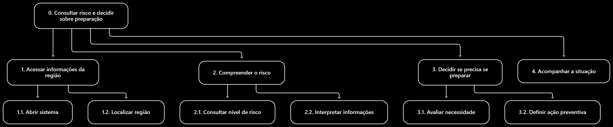
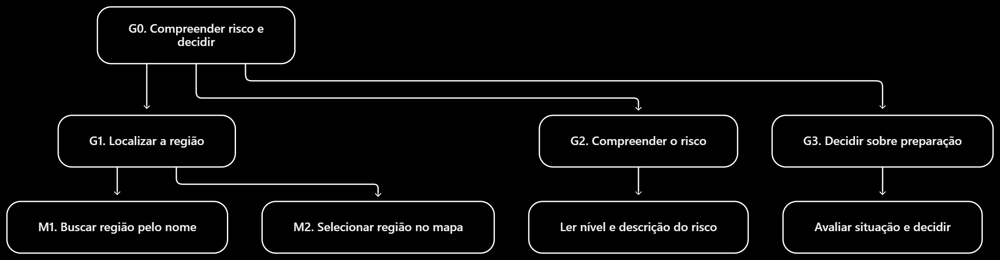
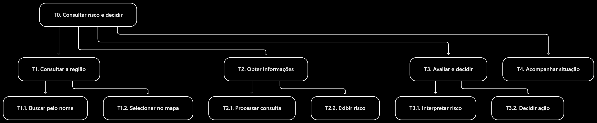

# Entrega 5 — Análise de tarefas: HTA, GOMS e CTT

**Data:** 08/10/2026
**Status:** 🟨 em andamento  
**Responsabilidade:** cada integrante modela pelo menos 1 HTA, 1 GOMS e 1 CTT. As três técnicas podem abordar a mesma funcionalidade ou funcionalidades distintas, conforme a orientação da disciplina.

## Objetivo da atividade

Modelar tarefas importantes sob perspectivas complementares: decomposição hierárquica (HTA), estrutura de metas/métodos/operações (GOMS) e relações temporais entre tarefas (CTT). O diagrama deve ser acompanhado de interpretação textual.

## Para projetos cujo TCC não previa interface

Modele **tarefas humanas relacionadas ao uso da contribuição técnica**, e não a implementação interna do algoritmo. Exemplos de boas tarefas para análise:

- investigar uma consulta de baixo desempenho;
- configurar uma análise e selecionar parâmetros;
- submeter um dataset e verificar sua validade;
- acompanhar uma execução demorada;
- comparar dois resultados/modelos;
- interpretar uma recomendação e decidir se a aceita;
- localizar uma execução anterior usando busca/filtros;
- gerar e compartilhar um relatório;
- administrar papéis/permissões quando isso for parte do trabalho real;
- revisar um alerta e registrar uma decisão.

Um CRUD pode gerar tarefas relevantes, mas “cadastrar usuário” só merece modelagem se tiver significado no domínio (papéis, validações, riscos, permissões, dependências).

## Seleção das tarefas

| ID | Tarefa | Persona/cenário de origem | Frequência/criticidade | Autor responsável |
|---|---|---|---|---|
| T01 | Consultar e interpretar o risco de alagamento de uma região para planejar o deslocamento | P01 / C01 | Frequência: depende da época do ano e de chuvas / Criticidade: alta, pois a informação pode apoiar decisões preventivas e evitar possíveis riscos à vida e financeiros. | Rafael Iamashita Becsei - 22.225.037-5 |
| T02 | {{...}} | {{P01/C01}} | {{...}} | {{...}} |
| T03 | Consultar o histórico de alagamentos de uma região e gerar um relatório | P01 / C01 | Frequência: eventual, principalmente quando o usuário deseja conhecer o histórico de uma região / Criticidade: média, pois permite compreender ocorrências anteriores e apoiar o planejamento de deslocamentos futuros. | Eric Song Watanabe - 22.125.086-3 |

> Priorize tarefas necessárias para que o usuário alcance objetivos centrais. Não desperdice a modelagem em ações triviais isoladas, como “clicar em login”, se o objetivo relevante é maior. Da mesma forma, não modele o funcionamento interno do algoritmo como se fosse uma tarefa humana.

---

## HTA — T01 Consultar e interpretar o risco de alagamento de uma região para planejar o deslocamento

**Autor(a):** Rafael Iamashita Becsei - 22.225.037-5

### Descrição da tarefa

A tarefa tem como objetivo permitir que Paulo consulte as informações disponíveis sobre o risco de alagamento nas regiões por onde pretende passar e, a partir da interpretação dessas informações, decida se deve manter seu trajeto habitual ou considerar um caminho alternativo para evitar possíveis áreas de risco.
A tarefa começa quando Paulo identifica a necessidade de verificar as condições das regiões de seu trajeto antes ou durante um período de chuva intensa, e termina quando ele consegue avaliar os riscos apresentados e decidir como realizará seu deslocamento.

### Diagrama

### Decomposição e planos

| ID | Objetivo/operação | Plano/ordem | Problema ou decisão de design observada |
|---|---|---|---|
| 0 | Consultar e avaliar o risco de alagamento de uma região para planejar o deslocamento | 1 > 2 > 3 | O sistema deve apresentar informações claras para apoiar o planejamento do deslocamento. |
| 1 | Localizar a região ou trajeto de interesse | 1.1 > 1.2 | A interface deve permitir localizar a região de forma simples e rápida, seja pelo mapa ou pela busca. |
| 1.1 | Usar o mapa e navegar até a região desejada | 1.1.1 > 1.1.2 | A navegação pelo mapa deve facilitar a localização da região desejada. |
| 1.1.1 | Acessar o mapa | — | O mapa deve ser facilmente acessível. |
| 1.1.2 | Explorar o mapa até encontrar a região | — | A navegação deve permitir identificar a região sem dificuldade. |
| 1.2 | Pesquisar o endereço ou região através da busca | 1.2.1 > 1.2.2 | A busca deve permitir localizar a região por endereço ou nome. |
| 1.2.1 | Inserir endereço ou nome da região | — | O campo de busca deve ser fácil de identificar e utilizar. |
| 1.2.2 | Selecionar endereço correspondente | — | Os resultados devem permitir identificar o endereço correto. |
| 2 | Interpretar as informações de risco | 2.1 > 2.2 | Informações técnicas podem dificultar a compreensão do risco. |
| 2.1 | Identificar o nível de risco apresentado da localização desejada | 2.1.1 > 2.1.2 | O nível de risco deve ser apresentado de forma clara e associado à região consultada. |
| 2.1.1 | Visualizar a extensão da área no mapa | — | A área de risco deve ser facilmente identificada no mapa. |
| 2.1.2 | Compreender o nível de risco exibido | — | O risco deve ser apresentado em linguagem simples e com indicadores compreensíveis. |
| 2.2 | Consultar informações complementares sobre chuva e região | 2.2.1 > 2.2.2 | As informações adicionais devem ajudar na interpretação sem sobrecarregar o usuário. |
| 2.2.1 | Visualizar informações da chuva na região | — | As informações sobre chuva devem ser claras e relacionadas à região consultada. |
| 2.2.2 | Verificar outras informações complementares presentes | — | As informações complementares devem ser relevantes e organizadas. |
| 3 | Decidir como realizar o deslocamento | 3.1 / 3.2 | As informações devem apoiar a decisão do usuário sobre seu deslocamento. |
| 3.1 | Tomar uma medida preventiva | 3.1.1 > 3.1.2 | A interface deve ajudar o usuário a avaliar se pode manter seu planejamento. |
| 3.1.1 | Confirmar que a região está segura | — | O nível de risco deve permitir avaliar as condições da região. |
| 3.1.2 | Verificar outras informações complementares presentes | — | Informações adicionais podem apoiar a decisão de manter o deslocamento. |
| 3.2 | Não tomar uma medida preventiva | 3.2.1 > 3.2.2 | O usuário deve conseguir identificar quando precisa considerar alternativas ao trajeto. |
| 3.2.1 | Identificar uma alternativa segura | — | O mapa deve facilitar a identificação de regiões com menor risco. |
| 3.2.2 | Definir um novo trajeto que seja mais seguro | — | As informações de risco devem apoiar a escolha de outro trajeto, sem exigir que o sistema calcule rotas. |

**Verificação do HTA:**

- O objetivo 0 representa uma meta do usuário?
- As subtarefas são necessárias e suficientes?
- Os **planos** indicam ordem, alternativa, repetição ou condição?
- A decomposição parou em nível útil para projeto de interação?

---

## GOMS — T01 Consultar e interpretar o risco de alagamento na região do comércio

**Autor(a):** Rafael Iamashita Becsei - 22.225.037-5

### Goal

`G0: Consultar e avaliar o risco de alagamento para planejar o deslocamento`

### Métodos, operadores e regras de seleção

GOAL 1: Localizar a região ou trajeto de interesse
- **Method M1:** Localizar a região pelo mapa
  - OP 1.1: Acessar o mapa
  - OP 1.2: Observar a região apresentada inicialmente
  - OP 1.3: Navegar pelo mapa, movimentando ou aproximando a visualização quando necessário
  - OP 1.4: Identificar a região por onde pretende passar.
  - OP 1.5: Selecionar a região desejada
  - OP 1.6: Verificar se a localização selecionada está correta
- **Method M2:** Localizar a região pela busca
  - OP 2.1: Identificar o campo de busca
  - OP 2.2: Selecionar o campo de busca
  - OP 2.3: Digitar o endereço ou nome da região
  - OP 2.4: Verificar os resultados apresentados
  - OP 2.5: Selecionar o endereço correspondente
  - OP 2.6: Confirmar se a região localizada está correta
- **Selection Rule SR1:**
  - Utilizar M1 quando Paulo conseguir reconhecer visualmente a região desejada no mapa
  - Utilizar M2 quando Paulo souber o endereço ou nome da região e preferir realizar uma pesquisa
GOAL 2: Interpretar as informações de risco da região
- **Method M3:** Consultar e interpretar o risco apresentado
  - OP 3.1: Visualizar a extensão da área de risco no mapa
  - OP 3.2: Identificar o nível de risco apresentado para a região
  - OP 3.3: Ler as informações associadas ao nível de risco
  - OP 3.4: Consultar informações complementares sobre chuva e condições da região
  - OP 3.5: Relacionar as informações apresentadas com as regiões por onde pretende passar
  - OP 3.6: Avaliar se o risco identificado pode afetar seu deslocamento
GOAL 3: Decidir como realizar o deslocamento
- **Method M4:** Manter o trajeto planejado
  - OP 4.1: Considerar o nível de risco apresentado para a região
  - OP 4.2: Verificar se as informações consultadas indicam algum risco relevante
  - OP 4.3: Concluir que não há necessidade de alterar o planejamento
  - OP 4.4: Manter o trajeto previsto
- **Method M5:** Considerar um trajeto alternativo
  - OP 5.1: Identificar regiões do trajeto que apresentam maior risco de alagamento
  - OP 5.2: Consultar outras regiões que possam ser utilizadas no deslocamento
  - OP 5.3: Comparar os níveis de risco das regiões consultadas
  - OP 5.4: Identificar uma alternativa que apresente menor risco
  - OP 5.5: Decidir se deve alterar o trajeto ou adiar o deslocamento
- **Selection Rule SR2:**
  - Utilizar M4 quando as informações consultadas não indicarem risco relevante para o deslocamento planejado.
  - Utilizar M5 quando as informações indicarem possibilidade de alagamento em regiões que possam comprometer o deslocamento.

> Não chame qualquer passo de “método”. Em GOMS, métodos são sequências alternativas capazes de atingir uma meta; regras de seleção explicam quando escolher entre eles.

---

## CTT — T01 Consultar e interpretar o risco de alagamento na região do comércio

**Autor(a):** Rafael Iamashita Becsei - 22.225.037-5

### Descrição

O CTT representa a sequência e as relações temporais envolvidas na consulta do risco de alagamento das regiões por onde Paulo pretende passar durante seu deslocamento. A tarefa envolve a localização da região de interesse, a apresentação das informações pelo sistema, a interpretação do risco e a decisão sobre manter o trajeto planejado ou considerar um caminho alternativo para evitar possíveis áreas de risco.

### Diagrama

### Legenda e relações temporais usadas

| Operador/relação | Significado no diagrama | Exemplo no modelo |
|---|---|---|
| >> | Ativação sequencial: uma tarefa começa após a conclusão da anterior | Após localizar a região de interesse, Paulo consulta e interpreta as informações de risco. Em seguida, decide como realizar o deslocamento |
| [] | Escolha: o usuário realiza uma entre duas tarefas alternativas | Paulo pode localizar a região pelo mapa ou pela busca. Depois de avaliar o risco, pode manter o trajeto ou considerar um caminho alternativo |
| []>> | Ativação com passagem de informação: a tarefa seguinte utiliza informações disponibilizadas pela anterior | O sistema apresenta as informações sobre o risco, que são utilizadas por Paulo para identificar o nível de risco da região |

Identifique, quando aplicável, tarefas de usuário, sistema, interação e tarefas abstratas. Verifique se concorrência, escolha, habilitação, desabilitação e repetição estão representadas corretamente segundo a notação adotada em aula.

---

## HTA — T02 Consultar o risco de alagamento da região e decidir sobre medidas preventivas

**Autor(a):** Victor Pimentel Lario — 22.125.064-0

### Descrição da tarefa

Victor Merker Binda está em casa acompanhando notícias sobre a previsão de chuva intensa. Preocupado com a possibilidade de alagamentos próximos à sua residência, decide consultar as informações de risco da região pelo celular. Seu objetivo é compreender o nível de risco apresentado e avaliar se precisa tomar alguma medida preventiva para proteger sua casa e seus bens.

A tarefa começa quando Victor decide buscar informações sobre sua região e termina quando consegue interpretar a situação e decidir como deve agir. Caso a chuva continue, ele pode voltar a acompanhar as informações para verificar possíveis mudanças.

### Diagrama

### Decomposição e planos

| **ID** | **Objetivo/operação** | **Plano/ordem** | **Problema ou decisão de design observada** |
|---|---|---|---|
| 0 | Consultar o risco e decidir sobre a preparação da residência | 1 > 2 > 3 > 4, sendo 4 executada conforme a necessidade | Victor precisa compreender o risco da região para decidir se deve tomar medidas preventivas. |
| 1 | Acessar informações da região | 1.1 > 1.2 | O acesso deve ser simples, com poucos passos. |
| 1.1 | Abrir o sistema pelo celular | Operação | A interface inicial deve facilitar a identificação da consulta de risco. |
| 1.2 | Localizar a região onde mora | Operação | Facilitar a localização da região, evitando navegação complexa pelo mapa. |
| 2 | Compreender o risco apresentado | 2.1 > 2.2 | Informações técnicas podem dificultar o entendimento. |
| 2.1 | Consultar o nível de risco da região | Operação | Exibir níveis de risco com textos e indicadores claros. |
| 2.2 | Interpretar as informações apresentadas | Operação | Evitar depender apenas de porcentagens ou cores. |
| 3 | Decidir se precisa tomar medidas preventivas | 3.1 > 3.2, sendo 3.2 necessária quando houver motivo para preparação | O sistema deve ajudar Victor a compreender a situação sem tomar a decisão por ele. |
| 3.1 | Avaliar a necessidade de preparação | Operação | As informações devem facilitar a decisão do morador. |
| 3.2 | Definir quais medidas preventivas realizar | Operação condicional | Victor pode ter dificuldade para decidir quais ações priorizar. |
| 4 | Acompanhar possíveis mudanças na situação | Repetir a consulta quando necessário | Facilitar novas consultas e a identificação de mudanças no risco. |

**Plano 0:** Realizar 1, depois 2 e 3. Executar 4 quando desejar acompanhar a evolução da situação.

**Plano 1:** Realizar 1.1 e depois 1.2.

**Plano 2:** Realizar 2.1 e depois 2.2.

**Plano 3:** Realizar 3.1. Caso exista necessidade de preparação, realizar 3.2.

### Verificação do HTA

- O objetivo 0 representa uma meta do usuário: entender o risco de alagamento de sua região e decidir se precisa se preparar.
- As subtarefas contemplam o acesso às informações, a interpretação do risco, a decisão e o acompanhamento.
- Os planos representam sequência, condições e repetição.
- A decomposição foi interrompida em operações úteis para identificar problemas e oportunidades de design.

---

## GOMS — T02 Consultar o risco de alagamento da região e decidir sobre medidas preventivas

**Autor(a):** Victor Pimentel Lario — 22.125.064-0

### Goal

`G0: Compreender o risco de alagamento da região onde mora e decidir se precisa tomar medidas preventivas.`

### Diagrama

### Métodos, operadores e regras de seleção

**GOAL 1: Localizar a região onde mora**

**Method M1: Localizar a região por meio de busca pelo nome**

- OP 1.1: Abrir o sistema pelo celular.
- OP 1.2: Identificar o campo de busca.
- OP 1.3: Tocar no campo de busca.
- OP 1.4: Digitar o nome da região.
- OP 1.5: Selecionar a região correspondente.
- OP 1.6: Verificar se a região apresentada está correta.

**Method M2: Localizar a região diretamente pelo mapa**

- OP 2.1: Abrir o sistema pelo celular.
- OP 2.2: Observar o mapa apresentado.
- OP 2.3: Movimentar ou aproximar o mapa, se necessário.
- OP 2.4: Identificar a região onde mora.
- OP 2.5: Tocar na região desejada.
- OP 2.6: Verificar se a região selecionada está correta.

**Selection Rule SR1:**
- Utilizar M1 quando Victor souber o nome da região e preferir uma consulta mais simples, sem precisar navegar pelo mapa.
- Utilizar M2 quando Victor conseguir reconhecer visualmente sua região no mapa e preferir selecioná-la diretamente.

**GOAL 2: Compreender o risco apresentado**

**Method M3: Consultar e interpretar as informações de risco**

- OP 3.1: Observar o nível de risco apresentado.
- OP 3.2: Ler a descrição associada ao nível de risco.
- OP 3.3: Identificar se a situação indica necessidade de atenção.
- OP 3.4: Relacionar as informações apresentadas com a situação da região onde mora.

**GOAL 3: Decidir sobre medidas preventivas**

**Method M4: Avaliar a necessidade de preparação**

- OP 4.1: Considerar o risco apresentado para sua região.
- OP 4.2: Comparar a situação com experiências anteriores de chuva intensa.
- OP 4.3: Decidir se precisa realizar alguma medida preventiva.
- OP 4.4: Caso necessário, definir ações para proteger a residência e os bens.

**Selection Rule SR2:**
- Se Victor entender que existe risco que justifique preparação, decide realizar medidas preventivas.
- Se entender que não existe necessidade imediata de preparação, continua acompanhando a situação e pode realizar outra consulta posteriormente.

### Considerações sobre o modelo

O GOMS apresenta dois métodos alternativos para localizar a região, levando em consideração a familiaridade limitada de Victor com ferramentas digitais. A busca pelo nome pode oferecer um caminho mais simples, enquanto a seleção pelo mapa permite uma consulta visual.

Após localizar sua região, Victor consulta as informações de risco, interpreta o resultado e decide se precisa se preparar. O sistema deve facilitar a compreensão das informações, mas a decisão de realizar medidas preventivas continua sendo do usuário.

---

## CTT — T02 Consultar o risco de alagamento da região e decidir sobre medidas preventivas
  

**Autor(a):** Victor Pimentel Lario — 22.125.064-0

### Descrição

O modelo CTT representa a sequência de tarefas realizadas por Victor Merker Binda ao consultar o risco de alagamento de sua região e decidir se precisa tomar medidas preventivas.

Inicialmente, Victor acessa o sistema pelo celular e localiza sua região, podendo realizar uma busca pelo nome ou selecionar diretamente pelo mapa. Após a seleção, o sistema processa a consulta e apresenta as informações de risco.

Victor interpreta o resultado e decide se precisa realizar alguma ação preventiva. Durante a chuva, pode repetir a consulta para acompanhar possíveis mudanças na situação.

O modelo diferencia tarefas realizadas pelo usuário, interações com o sistema, processamentos automáticos e tarefas abstratas.

### Diagrama

### Tarefas identificadas

| **ID** | **Tarefa** | **Tipo** |
|---|---|---|
| T0 | Consultar o risco e decidir sobre a preparação | Abstrata |
| T1 | Consultar a região onde mora | Abstrata |
| T1.1 | Buscar a região pelo nome | Interação |
| T1.2 | Selecionar a região pelo mapa | Interação |
| T2 | Obter informações de risco | Abstrata |
| T2.1 | Processar a consulta de risco | Sistema |
| T2.2 | Apresentar as informações de risco | Interação |
| T3 | Avaliar a situação e decidir | Abstrata |
| T3.1 | Interpretar o nível de risco | Usuário |
| T3.2 | Decidir sobre medidas preventivas | Usuário |
| T4 | Acompanhar possíveis mudanças | Abstrata |

### Legenda e relações temporais usadas

| **Operador/relação** | **Significado no diagrama** | **Exemplo no modelo** |
|---|---|---|
| `>>` | Habilitação: uma tarefa começa após a conclusão da anterior. | T2 >> T3: Victor recebe as informações antes de avaliar a situação. |
| `[]>>` | Habilitação com passagem de informação. | T1 []>> T2: a região selecionada é utilizada para realizar a consulta. |
| `[]` | Escolha: apenas uma das tarefas alternativas é executada. | T1.1 [] T1.2: Victor pode buscar a região pelo nome ou selecioná-la no mapa. |
| `*` | Repetição de uma tarefa. | T4*: Victor pode acompanhar novamente as condições durante a chuva. |
| `|||` | Concorrência: tarefas podem ocorrer em paralelo ou em qualquer ordem. | Acompanhar notícias e observar as condições da chuva podem ocorrer em paralelo à consulta. |

### Relação temporal principal

`T0 = T1 []>> T2 >> T3 >> T4*`

**Decomposição das tarefas:**

- T1 = T1.1 [] T1.2
- T2 = T2.1 >> T2.2
- T3 = T3.1 >> T3.2

A tarefa T4 representa novas verificações da situação. Quando Victor precisa consultar novamente o risco, pode repetir o processo de consulta e avaliação.

### Considerações sobre o modelo

O CTT evidencia que Victor possui alternativas para localizar sua região e que as informações precisam estar disponíveis antes que ele possa avaliar o risco.

O modelo também considera que o acompanhamento pode ocorrer repetidamente durante períodos de chuva intensa, permitindo que Victor reavalie a necessidade de preparação.

As tarefas foram organizadas para representar tanto as interações com o sistema quanto as decisões realizadas pelo usuário, respeitando suas características e necessidades.

---

## HTA — T03 Consultar o histórico de alagamentos de uma região e gerar um relatório

**Autor(a):** Eric Song Watanabe — 22.125.086-3

### Descrição da tarefa

A tarefa tem como objetivo permitir que Paulo Andre Oliveira consulte registros históricos de alagamentos de uma região e organize essas informações em um relatório que possa ser utilizado como apoio para compreender melhor o histórico do local.

Essa funcionalidade representa uma possibilidade adicional de interação a ser investigada, diferente da consulta do risco atual. A tarefa começa quando Paulo deseja conhecer ocorrências anteriores de alagamento em determinada região e termina quando consegue gerar e visualizar um relatório com as informações históricas selecionadas.

### Diagrama

### Decomposição e planos

| ID | Objetivo/operação | Plano/ordem | Problema ou decisão de design observada |
|---|---|---|---|
| 0 | Consultar o histórico de alagamentos de uma região e gerar um relatório | 1 > 2 > 3 > 4 | O processo deve permitir que o usuário encontre dados históricos, selecione informações relevantes e compreenda o relatório gerado. |
| 1 | Definir a consulta histórica | 1.1 > 1.2 > 1.3 | A configuração da consulta deve ser simples e permitir que o usuário determine claramente o que deseja analisar. |
| 1.1 | Selecionar a região de interesse | — | O usuário precisa conseguir identificar facilmente a região que deseja consultar. |
| 1.2 | Definir o período histórico | — | O período deve ser compreensível e permitir consultas de diferentes intervalos de tempo. |
| 1.3 | Aplicar filtros adicionais, se necessário | Opcional | Muitos filtros podem aumentar a complexidade da consulta, por isso devem ser utilizados apenas quando forem úteis para o usuário. |
| 2 | Consultar os dados históricos | 2.1 > 2.2 > 2.3 | As informações históricas precisam ser apresentadas de maneira compreensível, sem exigir conhecimento técnico. |
| 2.1 | Visualizar as ocorrências registradas | — | O usuário deve conseguir identificar quantas ocorrências foram registradas no período selecionado. |
| 2.2 | Identificar períodos com maior ocorrência de alagamentos | — | A apresentação deve facilitar a identificação de possíveis padrões no histórico. |
| 2.3 | Consultar detalhes das ocorrências | Opcional | Informações adicionais devem estar disponíveis sem sobrecarregar a visualização principal. |
| 3 | Configurar o relatório | 3.1 > 3.2 | O usuário deve compreender quais informações serão incluídas antes de gerar o documento. |
| 3.1 | Escolher as informações que serão incluídas | — | A seleção deve ser simples para evitar relatórios com informações desnecessárias. |
| 3.2 | Conferir região, período e dados selecionados | — | O usuário deve conseguir verificar a configuração antes da geração do relatório. |
| 4 | Gerar e consultar o relatório | 4.1 > 4.2 > 4.3 | O resultado deve deixar claro que o relatório foi criado a partir dos filtros e dados selecionados pelo usuário. |
| 4.1 | Solicitar a geração do relatório | — | A ação de geração deve ser facilmente identificada. |
| 4.2 | Visualizar o relatório gerado | — | O relatório precisa apresentar as informações históricas de forma organizada e compreensível. |
| 4.3 | Exportar ou compartilhar o relatório | Opcional | O usuário pode desejar utilizar o relatório fora do sistema ou compartilhá-lo com outra pessoa. |

**Plano 0:** Realizar 1, depois 2, 3 e 4.

**Plano 1:** Realizar 1.1 e 1.2. Realizar 1.3 apenas caso Paulo queira restringir ou detalhar a consulta histórica.

**Plano 2:** Realizar 2.1 e 2.2. Realizar 2.3 caso Paulo queira consultar informações mais detalhadas sobre alguma ocorrência.

**Plano 3:** Realizar 3.1 e depois 3.2.

**Plano 4:** Realizar 4.1 e 4.2. Realizar 4.3 caso Paulo queira salvar ou compartilhar o relatório.

### Verificação do HTA

- O objetivo 0 representa uma meta do usuário: conhecer o histórico de alagamentos de uma região e gerar um relatório com as informações consideradas relevantes.
- As subtarefas contemplam a definição da consulta, análise do histórico, configuração e geração do relatório.
- Os planos representam sequência e operações opcionais.
- A decomposição foi interrompida em operações úteis para identificar possíveis problemas e decisões de interação.

---

## GOMS — T03 Consultar o histórico de alagamentos de uma região e gerar um relatório

**Autor(a):** Eric Song Watanabe — 22.125.086-3

### Goal

`G0: Consultar o histórico de alagamentos de uma região e gerar um relatório com as informações desejadas.`

### Diagrama

### Métodos, operadores e regras de seleção

**GOAL 1: Definir a consulta histórica**

**Method M1: Realizar uma consulta utilizando apenas região e período**

- OP 1.1: Acessar a consulta de histórico.
- OP 1.2: Selecionar a região desejada.
- OP 1.3: Selecionar o período histórico.
- OP 1.4: Confirmar a consulta.
- OP 1.5: Verificar os resultados apresentados.

**Method M2: Realizar uma consulta utilizando filtros adicionais**

- OP 2.1: Acessar a consulta de histórico.
- OP 2.2: Selecionar a região desejada.
- OP 2.3: Selecionar o período histórico.
- OP 2.4: Acessar as opções de filtros.
- OP 2.5: Selecionar os filtros desejados.
- OP 2.6: Confirmar a consulta.
- OP 2.7: Verificar os resultados apresentados.

**Selection Rule SR1:**

- Utilizar M1 quando Paulo deseja obter uma visão geral do histórico de alagamentos da região.
- Utilizar M2 quando Paulo deseja restringir ou detalhar as informações apresentadas.

**GOAL 2: Analisar as informações históricas**

**Method M3: Analisar o resumo histórico apresentado**

- OP 3.1: Observar a quantidade de ocorrências registradas.
- OP 3.2: Identificar o período analisado.
- OP 3.3: Observar a distribuição das ocorrências ao longo do período.
- OP 3.4: Identificar períodos com maior número de registros.
- OP 3.5: Consultar detalhes adicionais quando necessário.

**GOAL 3: Gerar o relatório**

**Method M4: Gerar um relatório utilizando as informações padrão**

- OP 4.1: Selecionar a opção de gerar relatório.
- OP 4.2: Verificar região e período selecionados.
- OP 4.3: Confirmar a geração.
- OP 4.4: Aguardar o processamento.
- OP 4.5: Visualizar o relatório gerado.

**Method M5: Personalizar o conteúdo antes de gerar o relatório**

- OP 5.1: Selecionar a opção de gerar relatório.
- OP 5.2: Acessar as opções de personalização.
- OP 5.3: Selecionar as informações que serão incluídas.
- OP 5.4: Conferir região, período e informações selecionadas.
- OP 5.5: Confirmar a geração.
- OP 5.6: Aguardar o processamento.
- OP 5.7: Visualizar o relatório gerado.

**Selection Rule SR2:**

- Utilizar M4 quando Paulo deseja gerar rapidamente um relatório com as informações padrão da consulta.
- Utilizar M5 quando Paulo deseja escolher quais informações devem aparecer no relatório.

**GOAL 4: Utilizar o relatório gerado**

**Method M6: Consultar o relatório dentro do sistema**

- OP 6.1: Visualizar o relatório.
- OP 6.2: Examinar as informações apresentadas.
- OP 6.3: Finalizar a consulta.

**Method M7: Exportar o relatório**

- OP 7.1: Visualizar o relatório.
- OP 7.2: Selecionar a opção de exportação.
- OP 7.3: Selecionar o formato disponível.
- OP 7.4: Confirmar a exportação.
- OP 7.5: Verificar se o arquivo foi gerado.

**Selection Rule SR3:**

- Utilizar M6 quando Paulo deseja apenas consultar as informações dentro do sistema.
- Utilizar M7 quando deseja guardar ou utilizar o relatório posteriormente fora do sistema.

### Considerações sobre o modelo

O modelo GOMS apresenta diferentes métodos para realizar a consulta e gerar o relatório. Paulo pode realizar uma consulta mais simples, utilizando apenas região e período, ou utilizar filtros adicionais quando desejar informações mais específicas.

Na etapa de geração, também existem dois métodos: utilizar uma configuração padrão ou personalizar as informações que serão incluídas. As regras de seleção determinam qual método é mais adequado de acordo com o objetivo do usuário.

Dessa forma, a funcionalidade permite analisar dados históricos em diferentes níveis de detalhamento sem obrigar o usuário a realizar uma configuração complexa em todas as consultas.

---

## CTT — T03 Consultar o histórico de alagamentos de uma região e gerar um relatório

**Autor(a):** Eric Song Watanabe — 22.125.086-3

### Descrição

O modelo CTT representa as relações temporais entre as tarefas realizadas por Paulo Andre Oliveira ao consultar dados históricos de alagamentos de uma região e gerar um relatório.

Inicialmente, Paulo define a região e o período que deseja analisar, podendo também aplicar filtros adicionais. Após a configuração da consulta, o sistema processa os parâmetros selecionados e apresenta os dados históricos encontrados.

Paulo analisa as informações apresentadas e, quando considera que os dados atendem ao objetivo da consulta, configura e solicita a geração do relatório. O sistema processa essa solicitação e apresenta o documento gerado.

Depois da visualização, Paulo pode finalizar a tarefa ou exportar o relatório para utilizá-lo posteriormente.

### Diagrama

### Tarefas identificadas

| ID | Tarefa | Tipo |
|---|---|---|
| T0 | Consultar histórico e gerar relatório | Abstrata |
| T1 | Definir consulta histórica | Abstrata |
| T1.1 | Selecionar região | Interação |
| T1.2 | Definir período | Interação |
| T1.3 | Aplicar filtros adicionais | Interação |
| T2 | Obter dados históricos | Abstrata |
| T2.1 | Processar parâmetros da consulta | Sistema |
| T2.2 | Apresentar dados históricos | Interação |
| T3 | Analisar histórico | Abstrata |
| T3.1 | Examinar ocorrências registradas | Usuário |
| T3.2 | Identificar períodos com maior ocorrência | Usuário |
| T3.3 | Consultar detalhes de ocorrências | Interação |
| T4 | Configurar relatório | Abstrata |
| T4.1 | Selecionar informações do relatório | Interação |
| T4.2 | Conferir configuração | Usuário |
| T5 | Gerar relatório | Abstrata |
| T5.1 | Solicitar geração | Interação |
| T5.2 | Processar relatório | Sistema |
| T5.3 | Apresentar relatório | Interação |
| T6 | Utilizar relatório gerado | Abstrata |
| T6.1 | Visualizar relatório | Usuário |
| T6.2 | Exportar relatório | Interação |

### Legenda e relações temporais usadas

| Operador/relação | Significado no diagrama | Exemplo no modelo |
|---|---|---|
| `>>` | Ativação: a segunda tarefa começa após a conclusão da primeira. | T3 >> T4: após analisar o histórico, Paulo configura o relatório. |
| `[]>>` | Ativação com passagem de informação: a próxima tarefa utiliza dados produzidos pela tarefa anterior. | T1 []>> T2: região, período e filtros definidos são utilizados pelo sistema na consulta histórica. |
| `[]` | Escolha entre tarefas alternativas. | Após visualizar o relatório, Paulo pode finalizar a consulta ou optar pela exportação. |
| `|||` | Concorrência: tarefas podem ser realizadas em qualquer ordem ou paralelamente quando aplicável. | Durante a análise, Paulo pode observar a frequência das ocorrências e consultar detalhes sem uma ordem rígida. |

### Relação temporal principal

`T0 = T1 []>> T2 >> T3 >> T4 []>> T5 >> T6`

**Decomposição das tarefas:**

- `T1 = T1.1 >> T1.2 >> T1.3`
- `T2 = T2.1 >> T2.2`
- `T3 = T3.1 ||| T3.2 ||| T3.3`
- `T4 = T4.1 >> T4.2`
- `T5 = T5.1 >> T5.2 >> T5.3`
- `T6 = T6.1 >> T6.2`, quando houver necessidade de exportação.

### Considerações sobre o modelo

O CTT evidencia que a consulta histórica depende inicialmente da definição da região e do período de interesse. Essas informações precisam ser processadas antes que os dados históricos possam ser apresentados ao usuário.

Durante a análise do histórico, algumas informações podem ser examinadas sem uma ordem rígida, como quantidade de ocorrências, distribuição ao longo do período e detalhes específicos.

A geração do relatório depende dos dados obtidos anteriormente e da configuração realizada pelo usuário. Depois que o sistema gera o documento, Paulo pode apenas consultá-lo ou também exportá-lo, dependendo de sua necessidade.

A modelagem diferencia as ações realizadas por Paulo, as interações com a interface e os processamentos realizados automaticamente pelo sistema.

## Síntese da equipe

Quais problemas de interação, oportunidades e requisitos apareceram a partir das modelagens? Quais tarefas irão para o protótipo e para o teste de usabilidade?

## Checklist

- [ ] Cada integrante produziu ao menos 1 HTA, 1 GOMS e 1 CTT.
- [ ] Cada artefato identifica autor e tarefa.
- [ ] Diagramas são legíveis e possuem fonte editável quando possível.
- [ ] HTA contém planos, não apenas árvore de tópicos.
- [ ] GOMS distingue Goals, Operators, Methods e Selection Rules.
- [ ] CTT usa operadores temporais e tipos de tarefa coerentes.
- [ ] Há texto explicando cada diagrama.
- [ ] Tarefas estão ligadas a cenários/personas na rastreabilidade.
- [ ] Em TCC técnico, as tarefas descrevem o que a pessoa faz com a contribuição/resultados, não passos internos do código.
- [ ] CRUDs, relatórios, filtros e atividades administrativas foram escolhidos por relevância ao objetivo do usuário.
