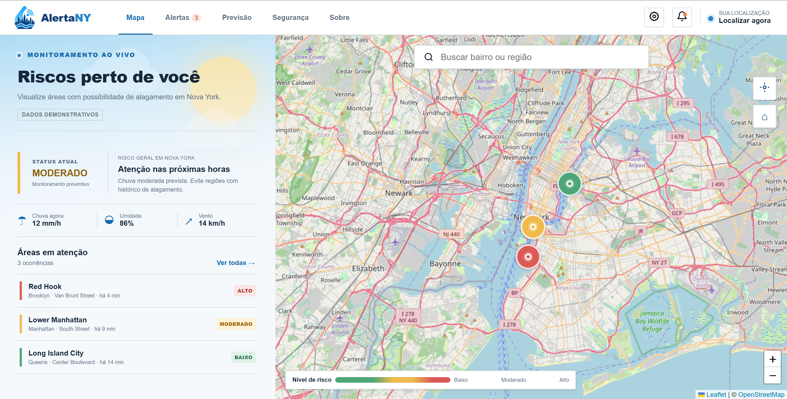
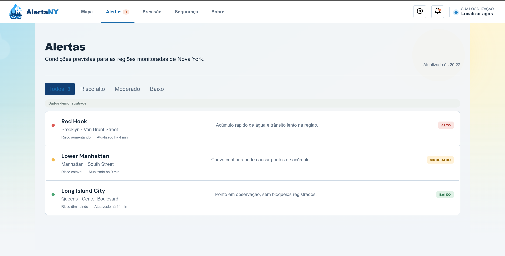
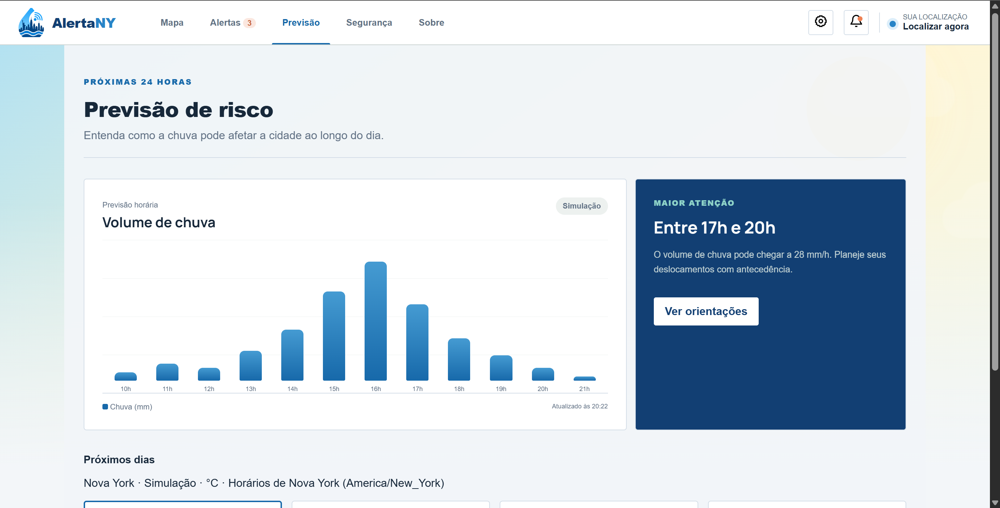
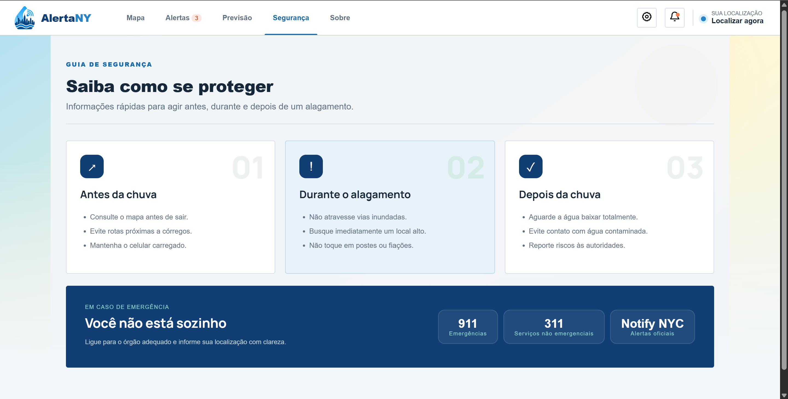
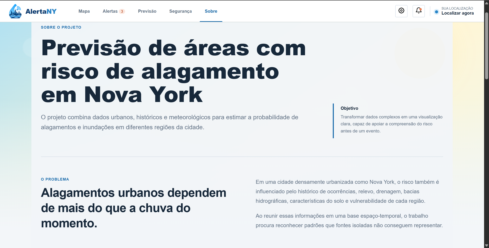
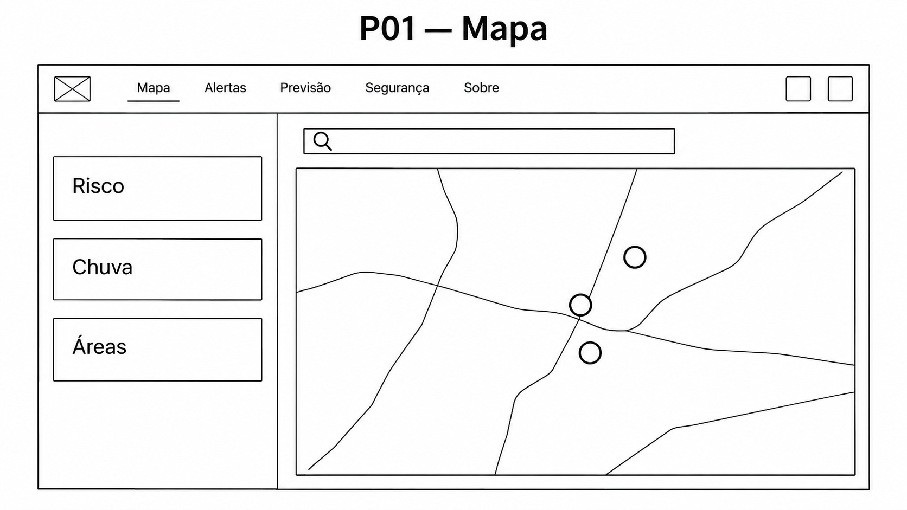
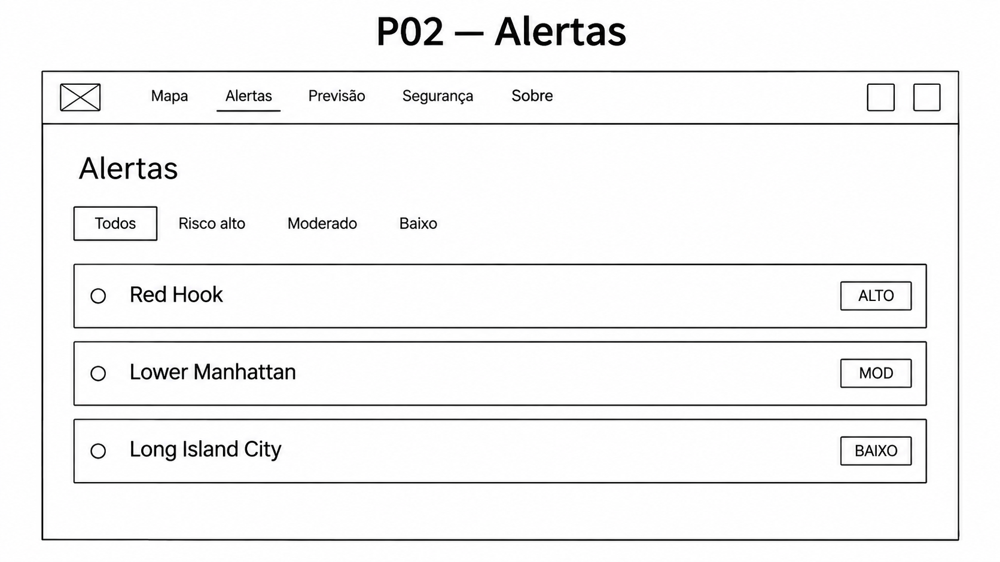
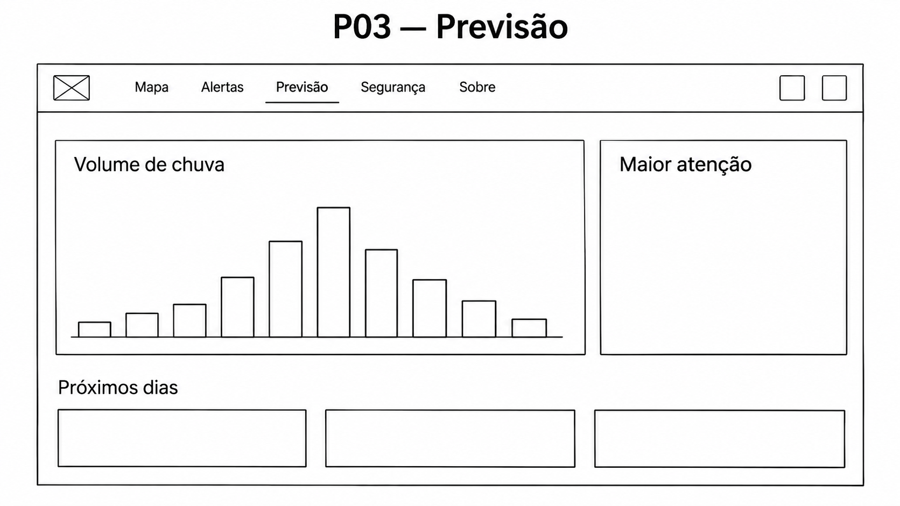
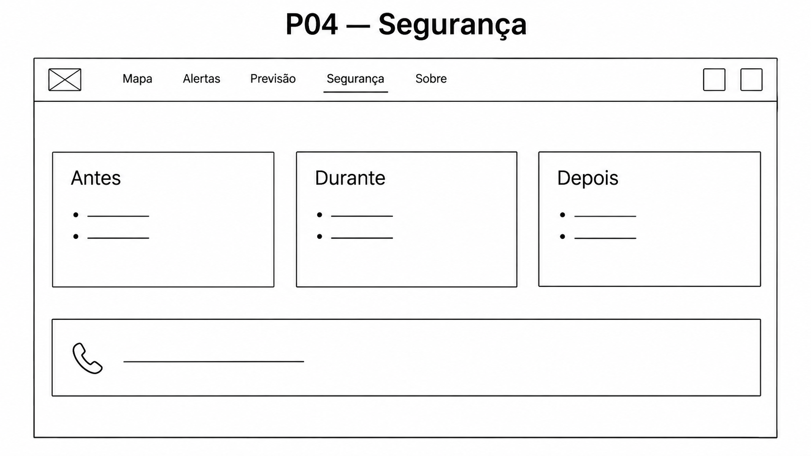
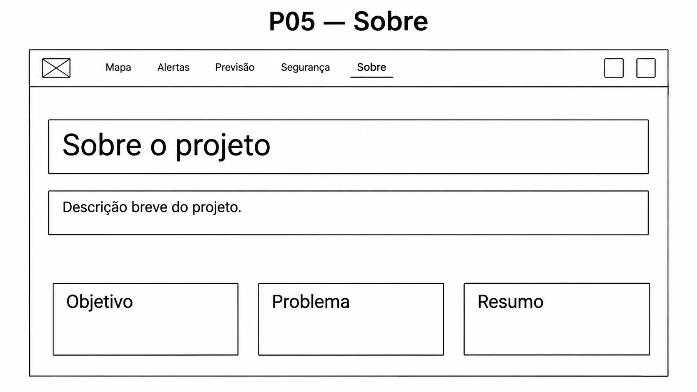

**Data:** 28/10/2026  
**Status:** 🟦 revisado apos feedback                                                               
**Responsabilidade:** 1 solução integrada por equipe  
**Projeto:** AlertaNY — Previsão de áreas com risco de alagamento em Nova York

>***OBS:** Como foi falado em aula, em nosso TCC, mudamos a região de atuação de São Paulo para Nova York. Por esse motivo, mantemos em IHC o escopo de São Paulo, mas para as prints da interface, usamos o do nosso TCC com tema atualizado.

## Objetivo da atividade

Explorar em baixa fidelidade as principais interações do AlertaNY antes de realizar alterações na interface final. O foco é observar se a pessoa entende as informações e consegue concluir as tarefas, e não avaliar a aparência visual das telas.

## 1. Escopo do protótipo

**Personas:** P01 — Paulo André Oliveira (primária); P02 — Victor Merker Binda; P03 — Viviane Santos Machado; P04 — Juliana Ferreira Costa (secundárias).

**Cenário/tarefa priorizado nesta iteração:** C01/T01 — consultar e interpretar o risco de alagamento de uma região para planejar o deslocamento.

**Objetivos principais:** localizar uma região pelo mapa ou pela busca; compreender o nível de risco apresentado; consultar informações complementares quando necessário; decidir se mantém ou reconsidera o deslocamento; recuperar-se de uma busca sem resultado.

Nesta iteração, a equipe optou por concentrar a prototipação de baixa fidelidade no fluxo PF01, por representar a tarefa mais central e madura para a persona P01.

As tarefas T02 — cadastro de trajeto habitual e configuração de alertas — e T03 — consulta de histórico e geração de relatório — continuam registradas como possibilidades de interação, mas não fazem parte do protótipo de baixa fidelidade desta iteração.

### 1.1 Família de interface priorizada

- **Consulta e monitoramento de risco:** mapa, busca por região, seleção de local, apresentação do nível de risco, informações complementares e apoio à decisão de deslocamento.

As telas da interface atual são utilizadas apenas como referência visual. O protótipo desta entrega é desenvolvido em baixa fidelidade para permitir alterações rápidas de estrutura, fluxo e feedback antes da consolidação da interface final.

## 2. Fluxo escolhido

| Fluxo | Tarefa/objetivo | Por que foi priorizado |
|---|---|---|
| PF01 | T01 — Consultar e interpretar o risco de alagamento de uma região para planejar o deslocamento | É a funcionalidade central da persona P01, possui alta criticidade e representa o principal objetivo de interação do sistema. |

PF02 e PF03 não foram incluídos nesta iteração de prototipação em baixa fidelidade. Eles permanecem como possibilidades de design a serem avaliadas posteriormente, caso sua necessidade seja confirmada.

**Escopo desta iteração:** PF01.

## 3. Telas e estados

As cinco imagens abaixo representam as telas disponíveis no AlertaNY. Elas servem como **referência da interface atual** para elaborar e avaliar o protótipo em papel. As capturas de tela são de alta fidelidade; portanto, não substituem, por si só, os desenhos em baixa fidelidade solicitados pela atividade.

| Tela | Funcionalidade e estados considerados |
|---|---|
| P01 — Mapa | Visualização de riscos, busca por região, seleção de marcador e abertura dos detalhes de um local. |
| P02 — Alertas | Lista de regiões monitoradas, seleção dos filtros Todos, Alto, Moderado e Baixo. |
| P03 — Previsão | Gráfico de chuva por horário, informações para os próximos dias e acesso às orientações. |
| P04 — Segurança | Orientações para antes, durante e depois de um alagamento, com contatos de emergência. |
| P05 — Sobre | Apresentação do objetivo do projeto e informações gerais da solução. |

### 3.1 Fluxo e transições do PF01

**PF01 — T01 (consulta de risco):** mapa inicial → buscar ou selecionar uma região → visualizar a região selecionada → consultar o nível de risco → acessar informações complementares, quando necessário → decidir se mantém ou reconsidera o deslocamento → voltar ao mapa.

Como caminho de recuperação, caso a busca não encontre a região informada, o sistema apresenta o estado de busca sem resultado e permite que o usuário revise os dados e tente novamente.

### 3.2 Imagens das cinco telas

**P01 — Mapa**

**P02 — Alertas**

**P03 — Previsão**

**P04 — Segurança**

**P05 — Sobre**

### 3.3 Protótipo de baixa fidelidade — PF01

Os estados abaixo foram desenvolvidos em baixa fidelidade para representar a execução da tarefa T01 e permitir a simulação do fluxo antes da consolidação da interface final.

**PF01-01 — Mapa inicial**

**PF01-02 — Região selecionada**

**PF01-03 — Detalhes do risco**

**PF01-04 — Busca sem resultado**

**PF01-05 — Versão revisada após a simulação**

## 4. Simulação / walkthrough

### 4.1 Caracterização da simulação

**Participante:** pessoa que não participou da elaboração do protótipo.  
**Perfil:** usuário com familiaridade básica com aplicativos de mapas e sem conhecimento técnico sobre modelos de previsão de alagamentos.  
**Tarefa proposta:** consultar o risco de alagamento de uma região e utilizar as informações apresentadas para decidir sobre seu deslocamento.  
**Estado inicial:** PF01-01 — Mapa inicial.

Durante a simulação, os estados do protótipo foram apresentados ao participante conforme ele indicava as ações que realizaria. O avaliador simulou manualmente as respostas do sistema e apresentou o próximo estado correspondente.

Foram observadas dúvidas, hesitações e dificuldades de interpretação durante a execução. O participante conseguiu concluir a tarefa, porém apresentou dificuldades relacionadas à quantidade de informações, à identificação da região consultada e à repetição da informação sobre o nível de risco.

### 4.2 Observações da simulação

| Observação | Tela/ação | Evidência | Consequência para o design |
|---|---|---|---|
| Grande quantidade de informações apresentadas simultaneamente | Mapa / visualização das informações de risco | O participante precisou de mais tempo para compreender a organização da tela e identificar quais informações eram mais relevantes | Reorganizar as informações, priorizando o risco e a região consultada e deixando dados complementares em áreas secundárias |
| Falta de clareza sobre a região que está sendo consultada | Mapa / seleção e visualização de uma região | O participante apresentou dificuldade para diferenciar sua localização atual da região selecionada para consulta | Adicionar uma identificação visível da região selecionada |
| Repetição de informações sobre o nível de risco | Mapa / consulta do risco | O participante percebeu que o nível de risco aparecia repetido em diferentes partes da interface | Centralizar a informação principal sobre o risco em um único local de destaque |
| Necessidade de recuperação após busca sem resultado | Busca por região | Ao considerar uma busca inválida ou sem correspondência, foi necessário deixar claro como o usuário poderia corrigir a informação e continuar a tarefa | Criar um estado específico de busca sem resultado com opção clara para revisar a consulta e tentar novamente |

## 5. Alterações após a simulação

| Antes | Problema | Depois | Justificativa |
|---|---|---|---|
| Muitas informações apresentadas simultaneamente na tela principal | Dificuldade para compreender rapidamente a organização e identificar as informações mais relevantes | As informações principais foram priorizadas e os conteúdos complementares passaram a ocupar áreas secundárias | Reduzir a sobrecarga de informação e facilitar a compreensão do estado atual |
| Não havia destaque suficiente para a região selecionada | Dificuldade para identificar qual região estava sendo consultada | A região selecionada passou a receber identificação própria e visível | Evitar confusão entre a localização atual do usuário e a área consultada |
| O nível de risco era apresentado em diferentes partes da interface | Redundância e aumento da carga de leitura | O nível de risco passou a ser apresentado em uma área principal de destaque | Tornar a informação central mais fácil de localizar e interpretar |
| Não havia um estado de recuperação claramente representado para uma busca sem resultado | O usuário poderia não saber como continuar após informar uma região inválida ou não encontrada | Foi incluído um estado de busca sem resultado com possibilidade de revisar a região e tentar novamente | Permitir recuperação do erro sem interromper a tarefa |

### 5.1 Versão revisada do protótipo

Após o walkthrough, o fluxo PF01 foi revisado considerando os problemas identificados durante a simulação.

A nova versão prioriza:

- identificação clara da região consultada;
- apresentação centralizada do nível de risco;
- redução de informações simultâneas;
- separação entre informações principais e complementares;
- recuperação após busca sem resultado.

A versão revisada está representada nos estados de baixa fidelidade apresentados na seção 3.3.

## Checklist

- [x] O protótipo cobre uma tarefa relevante da Entrega 5.
- [x] Cada tela/estado pode ser justificado por uma tarefa, decisão ou informação necessária.
- [x] O projeto não criou dashboard/CRUD/login apenas para parecer “completo”.
- [x] Telas/estados estão numerados e documentados.
- [x] Há pelo menos uma simulação/walkthrough documentado.
- [x] Críticas não foram apenas listadas: geraram decisões de revisão.
- [x] O protótipo foi representado em baixa fidelidade para permitir análise do fluxo sem depender do acabamento visual.

## Histórico de revisões

| O que foi alterado | Motivo |
|---|---|
| O escopo da prototipação foi reduzido para o fluxo PF01/T01. | Concentrar a iteração na tarefa mais central e madura, evitando declarar PF02 e PF03 como prototipados sem evidência visual correspondente. |
| PF02 e PF03 passaram a ser registrados como possibilidades para iterações futuras. | Manter coerência entre o escopo declarado e o artefato efetivamente produzido. |
| Foram adicionados protótipos de baixa fidelidade para o fluxo PF01. | Corrigir a ausência do principal artefato solicitado na atividade e permitir análise da estrutura da interação antes da alta fidelidade. |
| Foram representados estados intermediários e de recuperação do fluxo PF01. | Permitir a simulação completa da tarefa, incluindo seleção de região, consulta de risco e recuperação após busca sem resultado. |
| O walkthrough passou a incluir participante, perfil, tarefa proposta, estado inicial, forma de condução e conclusão. | Tornar a simulação mais rastreável e demonstrar como a avaliação foi realizada. |
| Foi acrescentada uma observação específica sobre recuperação após busca sem resultado. | Representar um ponto importante do fluxo que não estava documentado na versão anterior. |
| As alterações após a simulação foram reescritas como mudanças efetivamente incorporadas ao protótipo. | Demonstrar o ciclo construir → simular → observar → revisar. |
| O checklist foi atualizado para refletir o estado revisado da entrega. | Garantir que a documentação corresponda ao que realmente foi produzido. |
| O arquivo placeholder `prototipo_fluxo_01.svg` foi removido do repositório. | Eliminar um artefato de modelo que não representava uma evidência real da equipe. |
