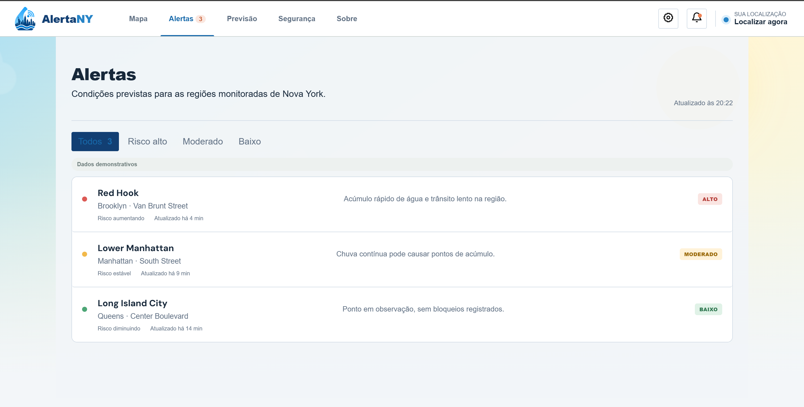
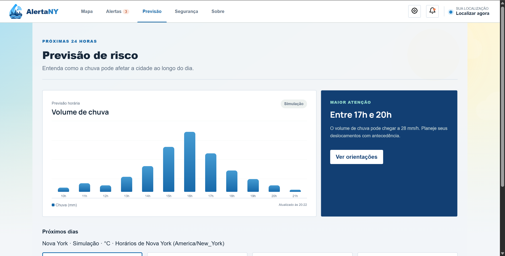
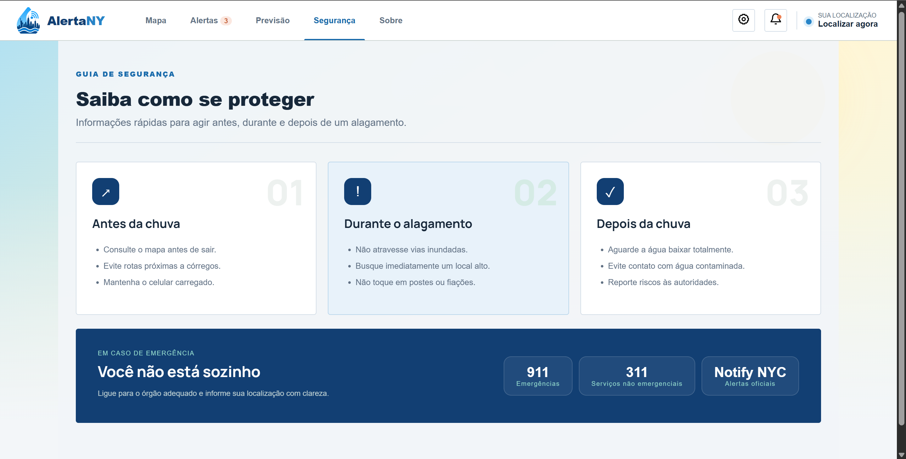
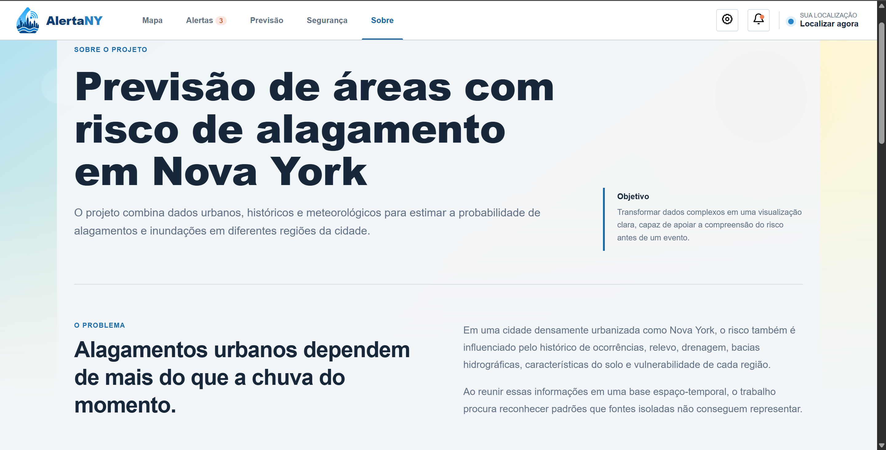

**Data:** 28/10/2026  
**Status:** 🟨 Em Andamento                                                                  
**Responsabilidade:** 1 solução integrada por equipe  
**Projeto:** AlertaNY — Previsão de áreas com risco de alagamento em Nova York

## Objetivo da atividade

Explorar em baixa fidelidade as principais interações do AlertaNY antes de realizar alterações na interface final. O foco é observar se a pessoa entende as informações e consegue concluir as tarefas, e não avaliar a aparência visual das telas.

## 1. Escopo do protótipo

**Personas:** P01 — Paulo André Oliveira (primária); P02 — Victor Merker Binda; P03 — Viviane Santos Machado; P04 — Juliana Ferreira Costa (secundárias).

**Cenários/tarefas cobertos:** C01/T01 — consultar e interpretar o risco de uma região para planejar o deslocamento; C01/T02 — cadastrar trajeto habitual e configurar alertas de risco; C01/T03 — consultar histórico de alagamentos e gerar relatório. A vinculação C01/T02 é proposta para esta prototipação: a Entrega 5 ainda mantém a linha de seleção de T02 em aberto, embora traga sua modelagem completa.

**Objetivos principais:** localizar uma região no mapa ou pela busca; compreender o nível de risco e dados de chuva; apoiar a decisão de manter ou alterar o deslocamento; configurar alertas sobre regiões de um trajeto; consultar registros históricos e obter um relatório.

### 1.1 Possíveis famílias de interface

- **Dashboard/monitoramento:** mapa e resumo dos níveis de risco, com acesso a detalhes por região (T01).
- **Configuração e alertas:** definição de origem, destino, níveis de risco e confirmação (T02).
- **Histórico/relatórios:** seleção de região, período, visualização de resultados e geração de relatório (T03).

Foram selecionadas apenas famílias ligadas a tarefas humanas da Entrega 5. Cadastro de trajetos e geração de relatórios são **propostas de interface ainda não presentes integralmente nas capturas do site atual**, e por isso devem ser consideradas hipóteses de design a testar, não funcionalidades comprovadamente implementadas.

## 2. Fluxos escolhidos

| Fluxo | Tarefa/objetivo | Por que foi priorizado |
|---|---|---|
| PF01 | T01 — Consultar e interpretar risco de alagamento de uma região | Funcionalidade central da persona P01 e decisão de maior criticidade. |
| PF02 | T02 — Cadastrar trajeto habitual e configurar alertas | Explora acompanhamento preventivo sem consulta manual constante. |
| PF03 | T03 — Consultar histórico e gerar relatório | Explora entendimento de ocorrências anteriores e uso posterior das informações. |

**Ordem de prioridade:** PF01 > PF02 > PF03. As tarefas adicionais não substituem o objetivo central do mapa de risco.

## 3. Telas e estados

As cinco imagens abaixo representam as telas disponíveis no AlertaNY. Elas servem como **referência da interface atual** para elaborar e avaliar o protótipo em papel. As capturas de tela são de alta fidelidade; portanto, não substituem, por si só, os desenhos em baixa fidelidade solicitados pela atividade.

| Tela | Funcionalidade e estados considerados |
|---|---|
| P01 — Mapa | Visualização de riscos, busca por região, seleção de marcador e abertura dos detalhes de um local. |
| P02 — Alertas | Lista de regiões monitoradas, seleção dos filtros Todos, Alto, Moderado e Baixo. |
| P03 — Previsão | Gráfico de chuva por horário, informações para os próximos dias e acesso às orientações. |
| P04 — Segurança | Orientações para antes, durante e depois de um alagamento, com contatos de emergência. |
| P05 — Sobre | Apresentação do objetivo do projeto e informações gerais da solução. |

### 3.1 Fluxos e transições propostos

**PF01 — T01 (consulta de risco):** P01 (Mapa) → buscar ou selecionar uma região → abrir detalhes do risco no próprio mapa → voltar ao mapa. Como caminhos alternativos, o usuário pode consultar P02 (Alertas) ou P03 (Previsão) para reunir informações antes de tomar uma decisão. Para o protótipo em papel, é importante desenhar também o estado de busca sem resultados.

**PF02 — T02 (trajeto habitual e notificações):** a Entrega 5 propõe informar origem e destino, ativar notificações, selecionar níveis de risco, conferir e salvar. **Esse fluxo ainda não aparece nas cinco imagens disponíveis**, então suas telas e estados de erro/confirmação precisam ser desenhados separadamente caso sejam mantidos no escopo da prototipação.

**PF03 — T03 (histórico e relatório):** a Entrega 5 propõe selecionar região e período, visualizar ocorrências, configurar o relatório e gerá-lo. **Esse fluxo também não está representado nas cinco imagens disponíveis** e depende de protótipos em papel complementares.

### 3.2 Imagens das cinco telas

**P01 — Mapa**

**P02 — Alertas**

**P03 — Previsão**

**P04 — Segurança**

**P05 — Sobre**

## 4. Simulação / walkthrough

Realize uma simulação com uma pessoa que não participou da elaboração dessas telas. Um colega pode ser usado **para essa iteração formativa**, mas isso não substitui os participantes finais da Entrega 14.

| Observação | Tela/ação | Evidência | Consequência para o design |
|---|---|---|---|
| {{...}} | {{...}} | {{...}} | {{...}} |

## 5. Alterações após a simulação

| Antes | Problema | Depois | Justificativa |
|---|---|---|---|
| {{...}} | {{...}} | {{...}} | {{...}} |

## Checklist

- [ ] O protótipo cobre tarefas relevantes da Entrega 5.
- [ ] Cada tela/estado pode ser justificado por uma tarefa, decisão ou informação necessária.
- [ ] O projeto não criou dashboard/CRUD/login apenas para parecer “completo”.
- [ ] Telas/estados estão numerados e navegáveis na documentação.
- [ ] Há pelo menos uma simulação/walkthrough documentado.
- [ ] Críticas não foram apenas listadas: geraram decisão de revisão.
- [ ] O protótipo continua em baixa fidelidade; detalhes visuais não mascaram problemas de fluxo.
