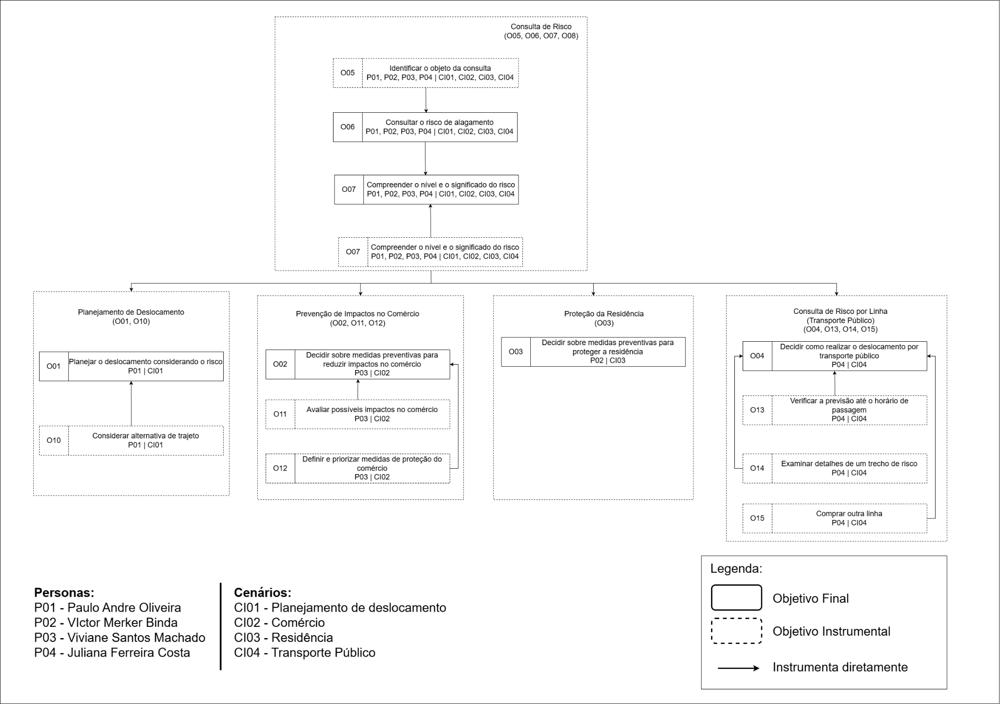

# Entrega 9 — Modelo conceitual e design centrado na comunicação

**Data:** 04/11/2026  
**Status:** 🟦 revisado apos feedback  
**Responsabilidade:** soluções individuais, com consolidação da equipe para mapa de objetivos e esquema de signos.

## Objetivo da atividade

Passar do cenário de problema para uma concepção da interação, explicitando objetivos, tópicos de conversa, falas e signos que a interface deverá comunicar e manipular.

A entrega mantém quatro soluções individuais, uma para cada cenário de interação, e apresenta ao final uma consolidação da equipe para os objetivos e para o vocabulário de signos que deverão ser reutilizados nas próximas modelagens.

## Transformando resultados técnicos em conceitos compreensíveis

Como o projeto utiliza dados e modelos computacionais para estimar risco de alagamento, a interface não deve expor apenas estruturas internas da implementação.

Os conceitos apresentados ao usuário devem possuir significado para sua tarefa, como região consultada, nível de risco, estimativa de risco, período de referência, chuva, ocorrência de alagamento, linha de transporte e atualização das informações.

A interface deve comunicar não apenas o resultado técnico, mas também:

- qual local ou trajeto foi compreendido pelo sistema;
- a qual período a informação se refere;
- que o risco apresentado representa uma estimativa;
- que uma estimativa não corresponde a uma ocorrência confirmada;
- quando os dados foram atualizados;
- quando determinada informação não estiver disponível.

---

# 1. Soluções individuais

## 1.1 CI01 — Planejamento de deslocamento durante chuva intensa

**Autor(a):** Eric Song Watanabe — 22.125.086-3  
**Origem:** cenário problema C01

Em um fim de tarde de chuva intensa, Paulo Andre Oliveira está terminando seu expediente no escritório e precisa voltar para casa. Antes de sair, percebe que a chuva aumentou e quer saber se o trajeto que costuma fazer passa por alguma região com risco de alagamento.

**Paulo informa ao sistema a região ou o trajeto que pretende percorrer. O sistema confirma o local compreendido e apresenta o risco estimado das regiões relacionadas ao deslocamento, indicando também o período de referência e a atualização das informações.**

Como Paulo não possui conhecimento técnico sobre precipitação e risco de alagamentos, **o sistema apresenta o nível de risco acompanhado de uma explicação em linguagem simples, deixando claro que se trata de uma estimativa e não de uma garantia sobre a ocorrência de alagamento. [H — H04]**

**Caso deseje compreender melhor a situação, Paulo pode consultar informações complementares sobre chuva e ocorrências de alagamento relacionadas à região consultada. [H — H05]**

**Com essas informações, Paulo avalia se mantém seu planejamento ou se considera outra alternativa de trajeto. O sistema apoia sua interpretação, mas a decisão final permanece com Paulo.**

Dessa forma, Paulo consegue reunir as informações necessárias em uma mesma interação e utilizá-las como apoio para planejar seu deslocamento.

### Diferenças relevantes

| Alteração | Por que foi necessária | Evidência/artefato que justifica |
|---|---|---|
| Risco, chuva e ocorrências passam a ser relacionados à região ou trajeto consultado | No cenário de problema, Paulo precisava relacionar manualmente informações de diferentes fontes ao deslocamento | C01 e T01 |
| O sistema confirma a região ou trajeto compreendido | Evitar que o usuário interprete informações referentes a um local diferente daquele desejado | C01 e modelagens de T01 |
| O risco é apresentado em linguagem simples e identificado como estimativa | Paulo possui dificuldade para interpretar dados técnicos isolados | P01, H04 e C01 |
| Informações complementares podem ser consultadas opcionalmente | Podem fornecer contexto adicional sem sobrecarregar a consulta principal | H05 |
| O sistema apoia a decisão, mas não decide pelo usuário | A escolha sobre como realizar o deslocamento depende do contexto pessoal de Paulo | C01 |

### Design centrado na comunicação — CI01

| Tópico > subtópico | Falas e signos envolvidos | Intenção/efeito esperado |
|---|---|---|
| Consultar risco de alagamento | `U: Quero saber o risco nas regiões por onde pretendo passar.` / `D: Informe a região ou o trajeto que deseja consultar.` **Signos:** região, trajeto | Permitir que Paulo indique o objeto da consulta |
| > identificar região ou trajeto | `U: Quero consultar este local.` / `D: A consulta será realizada para esta região ou trajeto.` **Signos:** região, trajeto | Confirmar que o sistema compreendeu corretamente o local |
| > compreender o risco | `D: O risco estimado para esta região é este, referente a este período. A informação foi atualizada neste horário.` / `U: Quero entender o que esse nível significa para meu deslocamento.` **Signos:** região, nível de risco, estimativa de risco, período de referência, atualização das informações | Permitir interpretação do risco sem conhecimento técnico |
| > consultar informações complementares | `U: Quero entender melhor a situação desta região.` / `D: Estas são as informações de chuva e ocorrências disponíveis para a região e período consultados.` **Signos:** chuva, ocorrência de alagamento, região, período de referência | Fornecer contexto adicional quando solicitado |
| Planejar deslocamento | `U: Com essas informações, quero decidir se mantenho meu planejamento.` / `D: Este é o resumo das condições identificadas para as regiões consultadas; a decisão sobre o deslocamento continua sendo sua.` **Signos:** região, nível de risco, planejamento do deslocamento | Apoiar a decisão sem transformá-la em recomendação absoluta |
| > considerar alternativa | `U: Quero verificar outra região ou trajeto antes de decidir.` / `D: Você pode realizar uma nova consulta e comparar as informações.` **Signos:** região, trajeto, alternativa de trajeto, nível de risco | Permitir avaliação de outra possibilidade |

**Convenção:** `U` = usuário; `D` = preposto do designer/sistema.

### Mapa individual — CI01

---

## 1.2 CI02 — Prevenção de impactos no comércio durante chuva intensa

**Autor(a):** Rafael Iamashita Becsei — 22.225.037-5  
**Origem:** cenário problema C02

Em um dia de previsão de chuva intensa, Viviane Santos Machado está em seu pequeno comércio e percebe que o tempo começou a mudar. Como sua região costuma sofrer com alagamentos durante períodos de chuva forte, ela se preocupa com os possíveis impactos no funcionamento do estabelecimento e com seus produtos e equipamentos.

**Antes que a chuva fique mais intensa, Viviane consulta no sistema a região onde está localizado seu comércio. O sistema confirma a região compreendida e apresenta o risco estimado de alagamento, seu período de referência e a atualização das informações.**

Como Viviane não possui conhecimento técnico sobre precipitação ou modelos de risco, **o nível de risco é acompanhado de uma explicação em linguagem simples, deixando claro que representa uma estimativa. [H — H04]**

**Caso precise de mais informações, Viviane pode consultar dados complementares sobre chuva e ocorrências de alagamento na região. [H — H05]**

**Com essas informações, Viviane avalia os possíveis impactos no estabelecimento e decide se considera necessárias medidas preventivas para proteger produtos, equipamentos e o funcionamento do comércio. A escolha das medidas continua sendo dela.**

**Durante a chuva, Viviane pode realizar uma nova consulta para acompanhar mudanças no risco e reconsiderar sua decisão.**

### Diferenças relevantes

| Alteração | Por que foi necessária | Evidência/artefato que justifica |
|---|---|---|
| Consulta associada à região do comércio | Viviane tinha dificuldade para relacionar informações gerais de chuva ao estabelecimento | C02, P03 e R02 |
| Confirmação explícita da região consultada | Evita que a decisão seja baseada em informações de outra área | C02 |
| Apresentação do risco em linguagem simples | Viviane não possui conhecimento técnico para interpretar dados meteorológicos isolados | C02, H01 e H04 |
| Informações complementares opcionais | Podem apoiar a compreensão da situação | C02 e H05 |
| Apoio à avaliação dos impactos e medidas preventivas | Viviane precisa decidir como proteger o estabelecimento | C02 |
| Nova consulta durante a chuva | As condições podem mudar e exigir reavaliação | C02 e Q6 |

### Design centrado na comunicação — CI02

| Tópico > subtópico | Falas e signos envolvidos | Intenção/efeito esperado |
|---|---|---|
| Consultar risco na região do comércio | `U: Quero saber se a região do meu comércio apresenta risco de alagamento.` / `D: Informe a região que deseja consultar.` **Signos:** região, comércio | Iniciar a consulta a partir do local relevante |
| > identificar região | `U: Quero verificar o local onde está meu comércio.` / `D: Esta é a região considerada na consulta.` **Signos:** região, comércio | Confirmar a área avaliada |
| > compreender o risco | `U: Quero entender a gravidade da situação.` / `D: Este é o nível de risco estimado para esta região, referente a este período e atualizado neste horário.` **Signos:** região, nível de risco, estimativa de risco, período de referência, atualização das informações | Permitir interpretação correta da estimativa |
| > consultar informações complementares | `U: Quero saber mais sobre as condições da região.` / `D: Estas são as informações disponíveis sobre chuva e ocorrências de alagamento.` **Signos:** chuva, ocorrência de alagamento, período de referência | Fornecer contexto adicional |
| Avaliar medidas preventivas | `U: Preciso decidir se devo proteger meus produtos e equipamentos.` / `D: Estas são as condições identificadas para a região consultada. A decisão sobre quais medidas adotar continua sendo sua.` **Signos:** região, nível de risco, impacto no comércio, medida preventiva | Apoiar a decisão sem prescrever uma ação |
| > acompanhar mudanças no risco | `U: Quero verificar se as condições mudaram.` / `D: Esta é a situação disponível na nova consulta e este é o horário de atualização.` **Signos:** região, nível de risco, atualização das informações | Permitir reavaliar a situação |

**Convenção:** `U` = usuário; `D` = preposto do designer/sistema.

### Mapa individual — CI02

---

## 1.3 CI03 — Preparação do morador durante previsão de chuva intensa

**Autor(a):** Victor Pimentel Lario — 22.125.064-0  
**Origem:** cenário problema C03

Em um dia com previsão de chuva intensa, Victor Merker Binda está em casa acompanhando as notícias sobre as condições do tempo. Como mora em uma região que pode sofrer impactos durante períodos de chuva forte, ele começa a se preocupar com a possibilidade de ocorrer algum alagamento ou inundação próximo à sua residência.

**Victor acessa o sistema pelo celular e informa a região onde mora. O sistema confirma a região consultada e apresenta o risco estimado de alagamento, indicando seu período de referência e a atualização das informações.**

Como possui apenas conhecimentos básicos sobre chuvas e alagamentos, **Victor consulta o nível de risco e uma explicação em linguagem simples sobre seu significado, deixando claro que a informação representa uma estimativa. [H — H04]**

**Caso queira compreender melhor a situação, pode consultar informações complementares sobre chuva e ocorrências de alagamento na região. [H — H05]**

**Com essas informações, Victor avalia se considera necessárias medidas preventivas para proteger a residência e seus bens. A decisão sobre quais medidas realizar continua sendo dele.**

**Durante a chuva, Victor pode realizar novas consultas para acompanhar possíveis mudanças nas condições da região.**

### Diferenças relevantes

| Alteração | Por que foi necessária | Evidência/artefato que justifica |
|---|---|---|
| Consulta específica da região onde mora | Victor tinha dificuldade para relacionar informações gerais de chuva à sua região | C03, P02 e R03 |
| Confirmação da região consultada | Evitar interpretações baseadas em um local diferente do desejado | C03 |
| Explicação simples do risco | Victor possui dificuldade para interpretar dados técnicos | P02 e H04 |
| Informações complementares opcionais | Podem ajudar a compreender melhor a situação | H05 e C03 |
| Apoio à decisão sobre medidas preventivas | Victor precisa decidir se deve proteger sua residência | C03 e P02 |
| Possibilidade de nova consulta | As condições podem mudar durante a chuva | C03 e Q6 |

### Design centrado na comunicação — CI03

| Tópico > subtópico | Falas e signos envolvidos | Intenção/efeito esperado |
|---|---|---|
| Consultar risco de alagamento | `U: Quero saber se minha região apresenta risco de alagamento.` / `D: Informe a região que deseja consultar.` **Signos:** região, residência | Permitir a consulta do local relevante |
| > identificar região | `U: Quero consultar onde moro.` / `D: Esta é a região considerada na consulta.` **Signos:** região, residência | Confirmar o local consultado |
| > compreender risco | `D: Este é o risco estimado para sua região, referente a este período e atualizado neste horário.` / `U: Quero entender a gravidade da situação.` **Signos:** nível de risco, estimativa de risco, região, período de referência, atualização das informações | Facilitar a compreensão |
| > consultar informações complementares | `U: Quero mais informações sobre a situação.` / `D: Estas são as informações disponíveis sobre chuva e ocorrências de alagamento.` **Signos:** chuva, ocorrência de alagamento, período de referência | Complementar a avaliação |
| Avaliar medidas preventivas | `U: Preciso decidir se devo proteger minha casa.` / `D: Estas são as condições identificadas para sua região. A decisão sobre as medidas permanece com você.` **Signos:** região, nível de risco, residência, medida preventiva | Apoiar a decisão do morador |
| > acompanhar situação | `U: Quero verificar se o risco mudou.` / `D: Esta é a situação disponível nesta nova consulta.` **Signos:** nível de risco, atualização das informações | Permitir reavaliar a situação |

**Convenção:** `U` = usuário; `D` = preposto do designer/sistema.

### Mapa individual — CI03

---

## 1.4 CI04 — Ida para a prova de transporte público com previsão de temporal

**Autor(a):** Henrique Hodel Babler — 22.125.084-8  
**Origem:** cenário problema C04

Em uma quinta-feira de março, Juliana Ferreira Costa, estudante universitária de 20 anos, tem uma prova às 19h. Para chegar à faculdade, pega um ônibus até um terminal de integração e segue de metrô. Ainda em casa, recebe um alerta de temporal e fica em dúvida se mantém o trajeto habitual, sai mais cedo ou busca outra alternativa.

**Juliana acessa o sistema pelo celular e informa a linha de ônibus que utiliza ou, se preferir, o ponto ou terminal onde embarca. Em seguida, confirma o sentido, onde embarca e desembarca e a que horas pretende sair. [H — H06]**

**O sistema apresenta o itinerário da linha com os trechos destacados por nível de risco, indicando o período da estimativa e a atualização das informações.**

Como Juliana não possui conhecimento técnico, **o nível de risco de seu trecho é acompanhado de uma explicação em linguagem simples e da previsão até o horário estimado de passagem.**

**Caso queira compreender melhor um trecho, Juliana pode consultar informações complementares sobre chuva e ocorrências de alagamento. Também pode alterar o horário de saída ou consultar outra linha para comparar as informações disponíveis.**

**Com essas informações, Juliana decide entre manter a linha e o horário, antecipar sua saída ou utilizar outra linha. O sistema apoia a decisão, mas a escolha permanece com ela. Durante a chuva, pode atualizar a consulta para verificar se o risco mudou.**

### Diferenças relevantes

| Alteração | Por que foi necessária | Evidência/artefato que justifica |
|---|---|---|
| A consulta pode ser feita por linha, ponto ou terminal | Juliana encontrava informações associadas a locais que não reconhecia e tinha dificuldade para relacioná-las à linha utilizada | C04, R04 e T04. **[H — H06]** |
| O risco é apresentado ao longo do itinerário | Juliana conhece principalmente os pontos de embarque e desembarque | C04 e HTA de T04 |
| O risco possui explicação em linguagem simples | Juliana não conseguia concluir facilmente se os dados representavam risco para seu trajeto | P04, H01 e H04 |
| A previsão considera o horário de passagem | O risco no momento da consulta pode ser diferente do risco no momento em que ela passar pelo trecho | HTA de T04 |
| Informações complementares, outro horário e outra linha podem ser consultados | Juliana precisa avaliar alternativas antes de decidir | H05 e GOMS de T04 |
| O sistema apoia sem decidir pela usuária | A escolha depende de elementos pessoais e contextuais que pertencem à usuária | C04 |

### Design centrado na comunicação — CI04

| Tópico > subtópico | Falas e signos envolvidos | Intenção/efeito esperado |
|---|---|---|
| Consultar risco ao longo da linha | `U: Quero saber se a linha que uso pode ser afetada por alagamento.` / `D: Informe a linha utilizada ou o ponto ou terminal onde você embarca.` **Signos:** linha, ponto ou terminal | Consultar o risco a partir da forma como Juliana pensa seu deslocamento |
| > identificar linha | `U: Uso esta linha.` ou `U: Só sei o ponto onde embarco.` / `D: Estas são as linhas encontradas para sua consulta.` **Signos:** linha, ponto ou terminal | Identificar corretamente a linha |
| > selecionar linha e sentido | `U: É esta linha, neste sentido; embarco aqui e desço neste ponto.` / `D: Este é o trecho considerado na consulta.` **Signos:** linha, sentido, ponto de embarque, ponto de desembarque, trecho | Definir o trecho realmente percorrido |
| > analisar risco ao longo da linha | `D: Este é o itinerário, com o risco estimado dos trechos e o significado do nível apresentado.` / `U: Quero entender se isso afeta meu caminho.` **Signos:** itinerário, trecho, nível de risco, estimativa de risco | Permitir interpretação do risco |
| > verificar previsão até o horário de passagem | `U: Como estará quando o ônibus passar por lá?` / `D: Esta é a previsão do risco até o horário estimado de passagem, referente ao horário de saída informado.` **Signos:** horário de saída, horário de passagem, previsão do risco, período de referência | Relacionar risco e momento do deslocamento |
| > examinar trecho de risco | `U: Quero entender melhor este trecho.` / `D: Estas são as informações disponíveis sobre chuva e ocorrências de alagamento neste trecho.` **Signos:** trecho, chuva, ocorrência de alagamento | Fornecer contexto adicional |
| Decidir como realizar o deslocamento | `U: Com isso, preciso decidir como vou para a faculdade.` / `D: Este é o resumo do risco estimado para seu trecho e horário. A decisão permanece com você.` **Signos:** linha, nível de risco, previsão do risco, horário de saída | Apoiar a decisão sem escolher pela usuária |
| > comparar outra linha | `U: Quero consultar outra linha antes de decidir.` / `D: Você pode realizar outra consulta e comparar as linhas já avaliadas.` **Signos:** linha, linhas consultadas, nível de risco | Permitir comparação entre alternativas |
| > acompanhar mudanças | `U: Quero verificar se o risco mudou.` / `D: Estas são as informações disponíveis neste momento e este é o horário da atualização.` **Signos:** atualização das informações, nível de risco, previsão do risco | Permitir reavaliação |

**Convenção:** `U` = usuário; `D` = preposto do designer/sistema.

### Mapa individual — CI04

---

# 2. Consolidação do mapa de objetivos

Os quatro mapas individuais foram utilizados como entrada para a construção de um único mapa de objetivos da equipe.

A consolidação elimina duplicidades, cria identificadores únicos para todo o projeto e diferencia:

- **objetivos finais:** representam aquilo que efetivamente motiva a persona a utilizar o sistema;
- **objetivos instrumentais:** representam meios utilizados para alcançar um objetivo final.

Objetivos semelhantes compartilhados por diferentes personas passam a utilizar o mesmo identificador.

## 2.1 Mapa de objetivos 

## 2.2 Dicionário consolidado de objetivos

| ID | Tipo | Objetivo | Persona(s) | Cenário(s) | Prioridade |
|---|---|---|---|---|---|
| O01 | Final | Planejar o deslocamento considerando o risco | P01 | CI01 | Alta |
| O02 | Final | Decidir sobre medidas preventivas para reduzir impactos no comércio | P03 | CI02 | Alta |
| O03 | Final | Decidir sobre medidas preventivas para proteger a residência | P02 | CI03 | Alta |
| O04 | Final | Decidir como realizar o deslocamento por transporte público | P04 | CI04 | Alta |
| O05 | Instrumental | Identificar o objeto da consulta | P01, P02, P03, P04 | CI01, CI02, CI03, CI04 | Alta |
| O06 | Instrumental | Consultar o risco de alagamento | P01, P02, P03, P04 | CI01, CI02, CI03, CI04 | Alta |
| O07 | Instrumental | Compreender o nível e o significado do risco | P01, P02, P03, P04 | CI01, CI02, CI03, CI04 | Alta |
| O08 | Instrumental | Consultar informações complementares | P01, P02, P03, P04 | CI01, CI02, CI03, CI04 | Média |
| O09 | Instrumental | Acompanhar mudanças no risco | P02, P03, P04 | CI02, CI03, CI04 | Média |
| O10 | Instrumental | Considerar alternativa de trajeto | P01 | CI01 | Média |
| O11 | Instrumental | Avaliar possíveis impactos no comércio | P03 | CI02 | Alta |
| O12 | Instrumental | Definir e priorizar medidas de proteção do comércio | P03 | CI02 | Média |
| O13 | Instrumental | Verificar a previsão até o horário de passagem | P04 | CI04 | Alta |
| O14 | Instrumental | Examinar detalhes de um trecho de risco | P04 | CI04 | Média |
| O15 | Instrumental | Comparar outra linha | P04 | CI04 | Média |

### Relações principais de instrumentação

- **O05, O06, O07 e O08** apoiam os quatro objetivos finais, de acordo com o contexto de cada persona.
- **O10** apoia O01.
- **O11 e O12** apoiam O02.
- **O09** apoia principalmente O02, O03 e O04 ao permitir nova avaliação diante de mudanças.
- **O13, O14 e O15** apoiam O04.
- Os objetivos instrumentais não substituem a decisão final do usuário.

---

# 3. Esquema conceitual de signos consolidado

Para garantir consistência entre os quatro cenários, a equipe adotou um vocabulário comum.

A origem dos signos segue duas categorias:

- **domínio:** conceito que existe no mundo do usuário independentemente da aplicação;
- **aplicação:** conceito criado, calculado ou mantido pela aplicação para apoiar a interação.

Os mesmos conceitos devem manter o mesmo nome, significado e origem em todas as modelagens posteriores.

| Grupo | Signo | Origem | Observações/semântica | Tipo de conteúdo | Restrição | Valor padrão | Prevenção | Recuperação |
|---|---|---|---|---|---|---|---|---|
| Localização | região | domínio | Área geográfica considerada na consulta | texto/localização | Deve corresponder a uma região reconhecida | — | PA: sugerir regiões reconhecidas | RA: informar que a região não foi encontrada e permitir nova consulta |
| Deslocamento | trajeto | domínio | Caminho que o usuário pretende realizar | localização/trajeto | Deve possuir informações suficientes para identificar o deslocamento | — | PP: explicar os dados necessários | RA: permitir corrigir a consulta |
| Contexto | comércio | domínio | Estabelecimento cuja região e possíveis impactos são avaliados | texto/localização | Deve estar relacionado a uma região | — | — | — |
| Contexto | residência | domínio | Local de moradia considerado na decisão preventiva | texto/localização | Deve estar relacionado a uma região | — | — | — |
| Transporte | linha | domínio | Linha de transporte utilizada pelo usuário | texto | Deve corresponder a uma linha existente | — | PA: sugerir linhas existentes | RA: permitir corrigir a linha |
| Transporte | ponto ou terminal | domínio | Local de embarque ou desembarque atendido por linhas | texto/localização | Deve corresponder a um ponto ou terminal válido | — | PA: sugerir pontos reconhecidos | RA: permitir nova seleção |
| Transporte | sentido | domínio | Direção em que uma linha é percorrida | seleção | Deve corresponder a um sentido válido da linha | — | AL: alertar quando embarque e desembarque forem incompatíveis com o sentido | RA: permitir alterar o sentido |
| Transporte | ponto de embarque | domínio | Local em que o usuário inicia o trecho de transporte | seleção | Deve pertencer à linha selecionada | — | PA: apresentar apenas pontos compatíveis | RA: permitir corrigir |
| Transporte | ponto de desembarque | domínio | Local em que o usuário encerra o trecho | seleção | Deve pertencer à linha e ocorrer após o embarque | — | PA: apresentar apenas pontos compatíveis | RA: permitir corrigir |
| Transporte | itinerário | domínio | Percurso realizado pela linha | sequência de trechos | Deve corresponder à linha e ao sentido | — | PP: destacar o trecho relevante | — |
| Transporte | trecho | aplicação | Parte do itinerário considerada na apresentação do risco | localização | Deve pertencer ao itinerário | — | PP: identificar claramente o trecho considerado | — |
| Risco | nível de risco | aplicação | Classificação simplificada utilizada para comunicar o risco estimado | categórico | Deve estar associado a local e período | — | PP: apresentar texto e significado, sem depender somente de cor | CE: informar quando o risco não estiver disponível |
| Risco | estimativa de risco | aplicação | Valor estimado da possibilidade de alagamento | percentual/probabilidade | Deve estar dentro da faixa válida do modelo | — | PP: explicar que se trata de uma estimativa | — |
| Risco | significado do risco | aplicação | Explicação do que o nível representa no contexto da tarefa | texto | Deve acompanhar o nível quando necessário | — | PP: utilizar linguagem simples e evitar garantia de segurança | — |
| Risco | previsão do risco | aplicação | Risco esperado para um momento futuro relevante | nível/período | Deve informar o período da previsão | — | PP: indicar que se trata de previsão | CE: informar indisponibilidade |
| Tempo | período de referência | aplicação | Momento ou intervalo ao qual as informações apresentadas correspondem | data/hora/período | Deve acompanhar as informações temporais | consulta atual | PP: apresentar claramente o período | CE: informar quando indisponível |
| Tempo | horário de saída | domínio | Momento em que o usuário pretende iniciar o deslocamento | hora | Deve representar horário válido para consulta | momento da consulta | PP: indicar formato esperado | RA: permitir alteração |
| Tempo | horário de passagem | aplicação | Horário estimado em que a linha passará pelo trecho | hora | Calculado a partir das informações disponíveis | — | PP: indicar que o horário é estimado | — |
| Condições | chuva | domínio | Informação meteorológica relacionada ao local e período | numérico/textual | Deve possuir unidade e período quando aplicável | — | PP: apresentar unidade e significado | CE: informar indisponibilidade |
| Alagamento | ocorrência de alagamento | domínio | Registro de alagamento ocorrido em determinado local e período | registro | Deve possuir referência espacial e temporal | — | PP: diferenciar ocorrência registrada de risco estimado | — |
| Consulta | atualização das informações | aplicação | Data e horário da última atualização dos dados exibidos | data/hora | Deve corresponder aos dados apresentados | — | PP: apresentar a atualização de forma visível | RA: permitir atualizar a consulta |
| Consulta | linhas consultadas | aplicação | Conjunto de linhas já avaliadas pelo usuário durante a interação | lista | Zero ou mais linhas | — | PA: permitir comparação apenas quando houver mais de uma linha | — |
| Decisão | alternativa de trajeto | domínio | Outra possibilidade de deslocamento considerada pelo usuário | trajeto | Deve representar uma possibilidade de deslocamento | — | — | RA: permitir realizar outra consulta |
| Decisão | medida preventiva | domínio | Ação considerada pelo usuário para reduzir possíveis impactos | texto/ação | A decisão permanece com o usuário | — | PP: evitar apresentar a ação como obrigação ou garantia | — |
| Decisão | impacto no comércio | domínio | Possível consequência da situação de chuva ou alagamento sobre o estabelecimento | texto/contexto | Relacionado ao comércio e à situação avaliada | — | PP: apresentar como possibilidade, não como certeza | — |
| Decisão | planejamento do deslocamento | domínio | Decisão do usuário sobre manter ou alterar seu deslocamento | decisão | Deve permanecer sob controle do usuário | — | PP: diferenciar informação de recomendação absoluta | — |

## 3.1 Convenções de prevenção e recuperação

- `PP` — **Prevenção passiva:** o preposto fornece explicações ou informações que ajudam a evitar uma ruptura.
- `PA` — **Prevenção ativa:** o preposto restringe ou impede uma entrada inválida.
- `AL` — **Prevenção apoiada/alerta:** o preposto identifica uma possível ruptura, alerta o usuário e solicita uma decisão antes de prosseguir.
- `RA` — **Recuperação apoiada:** o preposto informa a ruptura e oferece meios para o usuário retomar a interação.
- `CE` — **Captura de erro:** o preposto comunica uma situação que não pode ser resolvida diretamente pela interface naquele momento.

A sigla `PAp`, utilizada anteriormente em CI04, foi substituída por `AL` para manter a convenção utilizada no material da disciplina.

---

# 4. Hipóteses ainda abertas

A existência de uma solução proposta nos cenários de interação não significa que todas as necessidades correspondentes tenham sido confirmadas.

As hipóteses H01–H06 continuam sendo tratadas como hipóteses enquanto não houver evidência suficiente para sua confirmação.

Em especial:

- a forma mais adequada de representar o risco continua relacionada às hipóteses levantadas nas entregas anteriores;
- a necessidade e o nível de detalhamento das informações complementares permanecem sujeitos à validação;
- recursos de acompanhamento de mudanças devem ser avaliados com usuários;
- o fluxo de transporte público de CI04 continua explicitamente dependente de **H06**;
- a possibilidade de consulta por linha, ponto e terminal não deve ser tratada como requisito definitivamente validado apenas porque foi modelada.

---

# 5. Síntese para a Entrega 10

Os quatro cenários possuem um **núcleo de conversa compartilhado**, mas mantêm diferenças específicas de cada contexto.

## Núcleo compartilhado

Nos quatro cenários aparecem, de maneiras diferentes:

1. identificação do objeto da consulta;
2. consulta do risco;
3. compreensão do nível e significado do risco;
4. acesso opcional a informações complementares;
5. tomada de decisão pelo usuário;
6. possibilidade de reavaliação quando as condições mudam.

Esses elementos devem orientar a construção dos diagramas MoLIC.

## Especificidades que devem ser preservadas

**CI01 — P01**
- planejamento de deslocamento;
- consulta de região ou trajeto;
- consideração de alternativa.

**CI02 — P03**
- comércio;
- avaliação dos possíveis impactos;
- decisão sobre medidas preventivas.

**CI03 — P02**
- residência;
- proteção da casa e dos bens;
- decisão sobre medidas preventivas.

**CI04 — P04**
- linha;
- sentido;
- ponto de embarque;
- ponto de desembarque;
- trecho;
- horário de saída;
- horário de passagem;
- comparação entre linhas.

A consolidação elimina duplicidades de nomenclatura, mas não elimina as diferenças necessárias entre os quatro contextos.

## Vocabulário a ser reutilizado

Os diagramas MoLIC devem utilizar os IDs do dicionário consolidado de objetivos e os nomes de signos definidos nesta entrega.

Os termos:

- região;
- nível de risco;
- estimativa de risco;
- significado do risco;
- período de referência;
- chuva;
- ocorrência de alagamento;
- atualização das informações;

devem manter o mesmo significado nos diferentes diagramas.

Rupturas relacionadas a regiões ou linhas não encontradas, informações indisponíveis, incompatibilidades de sentido e ausência de dados devem ser representadas quando pertinentes nos caminhos de prevenção e recuperação da MoLIC.

---

# Checklist

- [x] Cenários de interação mostram alterações em relação aos cenários de problema.
- [x] Cada solução individual identifica autor e cenário de origem.
- [x] Tópicos, falas e signos são coerentes com os objetivos dos usuários.
- [x] Os quatro mapas individuais foram considerados na consolidação da equipe.
- [x] Há um mapa de objetivos consolidado com IDs únicos e estáveis.
- [x] Objetivos finais e instrumentais foram diferenciados.
- [x] Objetivos compartilhados utilizam os mesmos IDs nos cenários pertinentes.
- [x] O esquema de signos foi consolidado em um vocabulário comum.
- [x] A origem dos signos foi padronizada entre domínio e aplicação.
- [x] As convenções de prevenção e recuperação foram padronizadas.
- [x] Os nomes de objetivos e signos estão preparados para reutilização na Entrega 10.
- [x] As hipóteses ainda abertas permanecem identificadas como hipóteses.
- [x] Em TCC técnico, os signos representam conceitos compreensíveis para o usuário, e não apenas estruturas internas do modelo.
- [x] As especificidades de cada persona foram preservadas mesmo após a consolidação.
- [x] A interface comunica não apenas o resultado técnico, mas também seu significado, período de referência, atualização e limitações para a tarefa.

# Histórico de revisões

| O que foi alterado | Motivo |
|---|---|
| Os quatro cenários individuais foram preservados e reorganizados em uma estrutura única. | Manter a produção individual da equipe e facilitar a consolidação posterior. |
| As falas do preposto foram detalhadas para comunicar região, período, estimativa e atualização. | Tornar o Design Centrado na Comunicação mais preciso e menos semelhante a uma descrição genérica de requisitos. |
| Signos foram adicionados aos diálogos em que anteriormente estavam implícitos. | Fortalecer a ligação entre Design Centrado na Comunicação, esquema conceitual de signos e MoLIC. |
| Foi criado um único mapa de objetivos consolidado da equipe. | Atender à etapa de consolidação que não estava presente na versão anterior. |
| Os objetivos receberam IDs únicos O01–O15. | Eliminar as colisões causadas pela repetição de O01, O02 etc. nos quatro cenários. |
| A classificação entre objetivos finais e instrumentais foi revisada. | Diferenciar a motivação principal do usuário dos meios utilizados para alcançá-la. |
| Objetivos compartilhados foram consolidados. | Evitar duplicidades e estabelecer uma linguagem comum para a Entrega 10. |
| O esquema conceitual de signos foi consolidado em uma tabela única. | Padronizar nome, significado, origem, restrições, prevenção e recuperação dos conceitos compartilhados. |
| A origem dos signos foi padronizada como domínio ou aplicação. | Eliminar inconsistências entre usuário, sistema, interface, domínio/sistema e aplicação. |
| `PAp` foi substituído por `AL`. | Utilizar a convenção de prevenção apoiada/alerta adotada no material da disciplina. |
| A referência a “modal” foi removida de CI04. | Evitar introduzir um conceito que ainda não estava consolidado no vocabulário do projeto. |
| As hipóteses abertas passaram a ser explicitamente preservadas. | Evitar que uma solução concebida seja interpretada como necessidade já confirmada. |
| A síntese foi reescrita para apresentar um núcleo compartilhado sem tratar os quatro cenários como idênticos. | Preservar as especificidades de comércio, residência, deslocamento comum e transporte público. |
| Comentários HTML de edição foram removidos. | Eliminar resíduos internos que não pertencem ao conteúdo acadêmico. |
| O checklist foi atualizado. | Fazer a documentação refletir o estado revisado da entrega. |
