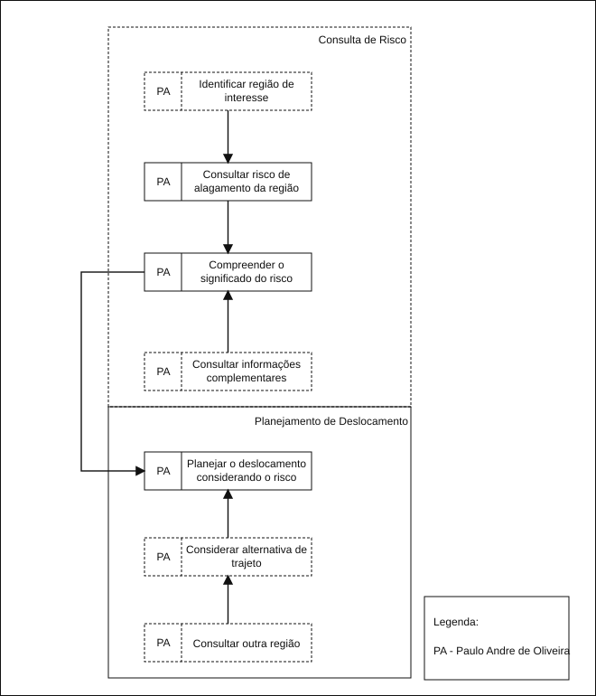
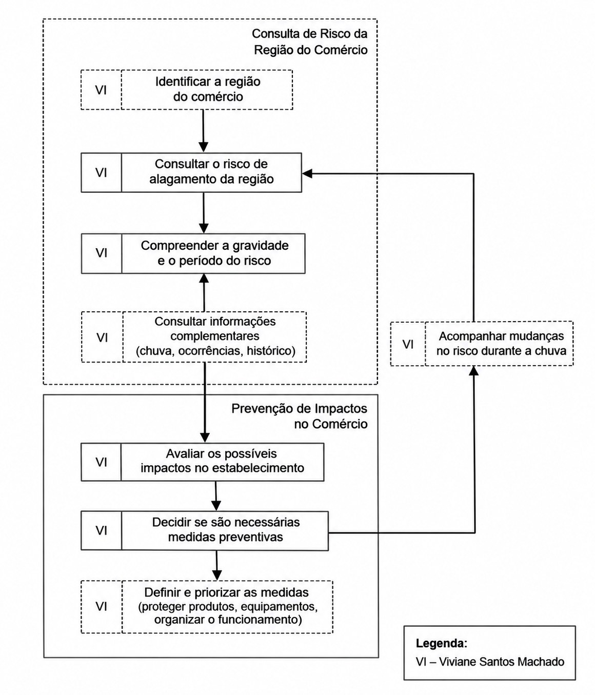
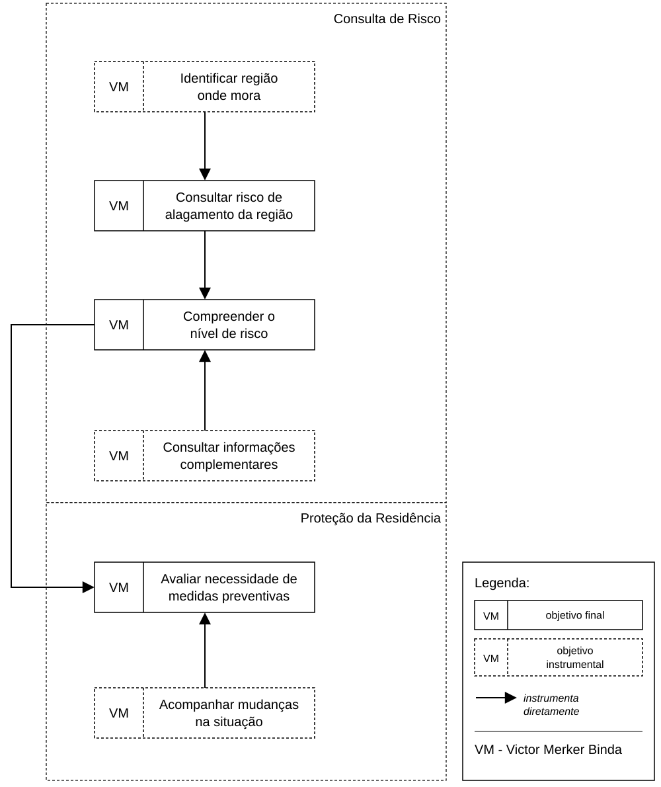
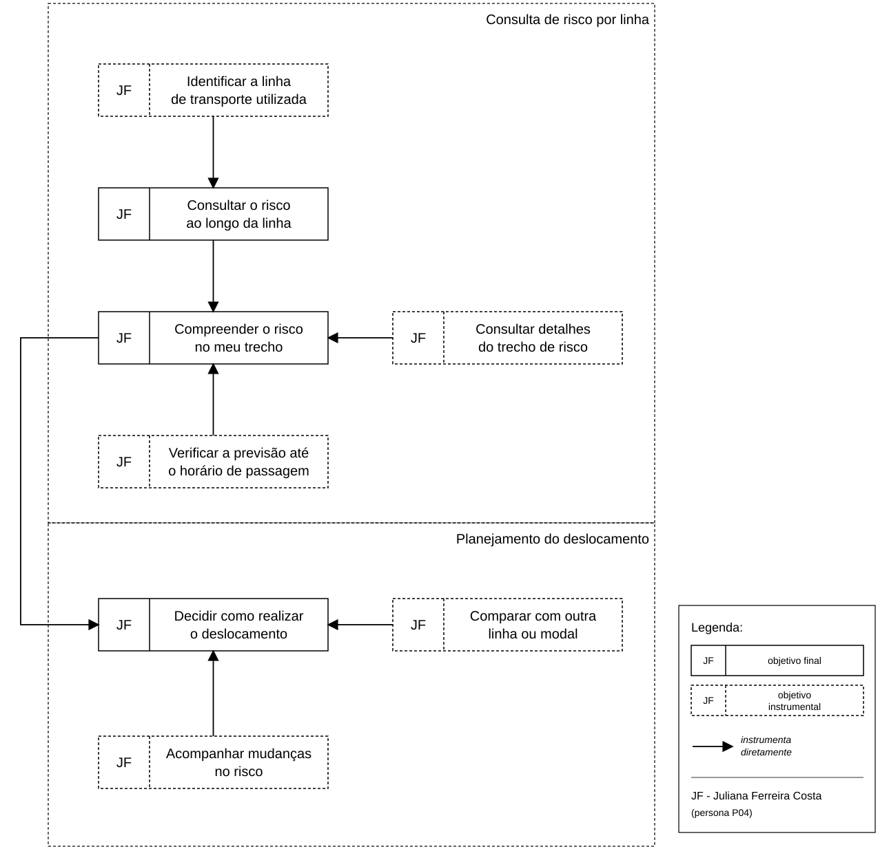

# Entrega 9 — Modelo conceitual e design centrado na comunicação

**Data:** 04/11/2026  
**Status:** 🟩 Concluída
**Responsabilidade:** soluções individuais, com consolidação da equipe para mapa de objetivos e esquema de signos.  

## Objetivo da atividade

Passar do cenário de problema para uma concepção da interação, explicitando objetivos, tópicos de conversa, falas e signos que a interface deverá comunicar/manipular.

## Transformando resultados técnicos em conceitos compreensíveis

Em TCCs algorítmicos ou orientados a dados, esta entrega deve evitar que a interface exponha apenas estruturas internas do código. Identifique os **conceitos e signos que fazem sentido para o usuário**.

Exemplos:

- `query plan`, custo estimado, recomendação e impacto para um DBA;
- modelo, dataset, versão, execução e métrica para engenheiro de IA;
- período, indicador, grupo, tendência e filtro para gestor/analista;
- alerta, severidade, evidência, responsável e status para analista de segurança.

Se um termo técnico for necessário, modele como será comunicado, explicado e relacionado à tarefa.

Dashboards, relatórios, filtros e CRUDs devem aparecer no modelo conceitual por meio dos **objetivos, signos e conversas** que justificam sua existência.

## 1. Cenários de interação

Para cada cenário de problema, produza uma versão em que a solução já pode ser descrita. **Destaque claramente o texto alterado** em relação ao cenário original.

### CI01 — Planejamento de deslocamento durante chuva intensa

**Autor(a):** Eric Song Watanabe — 22.125.086-3
**Origem:** cenário problema C01

Em um fim de tarde de chuva intensa, Paulo Andre Oliveira está terminando seu expediente no escritório e precisa voltar para casa. Antes de sair, percebe que a chuva aumentou e quer saber se o trajeto que costuma fazer passa por alguma região com risco de alagamento.

**Paulo informa ao sistema a região ou o trajeto que pretende percorrer. O sistema reúne as informações disponíveis e apresenta o risco de alagamento das regiões relacionadas ao seu deslocamento, utilizando uma forma de comunicação que não dependa de conhecimento técnico.**

**Paulo consulta o risco apresentado e informações complementares sobre chuva e ocorrências relacionadas às regiões do trajeto. Caso queira compreender melhor uma determinada região, pode consultar informações adicionais disponíveis sobre ela.**

Como Paulo não possui conhecimento técnico sobre precipitação e risco de alagamentos, **o sistema comunica o significado do risco em linguagem simples e relaciona as informações à região consultada**, permitindo que Paulo compreenda melhor a situação.

**Com essas informações, Paulo avalia se mantém seu trajeto habitual ou se deve considerar outra alternativa. O sistema fornece informações para apoiar a decisão, mas a escolha final permanece com Paulo.**

Dessa forma, Paulo consegue reunir e interpretar as informações necessárias em uma mesma interação, reduzindo a necessidade de consultar diferentes fontes antes de decidir como realizará seu deslocamento.

### Diferenças relevantes

| Alteração | Por que foi necessária | Evidência/artefato que justifica |
|---|---|---|
| As informações sobre chuva, ocorrências e risco passam a ser relacionadas à região ou trajeto de interesse | No cenário problema, Paulo precisava consultar diferentes fontes e tinha dificuldade para relacionar as informações ao trajeto | C01 e análise de tarefas T01 |
| O risco é comunicado em linguagem compreensível para usuários não técnicos | Paulo possui dificuldade para interpretar precipitação, probabilidades e dados técnicos isolados | P01, H04 e C01 |
| A interação permite consultar informações complementares sobre a região | Informações adicionais podem ajudar Paulo a compreender melhor a situação antes de tomar uma decisão | H05 e análises de tarefas |
| O sistema apoia a decisão sem decidir pelo usuário | O objetivo é fornecer informação para que Paulo escolha se mantém ou altera seu planejamento | C01 e modelagens de tarefas |

## 2. Design centrado na comunicação

**Nome do cenário:** CI01 — Planejamento de deslocamento durante chuva intensa

| Tópico > subtópico | Falas e signos envolvidos | Intenção/efeito esperado |
|---|---|---|
| Consultar risco de alagamento | `U: Quero saber o risco de alagamento nas regiões por onde pretendo passar.` / `D: Informe a região ou o trajeto que deseja consultar.` | Permitir que Paulo indique qual local deseja avaliar |
| > identificar região de interesse | `U: Quero consultar esta região.` / `D: Esta é a região selecionada. Vou apresentar as informações disponíveis para ela.` **Signos:** região, localização, trajeto | Confirmar que as informações apresentadas correspondem ao local desejado |
| > compreender risco | `D: O risco estimado para esta região é apresentado junto com uma explicação do seu significado.` / `U: Quero entender se esse risco pode afetar meu deslocamento.` **Signos:** nível de risco, estimativa de risco, região | Permitir que Paulo interprete o resultado sem precisar conhecer conceitos técnicos do modelo |
| > consultar informações complementares | `U: Quero entender melhor a situação desta região.` / `D: Estas são as informações complementares disponíveis sobre chuva e ocorrências relacionadas.` **Signos:** chuva, ocorrência de alagamento, período, região | Oferecer contexto adicional quando necessário, sem tornar toda consulta excessivamente detalhada |
| Planejar deslocamento | `U: Com essas informações, quero decidir se mantenho meu planejamento.` / `D: Estas são as condições identificadas nas regiões consultadas.` | Apoiar a tomada de decisão sem escolher pelo usuário |
| > considerar alternativa | `U: Quero verificar outra região antes de decidir.` / `D: Você pode consultar outra região e comparar as informações apresentadas.` **Signos:** região consultada, nível de risco | Permitir que Paulo obtenha informações sobre alternativas antes de tomar sua decisão |

**Convenção:** `U` = usuário; `D` = preposto do designer/sistema, conforme a abordagem de Engenharia Semiótica adotada na disciplina.

## 3. Mapa de objetivos

Cada integrante apresenta seu mapa e a equipe cria um **mapa consolidado**, eliminando duplicidades e resolvendo conflitos de nomenclatura.

### Dicionário de objetivos

| ID | Objetivo | Persona(s) | Cenário(s) | Prioridade |
|---|---|---|---|---|
| O01 | Planejar o deslocamento considerando o risco | P01 | CI01 | Alta |
| O02 | Consultar o risco de alagamento da região | P01 | CI01 | Alta |
| O03 | Compreender o significado do risco | P01 | CI01 | Alta |
| O04 | Identificar a região de interesse | P01 | CI01 | Alta |
| O05 | Consultar informações complementares | P01 | CI01 | Média |
| O06 | Considerar alternativa de trajeto | P01 | CI01 | Média |
| O07 | Consultar outra região | P01 | CI01 | Média |

## 4. Esquema conceitual de signos

| Grupo | Signo | Origem | Observações/semântica | Tipo de conteúdo | Restrição | Valor padrão | Prevenção | Recuperação |
|---|---|---|---|---|---|---|---|---|
| Localização | região | domínio | Área da cidade que o usuário deseja consultar | texto/localização | Deve corresponder a uma região válida | — | PA: permitir apenas regiões reconhecidas pelo sistema | RA: informar quando a região não for encontrada e permitir nova consulta |
| Localização | trajeto | usuário | Deslocamento que Paulo pretende realizar entre origem e destino | localização | Deve possuir origem e destino válidos | — | PP: explicar quais dados são necessários para identificar o trajeto | RA: permitir corrigir origem ou destino |
| Risco | nível de risco | sistema | Forma simplificada de comunicar a condição de risco de alagamento | categórico | Deve estar associado a uma região e período | — | PP: explicar o significado dos níveis apresentados | — |
| Risco | estimativa de risco | sistema | Resultado estimado para representar a possibilidade de alagamento | percentual/probabilidade | Deve estar dentro da faixa válida produzida pelo sistema | — | PP: apresentar explicação em linguagem simples | — |
| Condições | chuva | domínio/sistema | Informação de chuva relacionada à região consultada | numérico/textual | Deve estar associada a local e período | — | PP: apresentar unidade e significado de forma compreensível | — |
| Alagamento | ocorrência de alagamento | domínio | Registro de alagamento associado a uma região | registro | Deve possuir localização e período relacionados | — | — | — |
| Consulta | informações complementares | sistema/domínio | Dados adicionais utilizados para ajudar Paulo a compreender a situação | conjunto de informações | Devem estar relacionadas à região consultada | — | PP: apresentar apenas informações relevantes e explicadas | — |
| Planejamento | alternativa de trajeto | usuário | Possibilidade considerada por Paulo quando deseja evitar uma região de maior risco | localização/trajeto | Deve representar uma alternativa válida de deslocamento | — | — | RA: permitir realizar uma nova consulta caso a alternativa não seja adequada |

**Legenda de prevenção e recuperação:**

- `PP` — Prevenção passiva: o sistema fornece explicações para evitar erros de interpretação.
- `PA` — Prevenção ativa: o sistema impede entradas inválidas.
- `RA` — Recuperação apoiada: o sistema informa o problema e ajuda o usuário a corrigi-lo.

### CI02 — Prevenção de impactos no comércio durante chuva intensa

**Autor(a):** Rafael Iamashita Becsei - 22.225.037-5  
**Origem:** cenário problema C02  

Em um dia de previsão de chuva intensa, Viviane Santos Machado está em seu pequeno comércio e percebe que o tempo começou a mudar. Como sua região costuma sofrer com alagamentos durante períodos de chuva forte, ela se preocupa com os possíveis impactos no funcionamento do estabelecimento e com seus produtos e equipamentos.

**Antes que a chuva fique mais intensa, Viviane consulta no sistema a região onde está localizado seu comércio. O sistema identifica a região consultada e apresenta o risco estimado de alagamento, relacionando as informações disponíveis às condições daquele local.**

Como Viviane não possui conhecimento técnico sobre precipitação ou modelos de risco, o sistema apresenta o nível de risco acompanhado de uma explicação em linguagem simples, permitindo que ela compreenda melhor a gravidade da situação sem precisar interpretar dados técnicos isolados.

**Caso precise de mais informações, Viviane pode consultar dados complementares sobre a chuva e ocorrências de alagamento na região, considerando a situação antes de tomar uma decisão.**

**Com essas informações, Viviane avalia se precisa adotar medidas preventivas, como proteger produtos e equipamentos, reorganizar itens vulneráveis ou se preparar para uma possível interrupção das atividades. A decisão sobre quais medidas tomar continua sendo dela.**

**Durante a chuva, Viviane também pode realizar novas consultas para acompanhar possíveis mudanças no risco e reconsiderar as medidas adotadas. Dessa forma, consegue se preparar com mais informações e reduzir a incerteza sobre os possíveis impactos no comércio.**

### Diferenças relevantes

| Alteração | Por que foi necessária | Evidência/artefato que justifica |
|---|---|---|
| Consulta do risco associada à região do comércio | Viviane tinha dificuldade para relacionar informações gerais sobre chuva ao local do estabelecimento | C02, P03 e R02 |
| Apresentação do risco em linguagem simples | Viviane não possui conhecimento técnico para interpretar dados meteorológicos isolados | C02, H01 e H04 |
| Disponibilização de informações complementares | Informações sobre chuva e ocorrências podem ajudar a compreender melhor a situação | C02 e H05 |
| Apoio à decisão sobre medidas preventivas | Viviane precisa decidir como proteger produtos e equipamentos sem comprometer desnecessariamente as atividades | C02 e questões de refinamento Q3, Q4 e Q5 |
| Possibilidade de consultar novamente o risco | As condições podem mudar durante a chuva e exigir uma nova avaliação | C02 e questão de refinamento Q6 |

## 2. Design centrado na comunicação

**Nome do cenário:** CI02 — Prevenção de impactos no comércio durante chuva intensa

| Tópico > subtópico | Falas e signos envolvidos | Intenção/efeito esperado |
|---|---|---|
| Consultar risco na região do comércio | `U: Quero saber se a região do meu comércio apresenta risco de alagamento` / `D: Informe a região que deseja consultar` | Permitir que Viviane consulte o risco associado ao estabelecimento |
| > identificar a região | `U: Quero verificar o local onde está meu comércio` / `D: Esta é a região selecionada para consulta` Signos: região, localização, comércio | Confirmar que as informações correspondem à região desejada. |
| > compreender o risco | `U: Quero entender a gravidade do risco apresentado` / `D: Este é o nível de risco estimado para a região e seu significado` Signos: nível de risco, estimativa de risco, região | Facilitar a interpretação sem exigir conhecimento técnico |
| > consultar informações complementares | `U: Quero saber mais sobre as condições da região` / `D: Estas são as informações disponíveis sobre chuva e ocorrências de alagamento` Signos: chuva, ocorrência, período | Oferecer informações adicionais para apoiar a avaliação |
| Avaliar medidas preventivas | `U: Preciso decidir se devo proteger meus produtos e equipamentos` / `D: Estas são as condições de risco identificadas para a região consultada` | Apoiar a decisão de Viviane sem determinar as medidas que ela deve tomar |
| > acompanhar mudanças no risco | `U: Quero verificar se as condições mudaram desde a última consulta` / `D: Estas são as informações disponíveis para a região neste momento` Signos: região, nível de risco, período da consulta | Permitir que Viviane reavalie a situação durante a chuva |

**Convenção:** `U` = usuário; `D` = preposto do designer/sistema, conforme a abordagem de Engenharia Semiótica adotada na disciplina.

## 3. Mapa de objetivos

Cada integrante apresenta seu mapa e a equipe cria um **mapa consolidado**, eliminando duplicidades e resolvendo conflitos de nomenclatura.

### Dicionário de objetivos

| ID | Objetivo | Persona(s) | Cenário(s) | Prioridade |
|---|---|---|---|---|
| O01 | Avaliar o risco de alagamento para prevenir impactos no comércio | P03 | CI02 | Alta |
| O02 | Identificar a região onde está localizado o comércio | P03 | CI02 | Alta |
| O03 | Consultar o risco de alagamento da região | P03 | CI02 | Alta |
| O04 | Compreender a gravidade e o período do risco | P03 | CI02 | Alta |
| O05 | Consultar informações complementares sobre chuva e ocorrências | P03 | CI02 | Média |
| O06 | Avaliar os possíveis impactos no estabelecimento | P03 | CI02 | Alta |
| O07 | Decidir se são necessárias medidas preventivas | P03 | CI02 | Alta |
| O08 | Definir e priorizar medidas para proteger produtos, equipamentos e o funcionamento do comércio | P03 | CI02 | Média |
| O09 | Acompanhar mudanças no risco durante a chuva | P03 | CI02 | Média |

## 4. Esquema conceitual de signos

Consolide as informações em **uma tabela única**.

| Grupo | Signo | Origem | Observações/semântica | Tipo de conteúdo | Restrição | Valor padrão | Prevenção | Recuperação |
|---|---|---|---|---|---|---|---|---|
| Localização | Região consultada | Domínio | Identifica a região do comércio para a qual o risco será apresentado | Texto / localização | Deve corresponder a uma região válida. | — | PP: mostrar claramente o nome da região consultada | RA: permitir selecionar outra região |
| Risco | Nível de risco | Domínio | Indica a classificação do risco estimado de alagamento na região | Categoria | Utilizar os níveis definidos pelo sistema | — | PP: apresentar o nível acompanhado de uma explicação simples | RA: informar quando não houver dados disponíveis |
| Risco | Período de referência do risco | Domínio | Indica a qual momento ou intervalo a estimativa de risco se refere | Data / hora / período | Deve estar associado à estimativa apresentada | — | PP: identificar o período para evitar interpretações incorretas | RA: informar quando o período não estiver disponível |
| Clima | Informações de chuva | Domínio | Apresenta dados de chuva que ajudam a compreender as condições da região | Dados meteorológicos | Informar unidade e período dos dados | — | PP: apresentar unidades e descrições compreensíveis | RA: informar a indisponibilidade dos dados |
| Histórico | Ocorrências de alagamento | Domínio | Registros anteriores que podem complementar a avaliação da região | Registros históricos | Associar cada ocorrência a uma região e período | — | PP: diferenciar ocorrências passadas de riscos futuros | RA: indicar quando não houver registros disponíveis |
| Consulta | Atualização das informações | Interface | Indica quando as informações de risco foram atualizadas | Data e hora | Deve representar a atualização dos dados exibidos | — | PP: mostrar a referência temporal dos dados | RA: avisar quando não houver informação de atualização |

### CI03 — Preparação do morador durante previsão de chuva intensa

**Autor(a):** Victor Pimentel Lario — 22.125.064-0  
**Origem:** cenário problema C03

Em um dia com previsão de chuva intensa, Victor Merker Binda está em casa acompanhando as notícias sobre as condições do tempo. Como mora em uma região que pode sofrer impactos durante períodos de chuva forte, ele começa a se preocupar com a possibilidade de ocorrer algum alagamento ou inundação próximo à sua residência.

**Victor acessa o sistema pelo celular e informa a região onde mora. O sistema apresenta o risco estimado de alagamento da região, reunindo as informações disponíveis de forma simples e organizada.**

Como possui apenas conhecimentos básicos sobre chuvas e alagamentos, **Victor consulta o nível de risco e uma explicação em linguagem simples sobre seu significado, sem precisar interpretar dados técnicos.**

**Caso queira compreender melhor a situação, pode consultar informações complementares sobre a chuva e ocorrências de alagamento na região.**

**Com essas informações, Victor avalia se precisa tomar medidas preventivas, como proteger objetos e equipamentos, verificar pontos vulneráveis da residência ou continuar acompanhando a situação.**

**Durante a chuva, Victor também pode realizar novas consultas para verificar possíveis mudanças nas condições da região.** Dessa forma, consegue tomar decisões mais informadas sobre a proteção de sua casa e de seus bens.

### Diferenças relevantes

| Alteração | Por que foi necessária | Evidência/artefato que justifica |
|---|---|---|
| Consulta do risco específico da região onde mora | Victor tinha dificuldade para relacionar informações gerais de chuva à sua região | C03, P02 e R03 |
| Explicações em linguagem simples | Victor possui dificuldade para interpretar dados técnicos | P02 e H04 |
| Informações complementares sobre chuva e alagamentos | Ajudam a compreender melhor a situação | H05 e C03 |
| Apoio à decisão sobre medidas preventivas | Victor precisa decidir se deve proteger sua residência | C03 e P02 |
| Possibilidade de realizar novas consultas | As condições podem mudar durante a chuva | C03 e Q6 |

## 2. Design centrado na comunicação

**Nome do cenário:** CI03 — Preparação do morador durante previsão de chuva intensa

| Tópico > subtópico | Falas e signos envolvidos | Intenção/efeito esperado |
|---|---|---|
| Consultar risco de alagamento | `U: Quero saber se minha região apresenta risco de alagamento.` / `D: Informe a região que deseja consultar.` | Permitir a consulta do risco |
| > identificar região | `U: Quero consultar onde moro.` / `D: Esta é a região selecionada.` **Signos:** região, localização | Confirmar o local consultado |
| > compreender risco | `D: Este é o risco estimado e seu significado.` / `U: Quero entender a gravidade da situação.` **Signos:** nível de risco, estimativa de risco | Facilitar a compreensão |
| > consultar informações complementares | `U: Quero mais informações sobre a chuva.` / `D: Estas são as informações disponíveis.` **Signos:** chuva, ocorrências, período | Complementar a avaliação |
| Avaliar medidas preventivas | `U: Preciso decidir se devo proteger minha casa.` / `D: Estas são as condições identificadas para sua região.` | Apoiar a decisão do morador |
| > acompanhar situação | `U: Quero verificar se o risco mudou.` / `D: Estas são as informações disponíveis para a nova consulta.` **Signos:** nível de risco, período | Permitir reavaliar a situação |

**Convenção:** `U` = usuário; `D` = preposto do designer/sistema.

## 3. Mapa de objetivos

Cada integrante apresenta seu mapa e a equipe cria um mapa consolidado, eliminando duplicidades.

### Dicionário de objetivos

| ID | Objetivo | Persona(s) | Cenário(s) | Prioridade |
|---|---|---|---|---|
| O01 | Avaliar necessidade de medidas preventivas | P02 | CI03 | Alta |
| O02 | Consultar risco de alagamento | P02 | CI03 | Alta |
| O03 | Identificar região onde mora | P02 | CI03 | Alta |
| O04 | Compreender nível de risco | P02 | CI03 | Alta |
| O05 | Consultar informações complementares | P02 | CI03 | Média |
| O06 | Acompanhar mudanças na situação | P02 | CI03 | Média |

## 4. Esquema conceitual de signos

| Grupo | Signo | Origem | Observações/semântica | Tipo de conteúdo | Restrição | Valor padrão | Prevenção | Recuperação |
|---|---|---|---|---|---|---|---|---|
| Localização | região | usuário | Local onde Victor mora | texto/localização | Região válida | — | PA: sugerir regiões válidas | RA: permitir nova busca |
| Risco | nível de risco | sistema | Classificação simplificada do risco | categórico | Associado à região e ao período | — | PP: explicar os níveis | — |
| Risco | estimativa de risco | sistema | Possibilidade estimada de alagamento | percentual | Valor válido | — | PP: explicar o significado | — |
| Condições | chuva | domínio/sistema | Condições de chuva da região | numérico/textual | Local e período definidos | — | PP: explicar unidades | — |
| Alagamento | ocorrência de alagamento | domínio | Registro de alagamento próximo | registro | Local e período identificados | — | — | — |
| Consulta | período | sistema | Referência temporal das informações | data/hora | Data válida | Consulta atual | PP: mostrar referência temporal | — |
| Prevenção | medidas preventivas | usuário | Ações consideradas para proteger a residência | texto | — | — | — | — |

**Legenda:**

- `PP` — Prevenção passiva: apresenta explicações para evitar interpretações incorretas.
- `PA` — Prevenção ativa: impede entradas inválidas.
- `RA` — Recuperação apoiada: ajuda o usuário a corrigir erros.

<!-- BLOCO 1: substitui desde a linha '### CI04 — {{título}}' até a linha anterior a '### Regras para os signos' -->

### CI04 — Ida para a prova de transporte público com previsão de temporal

**Autor(a):** Henrique Hodel Babler — 22.125.084-8  
**Origem:** cenário problema C04

Em uma quinta-feira de março, Juliana Ferreira Costa, estudante universitária de 20 anos, tem uma prova às 19h. Para chegar à faculdade, pega um ônibus até um terminal de integração e segue de metrô. Ainda em casa, recebe um alerta de temporal e fica em dúvida se mantém o trajeto habitual, sai mais cedo ou busca outra alternativa.

**Juliana acessa o sistema pelo celular e informa a linha de ônibus que utiliza ou, se preferir, o ponto ou terminal onde embarca. Em seguida, confirma o sentido, onde embarca e desembarca e a que horas pretende sair. [H — H06]**

**O sistema apresenta o itinerário da linha com os trechos destacados por nível de risco, sem exigir que ela conheça os nomes das ruas.** Como Juliana não possui conhecimento técnico, **o nível de risco do seu trecho vem acompanhado de uma explicação em linguagem simples e da previsão até o horário em que o ônibus passará por ali.**

**Caso queira compreender melhor um trecho de risco, Juliana pode consultar informações complementares sobre chuva e ocorrências de alagamento. Também pode alterar o horário de saída ou consultar outra linha e comparar as linhas consultadas.**

**Com essas informações, Juliana decide entre manter a linha e o horário, antecipar a saída ou usar outra linha ou modal. O sistema apoia a decisão, mas a escolha permanece com ela. Durante a chuva, pode atualizar a consulta para verificar se o risco mudou.**

### Diferenças relevantes

| Alteração | Por que foi necessária | Evidência/artefato que justifica |
|---|---|---|
| A consulta passa a ser feita por linha, ponto ou terminal, e não apenas por região ou rua | Juliana encontrava ocorrências associadas a ruas que não reconhecia e não conseguia relacioná-las à linha que utiliza | C04, R04 e T04. **[H]** Depende da H06, ainda aberta na Entrega 7 |
| O risco é apresentado ao longo do itinerário, com destaque para o trecho entre o embarque e o desembarque | Juliana não conhece todo o itinerário da linha, apenas os pontos em que embarca e desembarca | C04 e HTA de T04 (2 e 3.1) |
| O risco é comunicado por nível, com explicação em linguagem simples | Juliana não conseguia concluir se os dados meteorológicos representavam risco no seu trajeto | P04, H01 e H04 |
| A previsão do risco é relacionada ao horário de passagem | O risco no momento da consulta pode ser diferente do risco quando o ônibus passar pelo trecho | HTA de T04 (3.2 e 4.2) |
| Informações complementares, outro horário de saída e outra linha podem ser consultados | Juliana precisava repetir a busca em várias fontes para comparar alternativas | H05, GOMS de T04 (M7) e Q4 |
| O sistema apoia a decisão sem decidir pela usuária, e a consulta pode ser atualizada | A escolha depende de fatores que só Juliana conhece, e as condições mudam durante a chuva | C04, Q3 e Q6 |

## 2. Design centrado na comunicação

**Nome do cenário:** CI04 — Ida para a prova de transporte público com previsão de temporal

| Tópico > subtópico | Falas e signos envolvidos | Intenção/efeito esperado |
|---|---|---|
| Consultar risco ao longo da linha | `U: Quero saber se a linha que eu uso pode ser afetada por alagamento.` / `D: Informe a linha que você utiliza ou o ponto ou terminal onde embarca.` | Permitir que Juliana consulte o risco a partir da forma como pensa o deslocamento |
| > identificar linha de transporte | `U: Uso esta linha.` ou `U: Só sei o ponto onde embarco.` / `D: Estas são as linhas encontradas.` **Signos:** linha, ponto ou terminal | Aceitar as duas formas de busca e confirmar que a linha encontrada é a que ela utiliza |
| > selecionar linha e sentido | `U: É esta linha, neste sentido; embarco aqui, desço no terminal e pretendo sair agora.` / `D: Este é o trecho que será considerado na consulta.` **Signos:** linha, sentido, ponto de embarque, ponto de desembarque, horário de saída | Garantir que o risco apresentado corresponda ao trecho realmente percorrido |
| > analisar risco ao longo da linha | `D: Este é o itinerário da linha, com o nível de risco de cada trecho e o significado do risco no seu trecho.` / `U: Quero entender se isso afeta o meu caminho.` **Signos:** itinerário, trecho, nível de risco, significado do risco | Permitir interpretar o risco sem conhecer os nomes das ruas nem conceitos técnicos |
| > verificar previsão até o horário de passagem | `U: Como estará quando o ônibus passar por lá? E se eu sair mais cedo?` / `D: Esta é a previsão do risco até o horário de passagem, para o horário de saída informado.` **Signos:** horário de saída, horário de passagem, previsão do risco, atualização das informações | Relacionar o risco ao momento em que Juliana estará no trecho e apoiar a decisão de antecipar a saída |
| > examinar trecho de risco | `U: Quero entender melhor este trecho.` / `D: Estas são as informações disponíveis sobre chuva e ocorrências de alagamento neste trecho.` **Signos:** trecho, nível de risco, estimativa de risco, chuva, ocorrência de alagamento | Oferecer contexto adicional somente quando há trecho de risco moderado ou alto |
| Decidir como realizar o deslocamento | `U: Com isso, preciso decidir como vou para a faculdade.` / `D: Este é o resumo do risco no seu trecho para a linha consultada.` **Signos:** linha, sentido, nível de risco, previsão do risco, horário de saída | Apoiar a decisão sem escolher pela usuária |
| > comparar com outra linha | `U: Quero ver outra linha antes de decidir.` / `D: Você pode consultar outra linha; as linhas já consultadas continuam disponíveis para comparação.` **Signos:** linhas consultadas, nível de risco | Permitir avaliar alternativas sem perder o que já foi consultado |
| > acompanhar mudanças no risco | `U: Quero verificar se o risco mudou.` / `D: Estas são as informações disponíveis neste momento.` **Signos:** atualização das informações, nível de risco, previsão do risco | Permitir reavaliar a situação durante a chuva, inclusive já no ponto de ônibus |

**Convenção:** `U` = usuário; `D` = preposto do designer/sistema, conforme a abordagem de Engenharia Semiótica adotada na disciplina.

## 3. Mapa de objetivos

Cada integrante apresenta seu mapa e a equipe cria um **mapa consolidado**, eliminando duplicidades e resolvendo conflitos de nomenclatura.

### Dicionário de objetivos

| ID | Objetivo | Persona(s) | Cenário(s) | Prioridade |
|---|---|---|---|---|
| O01 | Decidir como realizar o deslocamento | P04 | CI04 | Alta |
| O02 | Identificar a linha de transporte utilizada | P04 | CI04 | Alta |
| O03 | Consultar o risco ao longo da linha | P04 | CI04 | Alta |
| O04 | Compreender o risco no meu trecho | P04 | CI04 | Alta |
| O05 | Verificar a previsão até o horário de passagem | P04 | CI04 | Alta |
| O06 | Consultar detalhes do trecho de risco | P04 | CI04 | Média |
| O07 | Comparar com outra linha ou modal | P04 | CI04 | Média |
| O08 | Acompanhar mudanças no risco | P04 | CI04 | Média |

## 4. Esquema conceitual de signos

| Grupo | Signo | Origem | Observações/semântica | Tipo de conteúdo | Restrição | Valor padrão | Prevenção | Recuperação |
|---|---|---|---|---|---|---|---|---|
| **Linha (L)** | — | domínio | Linha de ônibus utilizada por Juliana | — | — | — | — | — |
| Linha (L) | + número | domínio | Identifica a linha | texto | não nulo; deve corresponder a uma linha existente | — | PA: sugerir apenas linhas existentes durante a digitação | RA: informar que nenhuma linha foi encontrada e manter a busca para correção |
| Linha (L) | nome | domínio | Nome pelo qual a linha é conhecida | texto | — | — | — | — |
| Linha (L) | sentido | domínio | Direção em que a linha é percorrida | seleção simples | ida ou volta | — | PP: identificar cada sentido pelo destino final. PAp: alertar quando o embarque e o desembarque não seguem o sentido escolhido | RA: permitir trocar o sentido e refazer a consulta |
| Linha (L) | itinerário | domínio | Percurso da linha no sentido escolhido; composto por T | lista de trechos | 1 ou mais trechos | — | PP: destacar o ponto de embarque e o de desembarque | — |
| **Ponto ou terminal (P)** | — | domínio | Local de parada atendido por uma ou mais linhas | — | — | — | — | — |
| Ponto ou terminal (P) | + nome | domínio | Identifica o ponto ou terminal; permite encontrar as linhas (L) que passam por ele | texto | deve corresponder a um ponto ou terminal existente | — | PA: sugerir apenas pontos e terminais existentes | RA: informar que nada foi encontrado e permitir nova busca |
| **Meu trecho (M)** | — | aplicação | Parte da linha que Juliana realmente percorre | — | — | — | — | — |
| Meu trecho (M) | ponto de embarque | domínio | Onde Juliana entra no ônibus; definido por P | seleção simples | deve pertencer à linha e ao sentido escolhidos | — | PA: listar apenas os pontos da linha selecionada | RA: permitir corrigir o ponto |
| Meu trecho (M) | ponto de desembarque | domínio | Onde Juliana desce; definido por P | seleção simples | deve vir depois do embarque no sentido escolhido | — | PA: listar apenas os pontos da linha selecionada | RA: permitir corrigir o ponto ou trocar o sentido |
| Meu trecho (M) | horário de saída | domínio | Momento em que Juliana pretende sair | hora | não pode ser anterior ao momento da consulta | momento da consulta | PP: mostrar o formato hh:mm. PA: impedir horários já passados | RA: permitir alterar o horário e refazer a consulta |
| Meu trecho (M) | horário de passagem | aplicação | Horário estimado em que o ônibus passará por um trecho | hora | calculado a partir do horário de saída | — | PP: indicar que o horário é estimado | — |
| **Trecho (T)** | — | aplicação | Parte do itinerário para a qual o risco é apresentado | — | — | — | — | — |
| Trecho (T) | + localização | domínio | Intervalo entre dois pontos do itinerário | localização | deve pertencer ao itinerário de L | — | PP: diferenciar os trechos entre o embarque e o desembarque dos demais | — |
| Trecho (T) | nível de risco | aplicação | Forma simplificada de comunicar o risco de alagamento | seleção simples | baixo, moderado ou alto | — | PP: apresentar o nível com cor e texto, acompanhado do significado do risco | CE: informar que o risco não está disponível para a linha no momento e orientar a tentar mais tarde ou consultar outra linha |
| Trecho (T) | significado do risco | aplicação | Explicação do que o nível representa para o deslocamento | texto | deve acompanhar o nível de risco | — | PP: usar linguagem simples, sem garantir segurança absoluta | — |
| Trecho (T) | estimativa de risco | aplicação | Possibilidade estimada de alagamento | número real | de 0 a 100% | — | PP: apresentar apenas nos detalhes do trecho, com explicação | — |
| Trecho (T) | previsão do risco | aplicação | Nível de risco esperado até o horário de passagem | nível de risco por horário | do momento da consulta até o horário de passagem | — | PP: indicar que é uma estimativa, e não uma ocorrência confirmada | — |
| Trecho (T) | chuva | domínio | Chuva prevista para o trecho | número real | em mm, com o período informado | — | PP: apresentar a unidade e o período | CE: informar quando os dados não estiverem disponíveis |
| Trecho (T) | ocorrência de alagamento | domínio | Registro de alagamento no trecho | registro | 0 ou mais por trecho, com local e período | — | PP: diferenciar ocorrência registrada de risco estimado | — |
| **Consulta (C)** | — | aplicação | Consulta de risco realizada por Juliana | — | — | — | — | — |
| Consulta (C) | atualização das informações | aplicação | Quando as informações apresentadas foram atualizadas | data e hora | deve corresponder aos dados exibidos | — | PP: mostrar a data e a hora da atualização | RA: permitir atualizar a consulta |
| Consulta (C) | linhas consultadas | aplicação | Linhas já consultadas, disponíveis para comparação; composto por L | lista de linhas | 0 ou mais | — | PA: oferecer a comparação apenas quando houver mais de uma linha consultada | — |

**Convenções:** signo-entidade em negrito, com inicial maiúscula e apelido entre parênteses; signos-atributo em minúsculas; `+` indica o atributo que identifica a entidade.

**Origem:** domínio (existe no mundo do usuário, independentemente do sistema) e aplicação (só faz sentido dentro do sistema). Não foram identificados signos transformados nem convencionais neste cenário.

**Prevenção e recuperação:**

- `PP` — Prevenção passiva: o preposto explica a linguagem da interface para evitar a ruptura.
- `PA` — Prevenção ativa: o preposto impede falas inválidas.
- `PAp` — Prevenção apoiada: o preposto alerta sobre uma possível ruptura e pede uma decisão do usuário.
- `RA` — Recuperação apoiada: o preposto descreve a ruptura e ajuda o usuário a retomar a conversa.
- `CE` — Captura de erro: o preposto explica uma ruptura que não pode ser resolvida pela interface.

<!-- BLOCO 2: substitui a seção '## Síntese' (até a linha anterior a '## Checklist') -->

## Síntese

Quais objetivos/tópicos/signos deverão necessariamente aparecer nos diagramas MoLIC?

Os quatro cenários de interação têm a mesma estrutura de conversa, que deve aparecer em todos os diagramas MoLIC:

- **Objetivos e tópicos:** identificar o que será consultado (região, trajeto ou linha de transporte); consultar o risco de alagamento; compreender o nível de risco e seu significado; consultar informações complementares sobre chuva e ocorrências, de forma opcional; decidir (planejar o deslocamento ou avaliar medidas preventivas), mantendo a escolha com o usuário; e reavaliar a situação por meio de uma nova consulta.
- **Signos:** região, trajeto ou linha (com sentido, ponto de embarque, ponto de desembarque e trecho); nível de risco; significado do risco; estimativa de risco; chuva; ocorrência de alagamento; período, previsão do risco e atualização das informações.
- **Rupturas:** as prevenções e recuperações registradas nos esquemas de signos devem aparecer como falas de ruptura e de recuperação, principalmente quando a região ou a linha não é encontrada e quando o risco não está disponível.

## Checklist

- [ ] Cenários de interação mostram alterações em relação aos cenários de problema.
- [ ] Cada solução individual identifica autor e cenário de origem.
- [ ] Tópicos/falas/signos são coerentes com objetivos do usuário.
- [ ] Mapas individuais foram consolidados.
- [ ] O esquema de signos está em uma tabela única e sem duplicações conceituais.
- [ ] Nomes de objetivos/signos serão reutilizados na Entrega 10.
- [ ] Em TCC técnico, signos representam conceitos do domínio compreensíveis ao usuário, não apenas variáveis/estruturas internas.
- [ ] Padrões como dashboard, relatório, filtros, administração e CRUD possuem objetivos e signos correspondentes.
- [ ] A interface comunica não só o resultado técnico, mas também seu significado para a tarefa.
