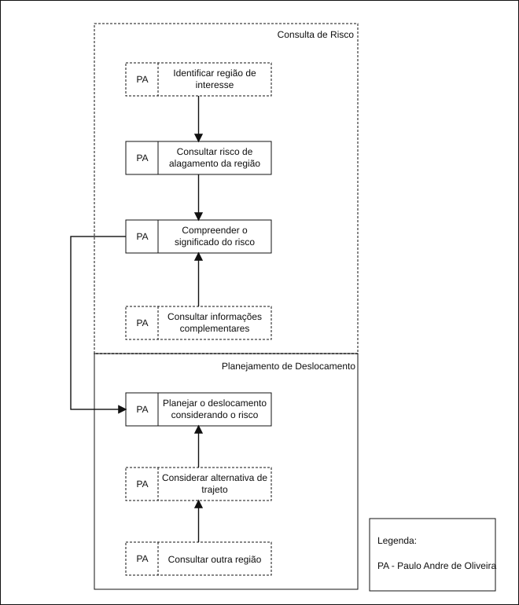
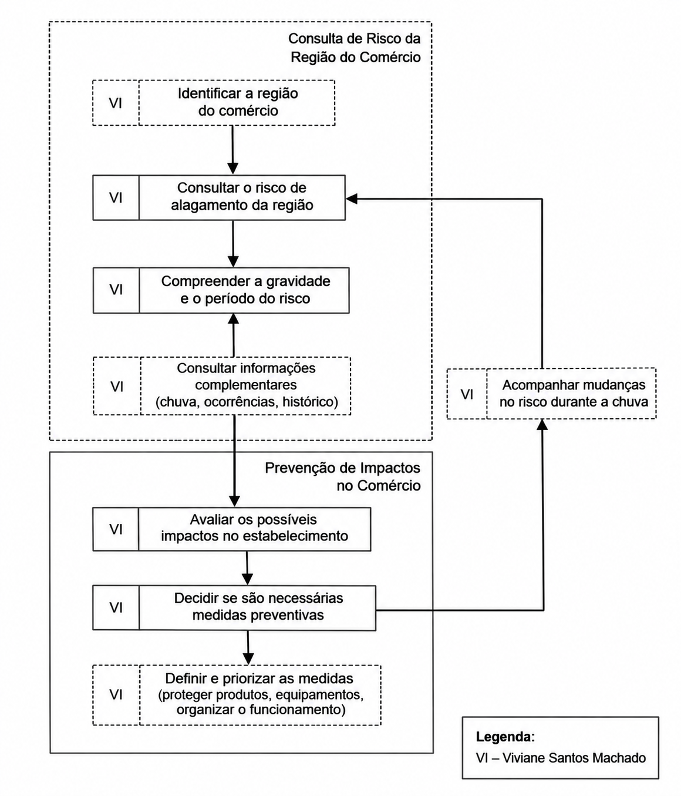

# Entrega 9 — Modelo conceitual e design centrado na comunicação

**Data:** 04/11/2026  
**Status:** 🟨 em andamento  
**Responsabilidade:** soluções individuais, com consolidação da equipe para mapa de objetivos e esquema de signos.  

## Objetivo da atividade

Passar do cenário de problema para uma concepção da interação, explicitando objetivos, tópicos de conversa, falas e signos que a interface deverá comunicar/manipular.

## Transformando resultados técnicos em conceitos compreensíveis

Em TCCs algorítmicos ou orientados a dados, esta entrega deve evitar que a interface exponha apenas estruturas internas do código. Identifique os **conceitos e signos que fazem sentido para o usuário**.

Exemplos:

- `query plan`, custo estimado, recomendação e impacto para um DBA;
- modelo, dataset, versão, execução e métrica para engenheiro de IA;
- período, indicador, grupo, tendência e filtro para gestor/analista;
- alerta, severidade, evidência, responsável e status para analista de segurança.

Se um termo técnico for necessário, modele como será comunicado, explicado e relacionado à tarefa.

Dashboards, relatórios, filtros e CRUDs devem aparecer no modelo conceitual por meio dos **objetivos, signos e conversas** que justificam sua existência.

## 1. Cenários de interação

Para cada cenário de problema, produza uma versão em que a solução já pode ser descrita. **Destaque claramente o texto alterado** em relação ao cenário original.

### CI01 — Planejamento de deslocamento durante chuva intensa

**Autor(a):** Eric Song Watanabe — 22.125.086-3
**Origem:** cenário problema C01

Em um fim de tarde de chuva intensa, Paulo Andre Oliveira está terminando seu expediente no escritório e precisa voltar para casa. Antes de sair, percebe que a chuva aumentou e quer saber se o trajeto que costuma fazer passa por alguma região com risco de alagamento.

**Paulo informa ao sistema a região ou o trajeto que pretende percorrer. O sistema reúne as informações disponíveis e apresenta o risco de alagamento das regiões relacionadas ao seu deslocamento, utilizando uma forma de comunicação que não dependa de conhecimento técnico.**

**Paulo consulta o risco apresentado e informações complementares sobre chuva e ocorrências relacionadas às regiões do trajeto. Caso queira compreender melhor uma determinada região, pode consultar informações adicionais disponíveis sobre ela.**

Como Paulo não possui conhecimento técnico sobre precipitação e risco de alagamentos, **o sistema comunica o significado do risco em linguagem simples e relaciona as informações à região consultada**, permitindo que Paulo compreenda melhor a situação.

**Com essas informações, Paulo avalia se mantém seu trajeto habitual ou se deve considerar outra alternativa. O sistema fornece informações para apoiar a decisão, mas a escolha final permanece com Paulo.**

Dessa forma, Paulo consegue reunir e interpretar as informações necessárias em uma mesma interação, reduzindo a necessidade de consultar diferentes fontes antes de decidir como realizará seu deslocamento.

### Diferenças relevantes

| Alteração | Por que foi necessária | Evidência/artefato que justifica |
|---|---|---|
| As informações sobre chuva, ocorrências e risco passam a ser relacionadas à região ou trajeto de interesse | No cenário problema, Paulo precisava consultar diferentes fontes e tinha dificuldade para relacionar as informações ao trajeto | C01 e análise de tarefas T01 |
| O risco é comunicado em linguagem compreensível para usuários não técnicos | Paulo possui dificuldade para interpretar precipitação, probabilidades e dados técnicos isolados | P01, H04 e C01 |
| A interação permite consultar informações complementares sobre a região | Informações adicionais podem ajudar Paulo a compreender melhor a situação antes de tomar uma decisão | H05 e análises de tarefas |
| O sistema apoia a decisão sem decidir pelo usuário | O objetivo é fornecer informação para que Paulo escolha se mantém ou altera seu planejamento | C01 e modelagens de tarefas |

## 2. Design centrado na comunicação

**Nome do cenário:** CI01 — Planejamento de deslocamento durante chuva intensa

| Tópico > subtópico | Falas e signos envolvidos | Intenção/efeito esperado |
|---|---|---|
| Consultar risco de alagamento | `U: Quero saber o risco de alagamento nas regiões por onde pretendo passar.` / `D: Informe a região ou o trajeto que deseja consultar.` | Permitir que Paulo indique qual local deseja avaliar |
| > identificar região de interesse | `U: Quero consultar esta região.` / `D: Esta é a região selecionada. Vou apresentar as informações disponíveis para ela.` **Signos:** região, localização, trajeto | Confirmar que as informações apresentadas correspondem ao local desejado |
| > compreender risco | `D: O risco estimado para esta região é apresentado junto com uma explicação do seu significado.` / `U: Quero entender se esse risco pode afetar meu deslocamento.` **Signos:** nível de risco, estimativa de risco, região | Permitir que Paulo interprete o resultado sem precisar conhecer conceitos técnicos do modelo |
| > consultar informações complementares | `U: Quero entender melhor a situação desta região.` / `D: Estas são as informações complementares disponíveis sobre chuva e ocorrências relacionadas.` **Signos:** chuva, ocorrência de alagamento, período, região | Oferecer contexto adicional quando necessário, sem tornar toda consulta excessivamente detalhada |
| Planejar deslocamento | `U: Com essas informações, quero decidir se mantenho meu planejamento.` / `D: Estas são as condições identificadas nas regiões consultadas.` | Apoiar a tomada de decisão sem escolher pelo usuário |
| > considerar alternativa | `U: Quero verificar outra região antes de decidir.` / `D: Você pode consultar outra região e comparar as informações apresentadas.` **Signos:** região consultada, nível de risco | Permitir que Paulo obtenha informações sobre alternativas antes de tomar sua decisão |

**Convenção:** `U` = usuário; `D` = preposto do designer/sistema, conforme a abordagem de Engenharia Semiótica adotada na disciplina.

## 3. Mapa de objetivos

Cada integrante apresenta seu mapa e a equipe cria um **mapa consolidado**, eliminando duplicidades e resolvendo conflitos de nomenclatura.

### Dicionário de objetivos

| ID | Objetivo | Persona(s) | Cenário(s) | Prioridade |
|---|---|---|---|---|
| O01 | {{...}} | {{P01}} | {{CI01}} | {{...}} |

## 4. Esquema conceitual de signos

Consolide as informações em **uma tabela única**.

| Grupo | Signo | Origem | Observações/semântica | Tipo de conteúdo | Restrição | Valor padrão | Prevenção | Recuperação |
|---|---|---|---|---|---|---|---|---|
| Credenciais | usuário | domínio | {{...}} | texto | não nulo | — | {{...}} | {{...}} |

### CI02 — {{título}}

**Autor(a):** {{nome — matrícula}}  
**Origem:** cenário problema {{C01}}

{{cenário de interação com alterações marcadas}}

### Diferenças relevantes

| Alteração | Por que foi necessária | Evidência/artefato que justifica |
|---|---|---|
| {{...}} | {{...}} | {{...}} |

## 2. Design centrado na comunicação

**Nome do cenário:** {{CI02}}

| Tópico > subtópico | Falas e signos envolvidos | Intenção/efeito esperado |
|---|---|---|
| {{objetivo}} | `U: ...` / `D: ...` | {{...}} |
| > {{subtópico}} | {{...}} | {{...}} |

**Convenção:** `U` = usuário; `D` = preposto do designer/sistema, conforme a abordagem de Engenharia Semiótica adotada na disciplina.

## 3. Mapa de objetivos

Cada integrante apresenta seu mapa e a equipe cria um **mapa consolidado**, eliminando duplicidades e resolvendo conflitos de nomenclatura.

### Dicionário de objetivos

| ID | Objetivo | Persona(s) | Cenário(s) | Prioridade |
|---|---|---|---|---|
| O01 | {{...}} | {{P01}} | {{CI01}} | {{...}} |

## 4. Esquema conceitual de signos

Consolide as informações em **uma tabela única**.

| Grupo | Signo | Origem | Observações/semântica | Tipo de conteúdo | Restrição | Valor padrão | Prevenção | Recuperação |
|---|---|---|---|---|---|---|---|---|
| Credenciais | usuário | domínio | {{...}} | texto | não nulo | — | {{...}} | {{...}} |

### CI03 — {{título}}

**Autor(a):** {{nome — matrícula}}  
**Origem:** cenário problema {{C01}}

{{cenário de interação com alterações marcadas}}

### Diferenças relevantes

| Alteração | Por que foi necessária | Evidência/artefato que justifica |
|---|---|---|
| {{...}} | {{...}} | {{...}} |

## 2. Design centrado na comunicação

**Nome do cenário:** {{CI03}}

| Tópico > subtópico | Falas e signos envolvidos | Intenção/efeito esperado |
|---|---|---|
| {{objetivo}} | `U: ...` / `D: ...` | {{...}} |
| > {{subtópico}} | {{...}} | {{...}} |

**Convenção:** `U` = usuário; `D` = preposto do designer/sistema, conforme a abordagem de Engenharia Semiótica adotada na disciplina.

## 3. Mapa de objetivos

Cada integrante apresenta seu mapa e a equipe cria um **mapa consolidado**, eliminando duplicidades e resolvendo conflitos de nomenclatura.

### Dicionário de objetivos

| ID | Objetivo | Persona(s) | Cenário(s) | Prioridade |
|---|---|---|---|---|
| O01 | {{...}} | {{P01}} | {{CI01}} | {{...}} |

## 4. Esquema conceitual de signos

Consolide as informações em **uma tabela única**.

| Grupo | Signo | Origem | Observações/semântica | Tipo de conteúdo | Restrição | Valor padrão | Prevenção | Recuperação |
|---|---|---|---|---|---|---|---|---|
| Credenciais | usuário | domínio | {{...}} | texto | não nulo | — | {{...}} | {{...}} |

### CI04 — {{título}}

**Autor(a):** {{nome — matrícula}}  
**Origem:** cenário problema {{C01}}

{{cenário de interação com alterações marcadas}}

### Diferenças relevantes

| Alteração | Por que foi necessária | Evidência/artefato que justifica |
|---|---|---|
| {{...}} | {{...}} | {{...}} |

## 2. Design centrado na comunicação

**Nome do cenário:** {{CI04}}

| Tópico > subtópico | Falas e signos envolvidos | Intenção/efeito esperado |
|---|---|---|
| {{objetivo}} | `U: ...` / `D: ...` | {{...}} |
| > {{subtópico}} | {{...}} | {{...}} |

**Convenção:** `U` = usuário; `D` = preposto do designer/sistema, conforme a abordagem de Engenharia Semiótica adotada na disciplina.

## 3. Mapa de objetivos

Cada integrante apresenta seu mapa e a equipe cria um **mapa consolidado**, eliminando duplicidades e resolvendo conflitos de nomenclatura.

### Dicionário de objetivos

| ID | Objetivo | Persona(s) | Cenário(s) | Prioridade |
|---|---|---|---|---|
| O01 | {{...}} | {{P01}} | {{CI01}} | {{...}} |

## 4. Esquema conceitual de signos

Consolide as informações em **uma tabela única**.

| Grupo | Signo | Origem | Observações/semântica | Tipo de conteúdo | Restrição | Valor padrão | Prevenção | Recuperação |
|---|---|---|---|---|---|---|---|---|
| Credenciais | usuário | domínio | {{...}} | texto | não nulo | — | {{...}} | {{...}} |

### Regras para os signos

- Use o vocabulário do domínio do usuário.
- Evite duplicar o mesmo conceito com nomes diferentes.
- Diferencie informação fornecida pelo usuário, produzida pelo sistema e derivada do domínio.
- Registre prevenção e recuperação apenas quando fizer sentido; explique as siglas usadas.

## Síntese

Quais objetivos/tópicos/signos deverão necessariamente aparecer nos diagramas MoLIC?

## Checklist

- [ ] Cenários de interação mostram alterações em relação aos cenários de problema.
- [ ] Cada solução individual identifica autor e cenário de origem.
- [ ] Tópicos/falas/signos são coerentes com objetivos do usuário.
- [ ] Mapas individuais foram consolidados.
- [ ] O esquema de signos está em uma tabela única e sem duplicações conceituais.
- [ ] Nomes de objetivos/signos serão reutilizados na Entrega 10.
- [ ] Em TCC técnico, signos representam conceitos do domínio compreensíveis ao usuário, não apenas variáveis/estruturas internas.
- [ ] Padrões como dashboard, relatório, filtros, administração e CRUD possuem objetivos e signos correspondentes.
- [ ] A interface comunica não só o resultado técnico, mas também seu significado para a tarefa.
