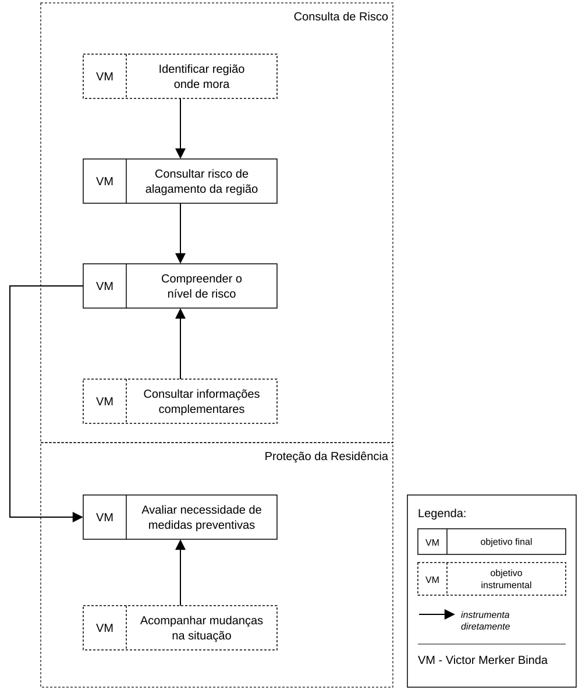

# Entrega 9 — Modelo conceitual e design centrado na comunicação

**Data:** 04/11/2026  
**Status:** 🟨 em andamento  
**Responsabilidade:** soluções individuais, com consolidação da equipe para mapa de objetivos e esquema de signos.  

## Objetivo da atividade

Passar do cenário de problema para uma concepção da interação, explicitando objetivos, tópicos de conversa, falas e signos que a interface deverá comunicar/manipular.

## Transformando resultados técnicos em conceitos compreensíveis

Em TCCs algorítmicos ou orientados a dados, esta entrega deve evitar que a interface exponha apenas estruturas internas do código. Identifique os **conceitos e signos que fazem sentido para o usuário**.

Exemplos:

- `query plan`, custo estimado, recomendação e impacto para um DBA;
- modelo, dataset, versão, execução e métrica para engenheiro de IA;
- período, indicador, grupo, tendência e filtro para gestor/analista;
- alerta, severidade, evidência, responsável e status para analista de segurança.

Se um termo técnico for necessário, modele como será comunicado, explicado e relacionado à tarefa.

Dashboards, relatórios, filtros e CRUDs devem aparecer no modelo conceitual por meio dos **objetivos, signos e conversas** que justificam sua existência.

## 1. Cenários de interação

Para cada cenário de problema, produza uma versão em que a solução já pode ser descrita. **Destaque claramente o texto alterado** em relação ao cenário original.

### CI01 — Planejamento de deslocamento durante chuva intensa

**Autor(a):** Eric Song Watanabe — 22.125.086-3
**Origem:** cenário problema C01

Em um fim de tarde de chuva intensa, Paulo Andre Oliveira está terminando seu expediente no escritório e precisa voltar para casa. Antes de sair, percebe que a chuva aumentou e quer saber se o trajeto que costuma fazer passa por alguma região com risco de alagamento.

**Paulo informa ao sistema a região ou o trajeto que pretende percorrer. O sistema reúne as informações disponíveis e apresenta o risco de alagamento das regiões relacionadas ao seu deslocamento, utilizando uma forma de comunicação que não dependa de conhecimento técnico.**

**Paulo consulta o risco apresentado e informações complementares sobre chuva e ocorrências relacionadas às regiões do trajeto. Caso queira compreender melhor uma determinada região, pode consultar informações adicionais disponíveis sobre ela.**

Como Paulo não possui conhecimento técnico sobre precipitação e risco de alagamentos, **o sistema comunica o significado do risco em linguagem simples e relaciona as informações à região consultada**, permitindo que Paulo compreenda melhor a situação.

**Com essas informações, Paulo avalia se mantém seu trajeto habitual ou se deve considerar outra alternativa. O sistema fornece informações para apoiar a decisão, mas a escolha final permanece com Paulo.**

Dessa forma, Paulo consegue reunir e interpretar as informações necessárias em uma mesma interação, reduzindo a necessidade de consultar diferentes fontes antes de decidir como realizará seu deslocamento.

### Diferenças relevantes

| Alteração | Por que foi necessária | Evidência/artefato que justifica |
|---|---|---|
| As informações sobre chuva, ocorrências e risco passam a ser relacionadas à região ou trajeto de interesse | No cenário problema, Paulo precisava consultar diferentes fontes e tinha dificuldade para relacionar as informações ao trajeto | C01 e análise de tarefas T01 |
| O risco é comunicado em linguagem compreensível para usuários não técnicos | Paulo possui dificuldade para interpretar precipitação, probabilidades e dados técnicos isolados | P01, H04 e C01 |
| A interação permite consultar informações complementares sobre a região | Informações adicionais podem ajudar Paulo a compreender melhor a situação antes de tomar uma decisão | H05 e análises de tarefas |
| O sistema apoia a decisão sem decidir pelo usuário | O objetivo é fornecer informação para que Paulo escolha se mantém ou altera seu planejamento | C01 e modelagens de tarefas |

## 2. Design centrado na comunicação

**Nome do cenário:** CI01 — Planejamento de deslocamento durante chuva intensa

| Tópico > subtópico | Falas e signos envolvidos | Intenção/efeito esperado |
|---|---|---|
| Consultar risco de alagamento | `U: Quero saber o risco de alagamento nas regiões por onde pretendo passar.` / `D: Informe a região ou o trajeto que deseja consultar.` | Permitir que Paulo indique qual local deseja avaliar |
| > identificar região de interesse | `U: Quero consultar esta região.` / `D: Esta é a região selecionada. Vou apresentar as informações disponíveis para ela.` **Signos:** região, localização, trajeto | Confirmar que as informações apresentadas correspondem ao local desejado |
| > compreender risco | `D: O risco estimado para esta região é apresentado junto com uma explicação do seu significado.` / `U: Quero entender se esse risco pode afetar meu deslocamento.` **Signos:** nível de risco, estimativa de risco, região | Permitir que Paulo interprete o resultado sem precisar conhecer conceitos técnicos do modelo |
| > consultar informações complementares | `U: Quero entender melhor a situação desta região.` / `D: Estas são as informações complementares disponíveis sobre chuva e ocorrências relacionadas.` **Signos:** chuva, ocorrência de alagamento, período, região | Oferecer contexto adicional quando necessário, sem tornar toda consulta excessivamente detalhada |
| Planejar deslocamento | `U: Com essas informações, quero decidir se mantenho meu planejamento.` / `D: Estas são as condições identificadas nas regiões consultadas.` | Apoiar a tomada de decisão sem escolher pelo usuário |
| > considerar alternativa | `U: Quero verificar outra região antes de decidir.` / `D: Você pode consultar outra região e comparar as informações apresentadas.` **Signos:** região consultada, nível de risco | Permitir que Paulo obtenha informações sobre alternativas antes de tomar sua decisão |

**Convenção:** `U` = usuário; `D` = preposto do designer/sistema, conforme a abordagem de Engenharia Semiótica adotada na disciplina.

## 3. Mapa de objetivos

Cada integrante apresenta seu mapa e a equipe cria um **mapa consolidado**, eliminando duplicidades e resolvendo conflitos de nomenclatura.

### Dicionário de objetivos

| ID | Objetivo | Persona(s) | Cenário(s) | Prioridade |
|---|---|---|---|---|
| O01 | Planejar o deslocamento considerando o risco | P01 | CI01 | Alta |
| O02 | Consultar o risco de alagamento da região | P01 | CI01 | Alta |
| O03 | Compreender o significado do risco | P01 | CI01 | Alta |
| O04 | Identificar a região de interesse | P01 | CI01 | Alta |
| O05 | Consultar informações complementares | P01 | CI01 | Média |
| O06 | Considerar alternativa de trajeto | P01 | CI01 | Média |
| O07 | Consultar outra região | P01 | CI01 | Média |

## 4. Esquema conceitual de signos

| Grupo | Signo | Origem | Observações/semântica | Tipo de conteúdo | Restrição | Valor padrão | Prevenção | Recuperação |
|---|---|---|---|---|---|---|---|---|
| Localização | região | domínio | Área da cidade que o usuário deseja consultar | texto/localização | Deve corresponder a uma região válida | — | PA: permitir apenas regiões reconhecidas pelo sistema | RA: informar quando a região não for encontrada e permitir nova consulta |
| Localização | trajeto | usuário | Deslocamento que Paulo pretende realizar entre origem e destino | localização | Deve possuir origem e destino válidos | — | PP: explicar quais dados são necessários para identificar o trajeto | RA: permitir corrigir origem ou destino |
| Risco | nível de risco | sistema | Forma simplificada de comunicar a condição de risco de alagamento | categórico | Deve estar associado a uma região e período | — | PP: explicar o significado dos níveis apresentados | — |
| Risco | estimativa de risco | sistema | Resultado estimado para representar a possibilidade de alagamento | percentual/probabilidade | Deve estar dentro da faixa válida produzida pelo sistema | — | PP: apresentar explicação em linguagem simples | — |
| Condições | chuva | domínio/sistema | Informação de chuva relacionada à região consultada | numérico/textual | Deve estar associada a local e período | — | PP: apresentar unidade e significado de forma compreensível | — |
| Alagamento | ocorrência de alagamento | domínio | Registro de alagamento associado a uma região | registro | Deve possuir localização e período relacionados | — | — | — |
| Consulta | informações complementares | sistema/domínio | Dados adicionais utilizados para ajudar Paulo a compreender a situação | conjunto de informações | Devem estar relacionadas à região consultada | — | PP: apresentar apenas informações relevantes e explicadas | — |
| Planejamento | alternativa de trajeto | usuário | Possibilidade considerada por Paulo quando deseja evitar uma região de maior risco | localização/trajeto | Deve representar uma alternativa válida de deslocamento | — | — | RA: permitir realizar uma nova consulta caso a alternativa não seja adequada |

**Legenda de prevenção e recuperação:**

- `PP` — Prevenção passiva: o sistema fornece explicações para evitar erros de interpretação.
- `PA` — Prevenção ativa: o sistema impede entradas inválidas.
- `RA` — Recuperação apoiada: o sistema informa o problema e ajuda o usuário a corrigi-lo.

### CI02 — Prevenção de impactos no comércio durante chuva intensa

**Autor(a):** Rafael Iamashita Becsei - 22.225.037-5  
**Origem:** cenário problema C02  

Em um dia de previsão de chuva intensa, Viviane Santos Machado está em seu pequeno comércio e percebe que o tempo começou a mudar. Como sua região costuma sofrer com alagamentos durante períodos de chuva forte, ela se preocupa com os possíveis impactos no funcionamento do estabelecimento e com seus produtos e equipamentos.

**Antes que a chuva fique mais intensa, Viviane consulta no sistema a região onde está localizado seu comércio. O sistema identifica a região consultada e apresenta o risco estimado de alagamento, relacionando as informações disponíveis às condições daquele local.**

Como Viviane não possui conhecimento técnico sobre precipitação ou modelos de risco, o sistema apresenta o nível de risco acompanhado de uma explicação em linguagem simples, permitindo que ela compreenda melhor a gravidade da situação sem precisar interpretar dados técnicos isolados.

**Caso precise de mais informações, Viviane pode consultar dados complementares sobre a chuva e ocorrências de alagamento na região, considerando a situação antes de tomar uma decisão.**

**Com essas informações, Viviane avalia se precisa adotar medidas preventivas, como proteger produtos e equipamentos, reorganizar itens vulneráveis ou se preparar para uma possível interrupção das atividades. A decisão sobre quais medidas tomar continua sendo dela.**

**Durante a chuva, Viviane também pode realizar novas consultas para acompanhar possíveis mudanças no risco e reconsiderar as medidas adotadas. Dessa forma, consegue se preparar com mais informações e reduzir a incerteza sobre os possíveis impactos no comércio.**

### Diferenças relevantes

| Alteração | Por que foi necessária | Evidência/artefato que justifica |
|---|---|---|
| Consulta do risco associada à região do comércio | Viviane tinha dificuldade para relacionar informações gerais sobre chuva ao local do estabelecimento | C02, P03 e R02 |
| Apresentação do risco em linguagem simples | Viviane não possui conhecimento técnico para interpretar dados meteorológicos isolados | C02, H01 e H04 |
| Disponibilização de informações complementares | Informações sobre chuva e ocorrências podem ajudar a compreender melhor a situação | C02 e H05 |
| Apoio à decisão sobre medidas preventivas | Viviane precisa decidir como proteger produtos e equipamentos sem comprometer desnecessariamente as atividades | C02 e questões de refinamento Q3, Q4 e Q5 |
| Possibilidade de consultar novamente o risco | As condições podem mudar durante a chuva e exigir uma nova avaliação | C02 e questão de refinamento Q6 |

## 2. Design centrado na comunicação

**Nome do cenário:** CI02 — Prevenção de impactos no comércio durante chuva intensa

| Tópico > subtópico | Falas e signos envolvidos | Intenção/efeito esperado |
|---|---|---|
| Consultar risco na região do comércio | `U: Quero saber se a região do meu comércio apresenta risco de alagamento` / `D: Informe a região que deseja consultar` | Permitir que Viviane consulte o risco associado ao estabelecimento |
| > identificar a região | `U: Quero verificar o local onde está meu comércio` / `D: Esta é a região selecionada para consulta` Signos: região, localização, comércio | Confirmar que as informações correspondem à região desejada. |
| > compreender o risco | `U: Quero entender a gravidade do risco apresentado` / `D: Este é o nível de risco estimado para a região e seu significado` Signos: nível de risco, estimativa de risco, região | Facilitar a interpretação sem exigir conhecimento técnico |
| > consultar informações complementares | `U: Quero saber mais sobre as condições da região` / `D: Estas são as informações disponíveis sobre chuva e ocorrências de alagamento` Signos: chuva, ocorrência, período | Oferecer informações adicionais para apoiar a avaliação |
| Avaliar medidas preventivas | `U: Preciso decidir se devo proteger meus produtos e equipamentos` / `D: Estas são as condições de risco identificadas para a região consultada` | Apoiar a decisão de Viviane sem determinar as medidas que ela deve tomar |
| > acompanhar mudanças no risco | `U: Quero verificar se as condições mudaram desde a última consulta` / `D: Estas são as informações disponíveis para a região neste momento` Signos: região, nível de risco, período da consulta | Permitir que Viviane reavalie a situação durante a chuva |

**Convenção:** `U` = usuário; `D` = preposto do designer/sistema, conforme a abordagem de Engenharia Semiótica adotada na disciplina.

## 3. Mapa de objetivos

Cada integrante apresenta seu mapa e a equipe cria um **mapa consolidado**, eliminando duplicidades e resolvendo conflitos de nomenclatura.

### Dicionário de objetivos

| ID | Objetivo | Persona(s) | Cenário(s) | Prioridade |
|---|---|---|---|---|
| O01 | Avaliar o risco de alagamento para prevenir impactos no comércio | P03 | CI02 | Alta |
| O02 | Identificar a região onde está localizado o comércio | P03 | CI02 | Alta |
| O03 | Consultar o risco de alagamento da região | P03 | CI02 | Alta |
| O04 | Compreender a gravidade e o período do risco | P03 | CI02 | Alta |
| O05 | Consultar informações complementares sobre chuva e ocorrências | P03 | CI02 | Média |
| O06 | Avaliar os possíveis impactos no estabelecimento | P03 | CI02 | Alta |
| O07 | Decidir se são necessárias medidas preventivas | P03 | CI02 | Alta |
| O08 | Definir e priorizar medidas para proteger produtos, equipamentos e o funcionamento do comércio | P03 | CI02 | Média |
| O09 | Acompanhar mudanças no risco durante a chuva | P03 | CI02 | Média |

## 4. Esquema conceitual de signos

Consolide as informações em **uma tabela única**.

| Grupo | Signo | Origem | Observações/semântica | Tipo de conteúdo | Restrição | Valor padrão | Prevenção | Recuperação |
|---|---|---|---|---|---|---|---|---|
| Localização | Região consultada | Domínio | Identifica a região do comércio para a qual o risco será apresentado | Texto / localização | Deve corresponder a uma região válida. | — | PP: mostrar claramente o nome da região consultada | RA: permitir selecionar outra região |
| Risco | Nível de risco | Domínio | Indica a classificação do risco estimado de alagamento na região | Categoria | Utilizar os níveis definidos pelo sistema | — | PP: apresentar o nível acompanhado de uma explicação simples | RA: informar quando não houver dados disponíveis |
| Risco | Período de referência do risco | Domínio | Indica a qual momento ou intervalo a estimativa de risco se refere | Data / hora / período | Deve estar associado à estimativa apresentada | — | PP: identificar o período para evitar interpretações incorretas | RA: informar quando o período não estiver disponível |
| Clima | Informações de chuva | Domínio | Apresenta dados de chuva que ajudam a compreender as condições da região | Dados meteorológicos | Informar unidade e período dos dados | — | PP: apresentar unidades e descrições compreensíveis | RA: informar a indisponibilidade dos dados |
| Histórico | Ocorrências de alagamento | Domínio | Registros anteriores que podem complementar a avaliação da região | Registros históricos | Associar cada ocorrência a uma região e período | — | PP: diferenciar ocorrências passadas de riscos futuros | RA: indicar quando não houver registros disponíveis |
| Consulta | Atualização das informações | Interface | Indica quando as informações de risco foram atualizadas | Data e hora | Deve representar a atualização dos dados exibidos | — | PP: mostrar a referência temporal dos dados | RA: avisar quando não houver informação de atualização |

### CI03 — Preparação do morador durante previsão de chuva intensa

**Autor(a):** Victor Pimentel Lario — 22.125.064-0  
**Origem:** cenário problema C03

Em um dia com previsão de chuva intensa, Victor Merker Binda está em casa acompanhando as notícias sobre as condições do tempo. Como mora em uma região que pode sofrer impactos durante períodos de chuva forte, ele começa a se preocupar com a possibilidade de ocorrer algum alagamento ou inundação próximo à sua residência.

**Victor acessa o sistema pelo celular e informa a região onde mora. O sistema apresenta o risco estimado de alagamento da região, reunindo as informações disponíveis de forma simples e organizada.**

Como possui apenas conhecimentos básicos sobre chuvas e alagamentos, **Victor consulta o nível de risco e uma explicação em linguagem simples sobre seu significado, sem precisar interpretar dados técnicos.**

**Caso queira compreender melhor a situação, pode consultar informações complementares sobre a chuva e ocorrências de alagamento na região.**

**Com essas informações, Victor avalia se precisa tomar medidas preventivas, como proteger objetos e equipamentos, verificar pontos vulneráveis da residência ou continuar acompanhando a situação.**

**Durante a chuva, Victor também pode realizar novas consultas para verificar possíveis mudanças nas condições da região.** Dessa forma, consegue tomar decisões mais informadas sobre a proteção de sua casa e de seus bens.

### Diferenças relevantes

| Alteração | Por que foi necessária | Evidência/artefato que justifica |
|---|---|---|
| Consulta do risco específico da região onde mora | Victor tinha dificuldade para relacionar informações gerais de chuva à sua região | C03, P02 e R03 |
| Explicações em linguagem simples | Victor possui dificuldade para interpretar dados técnicos | P02 e H04 |
| Informações complementares sobre chuva e alagamentos | Ajudam a compreender melhor a situação | H05 e C03 |
| Apoio à decisão sobre medidas preventivas | Victor precisa decidir se deve proteger sua residência | C03 e P02 |
| Possibilidade de realizar novas consultas | As condições podem mudar durante a chuva | C03 e Q6 |

## 2. Design centrado na comunicação

**Nome do cenário:** CI03 — Preparação do morador durante previsão de chuva intensa

| Tópico > subtópico | Falas e signos envolvidos | Intenção/efeito esperado |
|---|---|---|
| Consultar risco de alagamento | `U: Quero saber se minha região apresenta risco de alagamento.` / `D: Informe a região que deseja consultar.` | Permitir a consulta do risco |
| > identificar região | `U: Quero consultar onde moro.` / `D: Esta é a região selecionada.` **Signos:** região, localização | Confirmar o local consultado |
| > compreender risco | `D: Este é o risco estimado e seu significado.` / `U: Quero entender a gravidade da situação.` **Signos:** nível de risco, estimativa de risco | Facilitar a compreensão |
| > consultar informações complementares | `U: Quero mais informações sobre a chuva.` / `D: Estas são as informações disponíveis.` **Signos:** chuva, ocorrências, período | Complementar a avaliação |
| Avaliar medidas preventivas | `U: Preciso decidir se devo proteger minha casa.` / `D: Estas são as condições identificadas para sua região.` | Apoiar a decisão do morador |
| > acompanhar situação | `U: Quero verificar se o risco mudou.` / `D: Estas são as informações disponíveis para a nova consulta.` **Signos:** nível de risco, período | Permitir reavaliar a situação |

**Convenção:** `U` = usuário; `D` = preposto do designer/sistema.

## 3. Mapa de objetivos

Cada integrante apresenta seu mapa e a equipe cria um mapa consolidado, eliminando duplicidades.

### Dicionário de objetivos

| ID | Objetivo | Persona(s) | Cenário(s) | Prioridade |
|---|---|---|---|---|
| O01 | Avaliar necessidade de medidas preventivas | P02 | CI03 | Alta |
| O02 | Consultar risco de alagamento | P02 | CI03 | Alta |
| O03 | Identificar região onde mora | P02 | CI03 | Alta |
| O04 | Compreender nível de risco | P02 | CI03 | Alta |
| O05 | Consultar informações complementares | P02 | CI03 | Média |
| O06 | Acompanhar mudanças na situação | P02 | CI03 | Média |

## 4. Esquema conceitual de signos

| Grupo | Signo | Origem | Observações/semântica | Tipo de conteúdo | Restrição | Valor padrão | Prevenção | Recuperação |
|---|---|---|---|---|---|---|---|---|
| Localização | região | usuário | Local onde Victor mora | texto/localização | Região válida | — | PA: sugerir regiões válidas | RA: permitir nova busca |
| Risco | nível de risco | sistema | Classificação simplificada do risco | categórico | Associado à região e ao período | — | PP: explicar os níveis | — |
| Risco | estimativa de risco | sistema | Possibilidade estimada de alagamento | percentual | Valor válido | — | PP: explicar o significado | — |
| Condições | chuva | domínio/sistema | Condições de chuva da região | numérico/textual | Local e período definidos | — | PP: explicar unidades | — |
| Alagamento | ocorrência de alagamento | domínio | Registro de alagamento próximo | registro | Local e período identificados | — | — | — |
| Consulta | período | sistema | Referência temporal das informações | data/hora | Data válida | Consulta atual | PP: mostrar referência temporal | — |
| Prevenção | medidas preventivas | usuário | Ações consideradas para proteger a residência | texto | — | — | — | — |

**Legenda:**

- `PP` — Prevenção passiva: apresenta explicações para evitar interpretações incorretas.
- `PA` — Prevenção ativa: impede entradas inválidas.
- `RA` — Recuperação apoiada: ajuda o usuário a corrigir erros.

### CI04 — {{título}}

**Autor(a):** {{nome — matrícula}}  
**Origem:** cenário problema {{C01}}

{{cenário de interação com alterações marcadas}}

### Diferenças relevantes

| Alteração | Por que foi necessária | Evidência/artefato que justifica |
|---|---|---|
| {{...}} | {{...}} | {{...}} |

## 2. Design centrado na comunicação

**Nome do cenário:** {{CI04}}

| Tópico > subtópico | Falas e signos envolvidos | Intenção/efeito esperado |
|---|---|---|
| {{objetivo}} | `U: ...` / `D: ...` | {{...}} |
| > {{subtópico}} | {{...}} | {{...}} |

**Convenção:** `U` = usuário; `D` = preposto do designer/sistema, conforme a abordagem de Engenharia Semiótica adotada na disciplina.

## 3. Mapa de objetivos

Cada integrante apresenta seu mapa e a equipe cria um **mapa consolidado**, eliminando duplicidades e resolvendo conflitos de nomenclatura.

### Dicionário de objetivos

| ID | Objetivo | Persona(s) | Cenário(s) | Prioridade |
|---|---|---|---|---|
| O01 | {{...}} | {{P01}} | {{CI01}} | {{...}} |

## 4. Esquema conceitual de signos

Consolide as informações em **uma tabela única**.

| Grupo | Signo | Origem | Observações/semântica | Tipo de conteúdo | Restrição | Valor padrão | Prevenção | Recuperação |
|---|---|---|---|---|---|---|---|---|
| Credenciais | usuário | domínio | {{...}} | texto | não nulo | — | {{...}} | {{...}} |

### Regras para os signos

- Use o vocabulário do domínio do usuário.
- Evite duplicar o mesmo conceito com nomes diferentes.
- Diferencie informação fornecida pelo usuário, produzida pelo sistema e derivada do domínio.
- Registre prevenção e recuperação apenas quando fizer sentido; explique as siglas usadas.

## Síntese

Quais objetivos/tópicos/signos deverão necessariamente aparecer nos diagramas MoLIC?

## Checklist

- [ ] Cenários de interação mostram alterações em relação aos cenários de problema.
- [ ] Cada solução individual identifica autor e cenário de origem.
- [ ] Tópicos/falas/signos são coerentes com objetivos do usuário.
- [ ] Mapas individuais foram consolidados.
- [ ] O esquema de signos está em uma tabela única e sem duplicações conceituais.
- [ ] Nomes de objetivos/signos serão reutilizados na Entrega 10.
- [ ] Em TCC técnico, signos representam conceitos do domínio compreensíveis ao usuário, não apenas variáveis/estruturas internas.
- [ ] Padrões como dashboard, relatório, filtros, administração e CRUD possuem objetivos e signos correspondentes.
- [ ] A interface comunica não só o resultado técnico, mas também seu significado para a tarefa.
