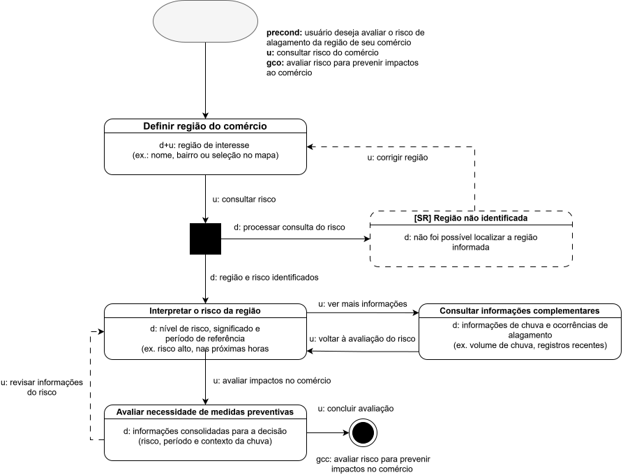
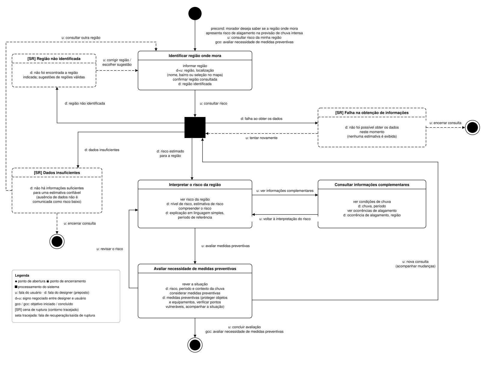

# Entrega 10 — MoLIC

**Data:** 11/11/2026  
**Status:** 🟨 em andamento  
**Responsabilidade:** 1 solução completa por integrante

## Objetivo da atividade

Modelar a interação como uma **conversa entre usuário e preposto do designer**, oferecendo visão global dos caminhos que permitem ao usuário atingir seus objetivos — incluindo alternativas e rupturas relevantes. MoLIC não deve ser reduzida a um fluxograma de telas.

> Use a **notação MoLIC ensinada na disciplina**. Este template foca critérios de qualidade e não substitui a legenda/notação apresentada em aula.

## Atenção a TCCs sem interface original

O MoLIC não modela o algoritmo por dentro. Ele modela a **conversa de interação necessária para que uma pessoa use a contribuição**.

Exemplos de conversas:

- usuário escolhe dados/parâmetros → sistema valida → usuário inicia análise → sistema comunica processamento → usuário interpreta resultado;
- usuário consulta histórico → refina filtros → abre execução → compara com outra;
- administrador seleciona perfil → altera permissão → sistema comunica consequências → administrador confirma/cancela;
- analista recebe alerta → examina evidências → classifica ocorrência → registra decisão.

Modele também rupturas plausíveis: entrada inválida, falha de processamento, ausência de resultado, permissão insuficiente, filtro sem resultados, conflito de alteração, cancelamento ou necessidade de recuperação.

## M01 — Planejamento de deslocamento durante chuva intensa

**Autor(a):** Eric Song Watanabe — 22.125.086-3  
**Cenário de interação de origem:** Planejamento de deslocamento durante chuva intensa  
**Objetivo(s):** O01 — Planejar o deslocamento considerando o risco; O02 — Consultar o risco de alagamento da região; O03 — Compreender o significado do risco  
**Tarefa(s) relacionada(s):** T01 — Consultar e interpretar o risco de alagamento de uma região para planejar o deslocamento  
**Signos relevantes:** região, trajeto, nível de risco, estimativa de risco, chuva, ocorrência de alagamento, informações complementares e alternativa de trajeto

### Diagrama

**Fonte editável:** [molic_m01.drawio](../assets/10_molic/molic_m01.drawio)

### Leitura do diagrama

Explique em texto o caminho principal e pelo menos os caminhos alternativos/rupturas mais importantes.

#### Caminho principal

1. A conversa começa quando Paulo deseja consultar o risco de alagamento relacionado ao seu deslocamento.
2. Paulo informa a região ou trajeto que deseja consultar.
3. O sistema processa a consulta e apresenta o risco calculado para a região.
4. Paulo analisa o nível de risco e seu significado.
5. Caso queira mais contexto, pode consultar informações complementares sobre chuva e ocorrências de alagamento.
6. Após compreender a situação, Paulo segue para o planejamento do deslocamento.
7. Se decidir manter o planejamento atual, a conversa é encerrada com o objetivo concluído.

#### Alternativas e rupturas

| Situação | Onde ocorre | Como o usuário percebe | Caminho de recuperação/saída |
|---|---|---|---|
| Região ou trajeto não identificado | Durante o processamento da consulta | O sistema informa que não foi possível identificar a região ou trajeto informado | Paulo revisa os dados da consulta e tenta novamente |
| Usuário precisa de mais informações | Após visualizar o risco da região | Paulo percebe que precisa de mais contexto para compreender a situação  | Consulta informações complementares sobre chuva e ocorrências e depois retorna à análise do risco |
| Usuário considera outro trajeto | Durante o planejamento do deslocamento | Paulo decide que deseja avaliar uma alternativa antes de concluir | Retorna à consulta de risco, informa outra região ou trajeto e realiza uma nova análise |

## M02 — Prevenção de impactos no comércio durante chuva intensa

**Autor(a):** Rafael Iamashita Becsei - 22.225.037-5  
**Cenário de interação de origem:** CI02 — Prevenção de impactos no comércio durante chuva intensa  
**Objetivo(s):** Avaliar o risco de alagamento na região do comércio; compreender sua gravidade e seu período; decidir sobre medidas preventivas      
**Tarefa(s) relacionada(s):** Consultar e interpretar o risco de alagamento da região para avaliar medidas preventivas 
**Signos relevantes:** região consultada, nível de risco, período de referência, informações de chuva e ocorrências de alagamento

### Diagrama

**Fonte editável:** [molic_m02.drawio](../assets/10_molic/molic_m02.drawio)

### Leitura do diagrama

Explique em texto o caminho principal e pelo menos os caminhos alternativos/rupturas mais importantes.

#### Caminho principal

1. A conversa começa quando Viviane deseja consultar o risco de alagamento na região onde está localizado seu comércio.
2. Viviane informa ou seleciona a região de interesse, utilizando o nome, bairro ou mapa.
3. O sistema processa a consulta e, quando a região é identificada, apresenta o nível de risco, seu significado e o período de referência.
4. Viviane interpreta as informações apresentadas e avalia como o risco pode afetar seu estabelecimento.
5. Caso precise de mais informações, pode consultar dados complementares sobre chuva e ocorrências de alagamento, retornando depois à interpretação do risco.
6. Com base nas informações disponíveis, Viviane avalia a necessidade de adotar medidas preventivas para proteger produtos, equipamentos e o funcionamento do comércio.
7. Após concluir sua avaliação, a conversa é encerrada com o objetivo alcançado.

#### Alternativas e rupturas

| Situação | Onde ocorre | Como o usuário percebe | Caminho de recuperação/saída |
|---|---|---|---|
| Região do comércio não identificada | Durante a definição da região consultada | O sistema informa que não conseguiu localizar a região solicitada | Viviane retorna à definição da região, corrige o nome ou seleciona uma região pelo mapa, realizando uma nova consulta |
| Necessidade de informações complementares | Após visualizar o risco da região | Viviane percebe que precisa de mais informações para compreender a situação | Consulta informações sobre chuva e ocorrências de alagamento e retorna à interpretação do risco |
| Necessidade de revisar o risco | Durante a avaliação de medidas preventivas | Viviane considera necessário analisar novamente as informações antes de decidir | Retorna à interpretação do risco e reavalia a situação |

## M03 — Preparação do morador durante previsão de chuva intensa

**Autor(a):** Victor Pimentel Lario — 22.125.064-0  
**Cenário de interação de origem:** CI03 — Preparação do morador durante previsão de chuva intensa  
**Objetivo(s):** O01 — Avaliar necessidade de medidas preventivas; O02 — Consultar risco de alagamento; O03 — Identificar região onde mora; O04 — Compreender nível de risco; O05 — Consultar informações complementares; O06 — Acompanhar mudanças na situação  
**Tarefa(s) relacionada(s):** Consultar o risco de alagamento da região onde mora, interpretar seu significado e avaliar a necessidade de proteger a residência.  
**Persona:** P02 — Victor Merker Binda  
**Signos relevantes:** região, localização, nível de risco, estimativa de risco, chuva, ocorrência de alagamento, período e medidas preventivas

### Diagrama

**Fonte editável:** [molic_m03.drawio](../assets/10_molic/molic_m03.drawio)

### Leitura do diagrama

#### Caminho principal

1. A conversa começa quando Victor Merker Binda deseja saber se a região onde mora apresenta risco de alagamento durante a previsão de chuva intensa.
2. Victor informa ou seleciona a região de sua residência, e o sistema confirma qual região será consultada.
3. O sistema consulta as informações disponíveis para a região e apresenta o nível e a estimativa de risco, com uma explicação em linguagem simples e indicação do período de referência.
4. Victor interpreta o risco para compreender a gravidade da situação, sem precisar de conhecimento técnico.
5. Se precisar de mais contexto, consulta informações complementares sobre chuva e ocorrências de alagamento e pode retornar à interpretação do risco.
6. Com base nas informações apresentadas, Victor avalia se precisa proteger objetos e equipamentos, verificar pontos vulneráveis da residência ou continuar acompanhando a situação. A decisão é do próprio morador.
7. Ao concluir sua avaliação, a conversa é encerrada com o objetivo alcançado. Durante a chuva, Victor também pode realizar uma nova consulta para verificar mudanças nas condições da região.

#### Alternativas e rupturas

| Situação | Onde ocorre | Como o usuário percebe | Caminho de recuperação/saída |
|---|---|---|---|
| Região não identificada | Ao selecionar a região onde mora | O sistema informa que não encontrou a região indicada | Victor corrige o nome, escolhe uma sugestão válida e refaz a consulta |
| Falha na obtenção de informações | Durante a consulta do risco | O sistema informa que não foi possível obter os dados naquele momento | Victor tenta novamente ou encerra a consulta, sem receber uma estimativa incorreta |
| Dados insuficientes para estimar o risco | Após consultar as informações disponíveis | O sistema explica que não há informações suficientes para apresentar uma estimativa confiável | Victor pode consultar outra região ou encerrar a conversa; a ausência de dados não é comunicada como risco baixo |
| Necessidade de compreender melhor o risco | Após visualizar o resultado | Victor percebe que precisa de mais informações sobre chuva e ocorrências | Consulta informações complementares e retorna à interpretação do risco |
| Mudanças durante a chuva | Após avaliar as medidas preventivas | Victor deseja conferir se o risco foi atualizado | Solicita uma nova consulta, visualiza as informações disponíveis e reavalia sua decisão |

**Observação de modelagem:** O MoLIC representa a conversa do morador com o sistema, incluindo retornos e rupturas. Não representa o funcionamento interno do modelo de previsão. Os casos de falha e dados insuficientes são caminhos de recuperação propostos para a interface, coerentes com o objetivo de comunicar o risco com clareza.

## M04 — {{nome do cenário/objetivo}}

**Autor(a):** {{nome — matrícula}}  
**Cenário de interação de origem:** {{CI04}}  
**Objetivo(s):** {{O04}}  
**Tarefa(s) relacionada(s):** {{T04}}  
**Signos relevantes:** {{...}}

### Diagrama

**Fonte editável:** {{adicione aqui o link para o arquivo `.drawio`, `.svg` editável ou outro formato utilizado pela equipe}}

### Leitura do diagrama

Explique em texto o caminho principal e pelo menos os caminhos alternativos/rupturas mais importantes.

#### Caminho principal

1. {{ponto de abertura → cena...}}
2. {{...}}

#### Alternativas e rupturas

| Situação | Onde ocorre | Como o usuário percebe | Caminho de recuperação/saída |
|---|---|---|---|
| {{dado inválido}} | {{...}} | {{fala/feedback}} | {{...}} |

### Checklist específico de modelagem

- [ ] Existe **ponto de abertura** coerente com o início do objetivo.
- [ ] As **cenas de conversa** representam tópicos/assuntos, não nomes de páginas apenas.
- [ ] As transições/falas deixam claro o que o usuário ou o sistema comunica.
- [ ] Há **ponto(s) de encerramento** para objetivos concluídos/abandonados quando aplicável.
- [ ] Processamentos do sistema estão representados conforme a notação adotada em aula, sem “inventar” fala do usuário.
- [ ] Rupturas (breakdowns) relevantes têm feedback e caminho de recuperação, não becos sem saída.
- [ ] Acessos ubíquos/atalhos só aparecem quando semanticamente justificáveis.
- [ ] O diagrama cobre caminhos alternativos importantes, e não apenas o “happy path”.
- [ ] Nomes de objetivos, tópicos e signos são coerentes com a Entrega 9.
- [ ] O diagrama é legível em tamanho normal no GitHub.
- [ ] O MoLIC representa a conversa usuário–sistema, não o fluxo interno do algoritmo.
- [ ] Processamento, filtros, administração, relatórios e históricos incluem retornos/rupturas quando relevantes.

> Repita M02, M03... para todos os integrantes.

## Consolidação da equipe

### Cobertura dos objetivos

| Objetivo | MoLIC que cobre | Lacunas/duplicidades | Decisão |
|---|---|---|---|
| O01 | M01 | {{...}} | {{...}} |

### Preparação para o Figma

Liste os estados/telas que serão necessários **a partir das conversas modeladas**, incluindo feedback, confirmação, erro e recuperação.

## Erros frequentes a evitar

- desenhar apenas caixas com nomes de telas e setas de navegação;
- não modelar falhas, cancelamento, volta ou recuperação;
- usar rótulos genéricos (“Tela 1”, “Processo 2”) sem tópico de conversa;
- criar no Figma fluxos que não existem no MoLIC;
- diagrama sem legenda/fonte editável e com texto ilegível.
