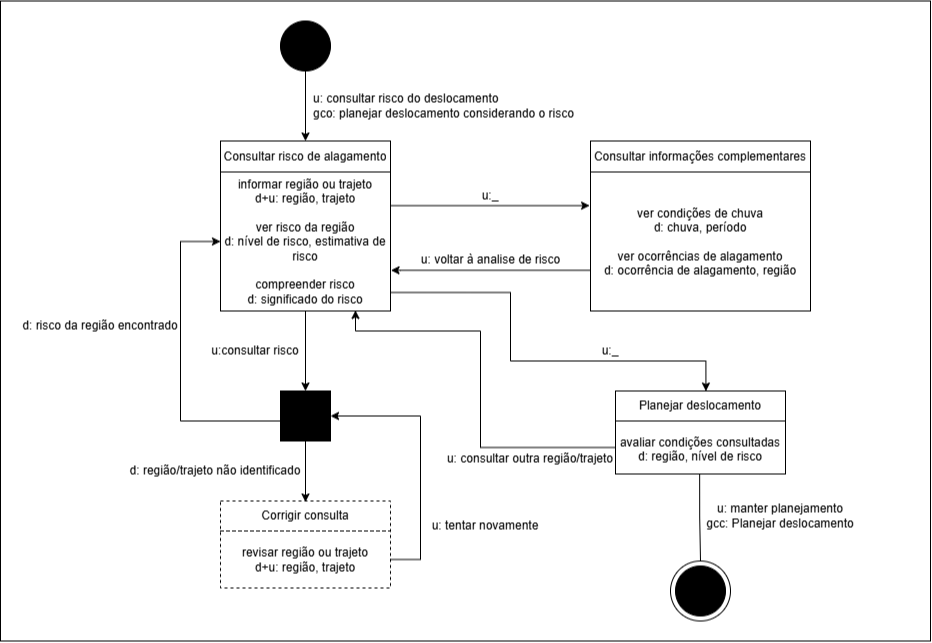
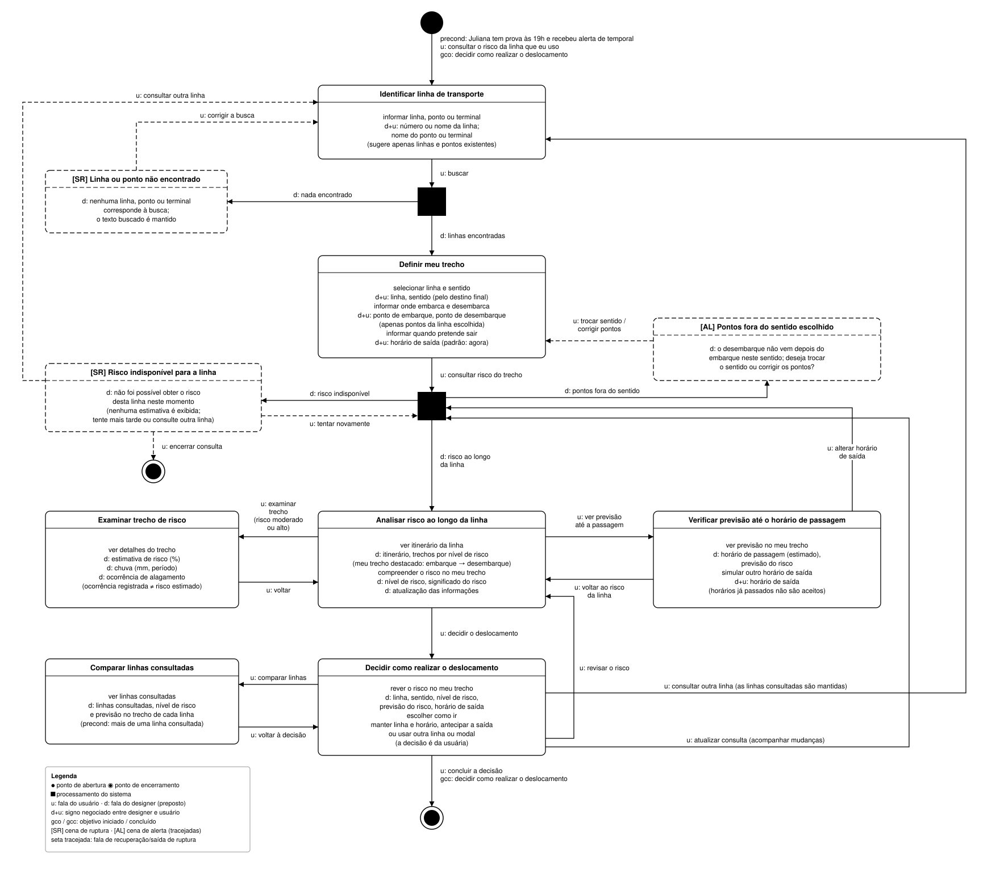

# Entrega 10 — MoLIC
 
**Data:** 22/11/2026  
**Status:** 🟩 Concluída  
**Responsabilidade:** 1 solução completa por integrante
 
## Objetivo da atividade
 
Modelar a interação como uma **conversa entre usuário e preposto do designer**, oferecendo visão global dos caminhos que permitem ao usuário atingir seus objetivos — incluindo alternativas e rupturas relevantes. MoLIC não deve ser reduzida a um fluxograma de telas.
 
> Use a **notação MoLIC ensinada na disciplina**. Este template foca critérios de qualidade e não substitui a legenda/notação apresentada em aula.
 
## Atenção a TCCs sem interface original
 
O MoLIC não modela o algoritmo por dentro. Ele modela a **conversa de interação necessária para que uma pessoa use a contribuição**.
 
Exemplos de conversas:
 
- usuário escolhe dados/parâmetros → sistema valida → usuário inicia análise → sistema comunica processamento → usuário interpreta resultado;
- usuário consulta histórico → refina filtros → abre execução → compara com outra;
- administrador seleciona perfil → altera permissão → sistema comunica consequências → administrador confirma/cancela;
- analista recebe alerta → examina evidências → classifica ocorrência → registra decisão.
Modele também rupturas plausíveis: entrada inválida, falha de processamento, ausência de resultado, permissão insuficiente, filtro sem resultados, conflito de alteração, cancelamento ou necessidade de recuperação.
 
## M01 — Planejamento de deslocamento durante chuva intensa
 
**Autor(a):** Eric Song Watanabe — 22.125.086-3  
**Cenário de interação de origem:** Planejamento de deslocamento durante chuva intensa  
**Objetivo(s):** O01 — Planejar o deslocamento considerando o risco; O02 — Consultar o risco de alagamento da região; O03 — Compreender o significado do risco  
**Tarefa(s) relacionada(s):** T01 — Consultar e interpretar o risco de alagamento de uma região para planejar o deslocamento  
**Signos relevantes:** região, trajeto, nível de risco, estimativa de risco, chuva, ocorrência de alagamento, informações complementares e alternativa de trajeto
 
### Diagrama
 

 
**Fonte editável:** [molic_m01.drawio](../assets/10_molic/molic_m01.drawio)
 
### Leitura do diagrama
 
#### Caminho principal
 
1. A conversa começa quando Paulo deseja consultar o risco de alagamento relacionado ao seu deslocamento.
2. Paulo informa a região ou trajeto que deseja consultar.
3. O sistema processa a consulta e apresenta o risco calculado para a região.
4. Paulo analisa o nível de risco e seu significado.
5. Caso queira mais contexto, pode consultar informações complementares sobre chuva e ocorrências de alagamento.
6. Após compreender a situação, Paulo segue para o planejamento do deslocamento.
7. Se decidir manter o planejamento atual, a conversa é encerrada com o objetivo concluído.
#### Alternativas e rupturas
 
| Situação | Onde ocorre | Como o usuário percebe | Caminho de recuperação/saída |
|---|---|---|---|
| Região ou trajeto não identificado | Durante o processamento da consulta | O sistema informa que não foi possível identificar a região ou trajeto informado | Paulo revisa os dados da consulta e tenta novamente |
| Usuário precisa de mais informações | Após visualizar o risco da região | Paulo percebe que precisa de mais contexto para compreender a situação  | Consulta informações complementares sobre chuva e ocorrências e depois retorna à análise do risco |
| Usuário considera outro trajeto | Durante o planejamento do deslocamento | Paulo decide que deseja avaliar uma alternativa antes de concluir | Retorna à consulta de risco, informa outra região ou trajeto e realiza uma nova análise |
 
## M02 — Prevenção de impactos no comércio durante chuva intensa
 
**Autor(a):** Rafael Iamashita Becsei - 22.225.037-5  
**Cenário de interação de origem:** CI02 — Prevenção de impactos no comércio durante chuva intensa  
**Objetivo(s):** Avaliar o risco de alagamento na região do comércio; compreender sua gravidade e seu período; decidir sobre medidas preventivas      
**Tarefa(s) relacionada(s):** Consultar e interpretar o risco de alagamento da região para avaliar medidas preventivas 
**Signos relevantes:** região consultada, nível de risco, período de referência, informações de chuva e ocorrências de alagamento
 
### Diagrama
 

 
**Fonte editável:** [molic_m02.drawio](../assets/10_molic/molic_m02.drawio)
 
### Leitura do diagrama
 
#### Caminho principal
 
1. A conversa começa quando Viviane deseja consultar o risco de alagamento na região onde está localizado seu comércio.
2. Viviane informa ou seleciona a região de interesse, utilizando o nome, bairro ou mapa.
3. O sistema processa a consulta e, quando a região é identificada, apresenta o nível de risco, seu significado e o período de referência.
4. Viviane interpreta as informações apresentadas e avalia como o risco pode afetar seu estabelecimento.
5. Caso precise de mais informações, pode consultar dados complementares sobre chuva e ocorrências de alagamento, retornando depois à interpretação do risco.
6. Com base nas informações disponíveis, Viviane avalia a necessidade de adotar medidas preventivas para proteger produtos, equipamentos e o funcionamento do comércio.
7. Após concluir sua avaliação, a conversa é encerrada com o objetivo alcançado.
#### Alternativas e rupturas
 
| Situação | Onde ocorre | Como o usuário percebe | Caminho de recuperação/saída |
|---|---|---|---|
| Região do comércio não identificada | Durante a definição da região consultada | O sistema informa que não conseguiu localizar a região solicitada | Viviane retorna à definição da região, corrige o nome ou seleciona uma região pelo mapa, realizando uma nova consulta |
| Necessidade de informações complementares | Após visualizar o risco da região | Viviane percebe que precisa de mais informações para compreender a situação | Consulta informações sobre chuva e ocorrências de alagamento e retorna à interpretação do risco |
| Necessidade de revisar o risco | Durante a avaliação de medidas preventivas | Viviane considera necessário analisar novamente as informações antes de decidir | Retorna à interpretação do risco e reavalia a situação |
 
 
## M03 — Preparação do morador durante previsão de chuva intensa
 
**Autor(a):** Victor Pimentel Lario — 22.125.064-0  
**Cenário de interação de origem:** CI03 — Preparação do morador durante previsão de chuva intensa  
**Objetivo(s):** O01 — Avaliar necessidade de medidas preventivas; O02 — Consultar risco de alagamento; O03 — Identificar região onde mora; O04 — Compreender nível de risco; O05 — Consultar informações complementares; O06 — Acompanhar mudanças na situação  
**Tarefa(s) relacionada(s):** Consultar o risco de alagamento da região onde mora, interpretar seu significado e avaliar a necessidade de proteger a residência.  
**Persona:** P02 — Victor Merker Binda  
**Signos relevantes:** região, localização, nível de risco, estimativa de risco, chuva, ocorrência de alagamento, período e medidas preventivas
 
### Diagrama
 

 
**Fonte editável:** [molic_m03.drawio](../assets/10_molic/molic_m03.drawio)
 
### Leitura do diagrama
 
#### Caminho principal
 
1. A conversa começa quando Victor Merker Binda deseja saber se a região onde mora apresenta risco de alagamento durante a previsão de chuva intensa.
2. Victor informa ou seleciona a região de sua residência, e o sistema confirma qual região será consultada.
3. O sistema consulta as informações disponíveis para a região e apresenta o nível e a estimativa de risco, com uma explicação em linguagem simples e indicação do período de referência.
4. Victor interpreta o risco para compreender a gravidade da situação, sem precisar de conhecimento técnico.
5. Se precisar de mais contexto, consulta informações complementares sobre chuva e ocorrências de alagamento e pode retornar à interpretação do risco.
6. Com base nas informações apresentadas, Victor avalia se precisa proteger objetos e equipamentos, verificar pontos vulneráveis da residência ou continuar acompanhando a situação. A decisão é do próprio morador.
7. Ao concluir sua avaliação, a conversa é encerrada com o objetivo alcançado. Durante a chuva, Victor também pode realizar uma nova consulta para verificar mudanças nas condições da região.
#### Alternativas e rupturas
 
| Situação | Onde ocorre | Como o usuário percebe | Caminho de recuperação/saída |
|---|---|---|---|
| Região não identificada | Ao selecionar a região onde mora | O sistema informa que não encontrou a região indicada | Victor corrige o nome, escolhe uma sugestão válida e refaz a consulta |
| Falha na obtenção de informações | Durante a consulta do risco | O sistema informa que não foi possível obter os dados naquele momento | Victor tenta novamente ou encerra a consulta, sem receber uma estimativa incorreta |
| Dados insuficientes para estimar o risco | Após consultar as informações disponíveis | O sistema explica que não há informações suficientes para apresentar uma estimativa confiável | Victor pode consultar outra região ou encerrar a conversa; a ausência de dados não é comunicada como risco baixo |
| Necessidade de compreender melhor o risco | Após visualizar o resultado | Victor percebe que precisa de mais informações sobre chuva e ocorrências | Consulta informações complementares e retorna à interpretação do risco |
| Mudanças durante a chuva | Após avaliar as medidas preventivas | Victor deseja conferir se o risco foi atualizado | Solicita uma nova consulta, visualiza as informações disponíveis e reavalia sua decisão |
 
**Observação de modelagem:** O MoLIC representa a conversa do morador com o sistema, incluindo retornos e rupturas. Não representa o funcionamento interno do modelo de previsão. Os casos de falha e dados insuficientes são caminhos de recuperação propostos para a interface, coerentes com o objetivo de comunicar o risco com clareza.
 
 
## M04 — Ida para a prova de transporte público com previsão de temporal
 
**Autor(a):** Henrique Hodel Babler — 22.125.084-8  
**Cenário de interação de origem:** CI04 — Ida para a prova de transporte público com previsão de temporal  
**Objetivo(s):** O01 — Decidir como realizar o deslocamento; O02 — Identificar a linha de transporte utilizada; O03 — Consultar o risco ao longo da linha; O04 — Compreender o risco no meu trecho; O05 — Verificar a previsão até o horário de passagem; O06 — Consultar detalhes do trecho de risco; O07 — Comparar com outra linha ou modal; O08 — Acompanhar mudanças no risco  
**Tarefa(s) relacionada(s):** T04 — Consultar o risco de alagamento ao longo da linha de transporte público utilizada e decidir como realizar o deslocamento  
**Persona:** P04 — Juliana Ferreira Costa  
**Signos relevantes:** linha (número, nome, sentido, itinerário), ponto ou terminal, meu trecho (ponto de embarque, ponto de desembarque, horário de saída, horário de passagem), trecho (nível de risco, significado do risco, estimativa de risco, previsão do risco, chuva, ocorrência de alagamento) e consulta (atualização das informações, linhas consultadas)
 
### Diagrama
 

 
**Fonte editável:** [molic_m04.drawio](../assets/10_molic/molic_m04.drawio)
 
### Leitura do diagrama
 
#### Caminho principal
 
1. A conversa começa quando Juliana, que tem prova às 19h e recebeu um alerta de temporal, quer saber se a linha que usa pode ser afetada por alagamento (`gco: decidir como realizar o deslocamento`).
2. Na cena **Identificar linha de transporte**, ela informa o número ou o nome da linha, ou o ponto ou terminal onde embarca. O preposto sugere apenas linhas e pontos existentes (PA). Ao buscar, o sistema processa a busca e apresenta as linhas encontradas.
3. Na cena **Definir meu trecho**, Juliana escolhe a linha e o sentido, que é identificado pelo destino final (PP). Depois informa onde embarca e onde desembarca, escolhendo apenas entre os pontos da linha (PA), e a que horas pretende sair (padrão: agora).
4. Ao pedir a consulta do risco do trecho, o sistema processa as informações e apresenta, na cena **Analisar risco ao longo da linha**, o itinerário com os trechos destacados por nível de risco. O trecho entre o embarque e o desembarque aparece em destaque, junto com o significado do risco em linguagem simples e a data e hora da atualização. Juliana não precisa conhecer os nomes das ruas.
5. Juliana consulta a cena **Verificar previsão até o horário de passagem** para saber como estará o trecho quando o ônibus passar por ali (o horário de passagem é estimado, PP). Ela pode voltar à análise ou simular outro horário de saída. Ao alterar o horário, o sistema refaz a consulta.
6. Com as informações em mãos, Juliana segue para **Decidir como realizar o deslocamento**. Essa cena resume o risco no trecho dela (linha, sentido, nível, previsão e horário de saída) e apresenta as opções: manter a linha e o horário, antecipar a saída ou usar outra linha ou modal. O sistema apoia a escolha, mas não decide por ela.
7. Quando Juliana conclui a decisão, a conversa é encerrada com o objetivo alcançado (`gcc: decidir como realizar o deslocamento`).
**Caminhos alternativos dentro do caminho principal:**
 
- **Examinar trecho de risco:** disponível apenas quando há trecho com risco moderado ou alto (pré-condição). Mostra a estimativa de risco (%), a chuva prevista (mm e período) e as ocorrências de alagamento, deixando clara a diferença entre ocorrência registrada e risco estimado (PP). Juliana volta depois à análise.
- **Comparar linhas consultadas:** disponível apenas quando mais de uma linha foi consultada (PA). Mostra lado a lado o nível de risco e a previsão no trecho de cada linha e depois volta à decisão.
- **Consultar outra linha:** a partir da decisão, Juliana pode voltar à identificação da linha sem perder as linhas que já consultou.
- **Atualizar consulta:** durante a chuva, inclusive já no ponto, Juliana pode refazer a consulta para ver se o risco mudou. O sistema processa a consulta de novo e apresenta as informações atualizadas.
- **Revisar o risco:** da decisão, Juliana pode voltar à análise do risco ao longo da linha.
#### Alternativas e rupturas
 
| Situação | Onde ocorre | Como o usuário percebe | Caminho de recuperação/saída |
|---|---|---|---|
| Linha, ponto ou terminal não encontrado | Processamento da busca, após a cena **Identificar linha de transporte** | Cena de ruptura **[SR] Linha ou ponto não encontrado**: `d: nenhuma linha, ponto ou terminal corresponde à busca`. O texto buscado é mantido | `u: corrigir a busca` → volta à identificação da linha sem precisar redigitar tudo (RA) |
| Embarque e desembarque fora do sentido escolhido | Processamento da consulta, após **Definir meu trecho** | Cena de alerta **[AL] Pontos fora do sentido escolhido**: o preposto explica que o desembarque não vem depois do embarque e pede uma decisão (prevenção apoiada) | `u: trocar sentido / corrigir pontos` → volta a **Definir meu trecho** |
| Risco indisponível para a linha | Processamento da consulta do trecho | Cena de ruptura **[SR] Risco indisponível para a linha**: `d: não foi possível obter o risco desta linha neste momento`. Nenhuma estimativa é exibida, para que a falta de dados não seja lida como risco baixo (CE) | `u: tentar novamente` (refaz o processamento), `u: consultar outra linha` (volta à identificação) ou `u: encerrar consulta` (encerramento) |
| Horário de saída já passado | Ao simular outro horário em **Verificar previsão até o horário de passagem** | O preposto não aceita horários anteriores ao momento da consulta e indica o formato hh:mm (PA + PP) | Juliana informa um horário válido e o sistema refaz a consulta |
| Necessidade de mais contexto sobre um trecho | Após visualizar o risco ao longo da linha | Juliana percebe que precisa entender por que um trecho está em risco moderado ou alto | `u: examinar trecho` → **Examinar trecho de risco** → `u: voltar` |
| Condições mudam durante a chuva | Na decisão, antes de sair ou já no ponto | Juliana quer saber se o risco foi atualizado | `u: atualizar consulta` → novo processamento → análise com a nova data e hora de atualização |
| Dúvida entre linhas | Na decisão | Juliana quer comparar alternativas antes de escolher | `u: consultar outra linha` (as linhas consultadas são mantidas) e `u: comparar linhas` → **Comparar linhas consultadas** → `u: voltar à decisão` |
 
**Observação de modelagem:** o M04 representa a conversa de Juliana com o sistema e não o funcionamento interno do modelo de previsão nem o cálculo do horário de passagem. Os processamentos aparecem como caixas pretas com falas `d:` na saída. Não foram modelados acessos ubíquos: no CI04 a conversa tem um único objetivo final, e a nova consulta e a comparação aparecem como falas de transição justificadas pelo próprio cenário. A consulta por linha, ponto ou terminal ainda depende da hipótese **H06**, em aberto desde a Entrega 7.
 

### Checklist específico de modelagem

- [ ] Existe **ponto de abertura** coerente com o início do objetivo.
- [ ] As **cenas de conversa** representam tópicos/assuntos, não nomes de páginas apenas.
- [ ] As transições/falas deixam claro o que o usuário ou o sistema comunica.
- [ ] Há **ponto(s) de encerramento** para objetivos concluídos/abandonados quando aplicável.
- [ ] Processamentos do sistema estão representados conforme a notação adotada em aula, sem “inventar” fala do usuário.
- [ ] Rupturas (breakdowns) relevantes têm feedback e caminho de recuperação, não becos sem saída.
- [ ] Acessos ubíquos/atalhos só aparecem quando semanticamente justificáveis.
- [ ] O diagrama cobre caminhos alternativos importantes, e não apenas o “happy path”.
- [ ] Nomes de objetivos, tópicos e signos são coerentes com a Entrega 9.
- [ ] O diagrama é legível em tamanho normal no GitHub.
- [ ] O MoLIC representa a conversa usuário–sistema, não o fluxo interno do algoritmo.
- [ ] Processamento, filtros, administração, relatórios e históricos incluem retornos/rupturas quando relevantes.

> Repita M02, M03... para todos os integrantes.

## Consolidação da equipe

### Cobertura dos objetivos

| Objetivo | MoLIC que cobre | Lacunas/duplicidades | Decisão |
|---|---|---|---|
| O01 | M01 | {{...}} | {{...}} |

### Preparação para o Figma

Liste os estados/telas que serão necessários **a partir das conversas modeladas**, incluindo feedback, confirmação, erro e recuperação.

## Erros frequentes a evitar

- desenhar apenas caixas com nomes de telas e setas de navegação;
- não modelar falhas, cancelamento, volta ou recuperação;
- usar rótulos genéricos (“Tela 1”, “Processo 2”) sem tópico de conversa;
- criar no Figma fluxos que não existem no MoLIC;
- diagrama sem legenda/fonte editável e com texto ilegível.
