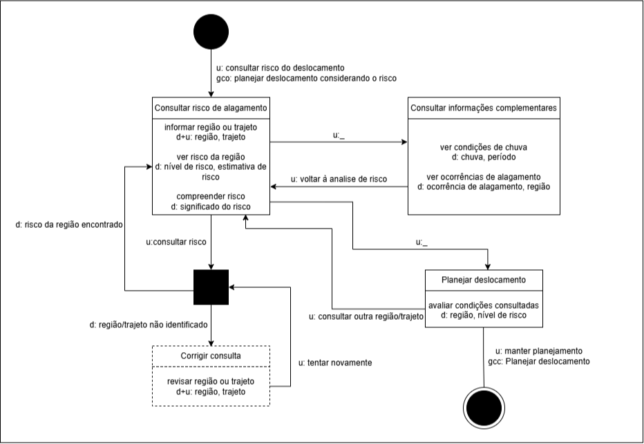

# Entrega 10 — MoLIC

**Data:** 11/11/2026  
**Status:** 🟨 em andamento  
**Responsabilidade:** 1 solução completa por integrante

## Objetivo da atividade

Modelar a interação como uma **conversa entre usuário e preposto do designer**, oferecendo visão global dos caminhos que permitem ao usuário atingir seus objetivos — incluindo alternativas e rupturas relevantes. MoLIC não deve ser reduzida a um fluxograma de telas.

> Use a **notação MoLIC ensinada na disciplina**. Este template foca critérios de qualidade e não substitui a legenda/notação apresentada em aula.

## Atenção a TCCs sem interface original

O MoLIC não modela o algoritmo por dentro. Ele modela a **conversa de interação necessária para que uma pessoa use a contribuição**.

Exemplos de conversas:

- usuário escolhe dados/parâmetros → sistema valida → usuário inicia análise → sistema comunica processamento → usuário interpreta resultado;
- usuário consulta histórico → refina filtros → abre execução → compara com outra;
- administrador seleciona perfil → altera permissão → sistema comunica consequências → administrador confirma/cancela;
- analista recebe alerta → examina evidências → classifica ocorrência → registra decisão.

Modele também rupturas plausíveis: entrada inválida, falha de processamento, ausência de resultado, permissão insuficiente, filtro sem resultados, conflito de alteração, cancelamento ou necessidade de recuperação.

## M01 — Planejamento de deslocamento durante chuva intensa

**Autor(a):** Eric Song Watanabe — 22.125.086-3  
**Cenário de interação de origem:** Planejamento de deslocamento durante chuva intensa  
**Objetivo(s):** O01 — Planejar o deslocamento considerando o risco; O02 — Consultar o risco de alagamento da região; O03 — Compreender o significado do risco  
**Tarefa(s) relacionada(s):** T01 — Consultar e interpretar o risco de alagamento de uma região para planejar o deslocamento  
**Signos relevantes:** região, trajeto, nível de risco, estimativa de risco, chuva, ocorrência de alagamento, informações complementares e alternativa de trajeto

### Diagrama

**Fonte editável:** [molic_m01.drawio](../assets/10_molic/molic_m01.drawio)

### Leitura do diagrama

Explique em texto o caminho principal e pelo menos os caminhos alternativos/rupturas mais importantes.

#### Caminho principal

1. A conversa começa quando Paulo deseja consultar o risco de alagamento relacionado ao seu deslocamento.
2. Paulo informa a região ou trajeto que deseja consultar.
3. O sistema processa a consulta e apresenta o risco calculado para a região.
4. Paulo analisa o nível de risco e seu significado.
5. Caso queira mais contexto, pode consultar informações complementares sobre chuva e ocorrências de alagamento.
6. Após compreender a situação, Paulo segue para o planejamento do deslocamento.
7. Se decidir manter o planejamento atual, a conversa é encerrada com o objetivo concluído.

#### Alternativas e rupturas

| Situação | Onde ocorre | Como o usuário percebe | Caminho de recuperação/saída |
|---|---|---|---|
| Região ou trajeto não identificado | Durante o processamento da consulta | O sistema informa que não foi possível identificar a região ou trajeto informado | Paulo revisa os dados da consulta e tenta novamente |
| Usuário precisa de mais informações | Após visualizar o risco da região | Paulo percebe que precisa de mais contexto para compreender a situação  | Consulta informações complementares sobre chuva e ocorrências e depois retorna à análise do risco |
| Usuário considera outro trajeto | Durante o planejamento do deslocamento | Paulo decide que deseja avaliar uma alternativa antes de concluir | Retorna à consulta de risco, informa outra região ou trajeto e realiza uma nova análise |

## M02 — {{nome do cenário/objetivo}}

**Autor(a):** {{nome — matrícula}}  
**Cenário de interação de origem:** {{CI02}}  
**Objetivo(s):** {{O02}}  
**Tarefa(s) relacionada(s):** {{T02}}  
**Signos relevantes:** {{...}}

### Diagrama

**Fonte editável:** {{adicione aqui o link para o arquivo `.drawio`, `.svg` editável ou outro formato utilizado pela equipe}}

### Leitura do diagrama

Explique em texto o caminho principal e pelo menos os caminhos alternativos/rupturas mais importantes.

#### Caminho principal

1. {{ponto de abertura → cena...}}
2. {{...}}

#### Alternativas e rupturas

| Situação | Onde ocorre | Como o usuário percebe | Caminho de recuperação/saída |
|---|---|---|---|
| {{dado inválido}} | {{...}} | {{fala/feedback}} | {{...}} |

## M03 — {{nome do cenário/objetivo}}

**Autor(a):** {{nome — matrícula}}  
**Cenário de interação de origem:** {{CI03}}  
**Objetivo(s):** {{O03}}  
**Tarefa(s) relacionada(s):** {{T03}}  
**Signos relevantes:** {{...}}

### Diagrama

**Fonte editável:** {{adicione aqui o link para o arquivo `.drawio`, `.svg` editável ou outro formato utilizado pela equipe}}

### Leitura do diagrama

Explique em texto o caminho principal e pelo menos os caminhos alternativos/rupturas mais importantes.

#### Caminho principal

1. {{ponto de abertura → cena...}}
2. {{...}}

#### Alternativas e rupturas

| Situação | Onde ocorre | Como o usuário percebe | Caminho de recuperação/saída |
|---|---|---|---|
| {{dado inválido}} | {{...}} | {{fala/feedback}} | {{...}} |

## M04 — {{nome do cenário/objetivo}}

**Autor(a):** {{nome — matrícula}}  
**Cenário de interação de origem:** {{CI04}}  
**Objetivo(s):** {{O04}}  
**Tarefa(s) relacionada(s):** {{T04}}  
**Signos relevantes:** {{...}}

### Diagrama

**Fonte editável:** {{adicione aqui o link para o arquivo `.drawio`, `.svg` editável ou outro formato utilizado pela equipe}}

### Leitura do diagrama

Explique em texto o caminho principal e pelo menos os caminhos alternativos/rupturas mais importantes.

#### Caminho principal

1. {{ponto de abertura → cena...}}
2. {{...}}

#### Alternativas e rupturas

| Situação | Onde ocorre | Como o usuário percebe | Caminho de recuperação/saída |
|---|---|---|---|
| {{dado inválido}} | {{...}} | {{fala/feedback}} | {{...}} |

### Checklist específico de modelagem

- [ ] Existe **ponto de abertura** coerente com o início do objetivo.
- [ ] As **cenas de conversa** representam tópicos/assuntos, não nomes de páginas apenas.
- [ ] As transições/falas deixam claro o que o usuário ou o sistema comunica.
- [ ] Há **ponto(s) de encerramento** para objetivos concluídos/abandonados quando aplicável.
- [ ] Processamentos do sistema estão representados conforme a notação adotada em aula, sem “inventar” fala do usuário.
- [ ] Rupturas (breakdowns) relevantes têm feedback e caminho de recuperação, não becos sem saída.
- [ ] Acessos ubíquos/atalhos só aparecem quando semanticamente justificáveis.
- [ ] O diagrama cobre caminhos alternativos importantes, e não apenas o “happy path”.
- [ ] Nomes de objetivos, tópicos e signos são coerentes com a Entrega 9.
- [ ] O diagrama é legível em tamanho normal no GitHub.
- [ ] O MoLIC representa a conversa usuário–sistema, não o fluxo interno do algoritmo.
- [ ] Processamento, filtros, administração, relatórios e históricos incluem retornos/rupturas quando relevantes.

> Repita M02, M03... para todos os integrantes.

## Consolidação da equipe

### Cobertura dos objetivos

| Objetivo | MoLIC que cobre | Lacunas/duplicidades | Decisão |
|---|---|---|---|
| O01 | M01 | {{...}} | {{...}} |

### Preparação para o Figma

Liste os estados/telas que serão necessários **a partir das conversas modeladas**, incluindo feedback, confirmação, erro e recuperação.

## Erros frequentes a evitar

- desenhar apenas caixas com nomes de telas e setas de navegação;
- não modelar falhas, cancelamento, volta ou recuperação;
- usar rótulos genéricos (“Tela 1”, “Processo 2”) sem tópico de conversa;
- criar no Figma fluxos que não existem no MoLIC;
- diagrama sem legenda/fonte editável e com texto ilegível.
