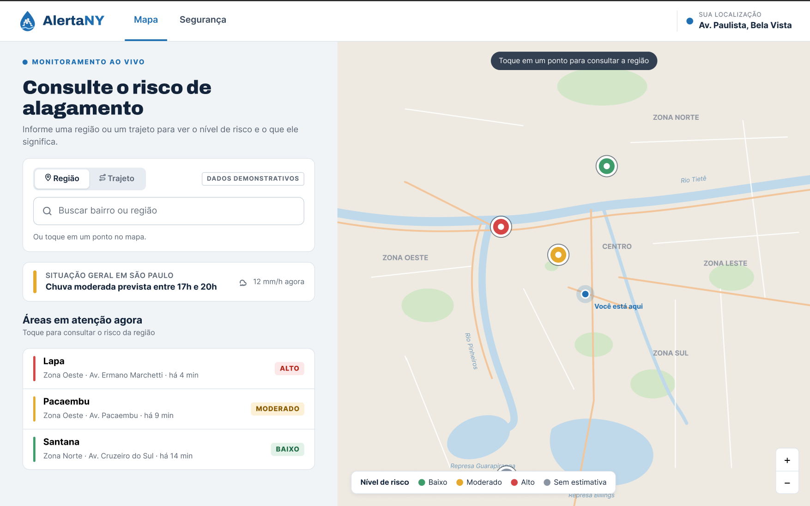
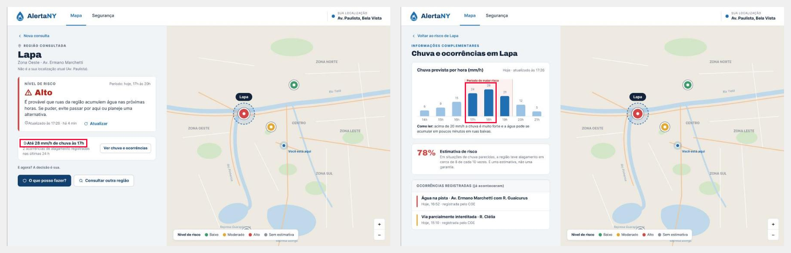

# Entrega 13 — Avaliação de IHC por inspeção heurística

**Data:** 22/11/2026  
**Status:** 🟨 em andamento  
**Responsabilidade:** 1 avaliação completa por integrante, sobre todas as telas/estados relevantes do projeto.

## Objetivo da atividade

Encontrar problemas de usabilidade por inspeção sistemática da interface com as **10 heurísticas de Nielsen**. Cada avaliador trabalha individualmente primeiro; depois a equipe consolida problemas duplicados e prioridades.

> **Parte de violações:** registre somente problemas reais. Não invente uma violação para “preencher” cada heurística. Para provar que todas foram exercitadas, use a **matriz de cobertura H1–H10**. Para heurísticas sem violação, a disciplina solicita um exemplo didático de boa prática.

## 1. Heurísticas adotadas

1. Visibilidade do status do sistema
2. Compatibilidade entre o sistema e o mundo real
3. Controle e liberdade do usuário
4. Consistência e padrões
5. Prevenção de erros
6. Reconhecimento em vez de memorização
7. Flexibilidade e eficiência de uso
8. Estética e design minimalista
9. Ajudar usuários a reconhecer, diagnosticar e recuperar-se de erros
10. Ajuda e documentação

## Cobertura especial para interfaces administrativas e analíticas

Quando existirem, não limite a avaliação às “telas principais”. Inspecione também:

- dashboard em estados normal, vazio e erro;
- filtros sem resultado e filtros combinados;
- relatórios e exportação;
- histórico/listas longas;
- formulários CRUD (criação, edição, exclusão, validação);
- alteração de perfil/permissão;
- confirmações de ações destrutivas;
- processamento/loading/progresso;
- falha e recuperação;
- comparação de resultados;
- mensagens de termos técnicos, métricas e recomendações;
- ajuda/documentação contextual.

Em TCCs técnicos, observe especialmente se a interface comunica o estado do processamento e traduz informações técnicas para o vocabulário do usuário escolhido.

## 2. Escopo da inspeção

| Item | Definição |
|---|---|
| Versão avaliada | Protótipo AlertaNY - Entrega 11 (Figma) |
| Telas/estados | F01 - Início; F02 - Busca; F02E - Região não encontrada; F03 - Consultando; F04 - Risco da região; F04A - Risco atualizado; F05 - Chuva e ocorrências; F06 - Trajeto; F06E - Destino não identificado; F07 - Risco ao longo do trajeto; F09 - O que posso fazer?; F10 - Falha ao obter informações na consulta; F11 - Dados insuficientes |
| Fluxos | M01 - Planejamento de deslocamento durante chuva intensa; M02 - Prevenção de impactos no comércio durante chuva intensa; M03 - Preparação do morador durante previsão de chuva intensa; M04 - Ida para a prova de transporte público com previsão de temporal |
| Dispositivo/viewport | Computador, interface desktop para M01, M02 e M03, M04 |
| Avaliadores | Rafael Iamashita Becsei, Eric Song Watanabe, Victor Pimentel Lario |

## 3. Procedimento individual

Cada avaliador deve:

1. percorrer os fluxos/telas ao menos uma vez para familiarização;
2. inspecionar novamente aplicando sistematicamente H1–H10;
3. registrar cada problema com evidência e contexto;
4. atribuir severidade **depois de compreender bem o problema**, justificando a decisão;
5. não discutir achados com os demais antes de terminar a inspeção individual, quando o objetivo for preservar independência.

### Escala de severidade (0–4)

| Grau | Interpretação |
|---:|---|
| 0 | não é considerado problema de usabilidade |
| 1 | problema cosmético; corrigir se houver tempo |
| 2 | problema menor; baixa prioridade |
| 3 | problema maior; alta prioridade |
| 4 | catástrofe de usabilidade; correção imperativa antes de disponibilizar |

Ao justificar, considere **frequência, impacto e persistência** do problema no contexto real de uso.

---

## Avaliador A01 - Rafael Iamashita Becsei

### 4.1. Matriz de cobertura das 10 heurísticas

| Heurística | Telas/fluxos examinados | Houve violação? | IDs dos achados | Exemplo de boa prática se não violada |
|---|---|---|---|---|
| H1 | Todas as telas | não | - | As telas de processamento apresentam feedbacks, permitindo acompanhar o andamento, e o resultado das telas |
| H2 | Todas as telas | não | - | As telas apresentam palavras, frases e expressões comuns, como as categorias baixo, moderado e alto, e a presença de explicações e informações complementares que aproximam os dados da compreensão cotidiana do usuário |
| H3 | Todas as telas | não | - | O protótipo apresenta opções de cancelamento durante o processamento, retorno e realização de uma nova consulta, permitindo que o usuário não fique restrito e consiga refazer e desfazer suas ações |
| H4 | Todas as telas | sim | V01 | O sistema possui representação visual e textual, mantendo um padrão de identificação nas diferentes telas |
| H5 | Todas as telas | não | - | As regiões, sugestões de busca, níveis de risco, legenda e informações complementares apresentam instruções e descrições de forma acessível e visível para não dar chance do usuário se confundir |
| H6 | Todas as telas | não | - | A localização das regiões pode ser feita através da busca do nome do local, mas também pode ser feita através do mapa, para usuários que não sabem o nome ou apresentam dificuldade em fazer a pesquisa, deixando flexível e eficiente para os diferentes tipos de usuários |
| H7 | Todas as telas | não | - | As informações são distribuídas em áreas distintas, organizando mapa, risco, chuva e ocorrências de maneira que cada grupo de informações tenha seu próprio espaço na interface e apresente dados necessários |
| H8 | Todas as telas | não | - | Quando ocorrem erros, como região não encontrada, as informações do local não encontradas e falta de dados para estimar o risco, a interface apresenta mensagens para essa situação e oferece alternativas para que o usuário possa continuar e sair dessa situação |
| H9 | Todas as telas | sim | V02 | As mensagens de erros apresentam uma linguagem simples, explicações para contextualizar o que houve e uma solução para contornar esse problema |
| H10 | Todas as telas | sim | V03 | A interface apresenta um tour, caso seja a primeira vez do usuário usando a interface, explicações sobre o risco, informações de chuva e ocorrências e orientações preventivas, oferecendo apoio contextual para a interpretação dos dados e para saber utilizar o sistema |

### 5.1. Declaração de violações

| ID | Heurística | Tela/estado | Problema observado | Evidência | Severidade | Justificativa da severidade | Recomendação |
|---|---|---|---|---|---:|---|---|
| V01 | H4 | F11 | Nessa tela, identifiquei que houve troca da cor e posição do botão de Consultar outra região, levando em consideração as outras telas. Nessa tela específica, o botão está azul e na esquerda, enquanto em outras telas como a F04 está branco e na direita |  | 2 | Pouca frequência e não é um impacto grande | Para padronizar e seguir uma consistência em todas as telas, seria necessário deixar a cor como branca e a posição dele a direita do outro botão |
| V02 | H9 | F11 | Nessa tela, identifiquei que não há um solução específica para o usuário seguir e contornar o erro, mesmo que esse caso seja pela falta de dados no sistema para estimar o risco, seria interessante se houvesse alguma dica de como o usuário poderia ser informar sobre isso ou até como se precaver |  | 2 | Para corrigir isso ou minimizar o problema, seria necessário alguma dica de como e onde o usuário poderia conseguir informações sobre isso ou como agir nesses casos, pois pode haver um alagamento no local e não mostrar no sistema |
| V03 | H10 | F01 | Mesmo a interface sendo simples e intuitiva, identifiquei que não há um tour inicial para o usuário que acabou de acessar pela primeira vez ser contextualizado sobre as funcionalidades da ferramenta e funções que pode usar para chegar no resultado desejado, também não há uma aba de guia que possa ajudar durante o uso do sistema |  | 3 | Seria importante adicionar o tour de inicio quando o usuário entra pela primeira vez ou uma aba com guia em todas as telas que, se houver dúvidas, seja possível entender ali o que fazer |

**Qualidade do relato:** o problema deve ser observável e localizado. Evite “interface confusa” sem dizer **o que**, **onde**, **quando** e **para quem**.

### 6.1. Boas práticas - heurísticas não violadas (atividade didática)

| Heurística sem violação | Exemplo no sistema | Evidência | Por que atende |
|---|---|---|---|
| H1 | Processamento da consulta de risco |  | O sistema apresenta etapas do processamento, indicando ao usuário o andamento da consulta e o que está sendo realizado. |
| H2 | Apresentação do nível de risco em linguagem acessível |  | A categorização do risco e as explicações apresentadas aproximam o resultado técnico da interpretação de um usuário não especializado. |
| H3 | Cancelar ou realizar outra consulta |  | O usuário pode cancelar o processamento ou seguir para outra consulta, oferecendo possibilidades de saída e continuidade. |
| H4 | Representação dos níveis de risco |  | A representação textual e visual do risco permite manter uma forma de identificação semelhante entre o mapa e o detalhamento. |
| H5 | Sugestões de busca e alternativas para região não encontrada |  | A interface oferece sugestões e caminhos alternativos quando o usuário não encontra a região desejada, reduzindo a chance de a busca interromper a tarefa. |
| H6 | Legenda, sugestões e informações disponíveis na interface |  | Os elementos necessários para consultar e interpretar o risco são apresentados visualmente, sem exigir que o usuário memorize dados ou opções. |
| H7 | Busca textual e consulta pelo mapa |  | O usuário pode utilizar diferentes formas de localizar a região, escolhendo a que melhor atende sua necessidade. |
| H8 | Separação visual das informações |  | A organização em áreas distintas facilita identificar o mapa, o risco principal e as informações complementares, evitando concentrar tudo em um único espaço. |
| H9 | Estado de busca sem correspondência |  | O usuário recebe retorno de que a região não foi encontrada e pode seguir alternativas para corrigir ou continuar a consulta. |
| H10 | Explicações e orientações contextualizadas |  | O protótipo oferece explicações sobre o significado do risco, contexto meteorológico, ocorrências e orientações, auxiliando o usuário na compreensão das informações. |

## Avaliador A02 — Victor Pimentel Lario

### 4.2. Matriz de cobertura das 10 heurísticas

| Heurística | Telas/fluxos examinados | Houve violação? | IDs dos achados | Exemplo de boa prática se não violada |
|---|---|---|---|---|
| H1 | F03, F04, F04A, F23L, F23, F29 | não | - | F03 e F23L mostram as etapas da consulta (região identificada, reunindo dados, estimando risco). F04A avisa que o risco mudou desde a última consulta ("era moderado às 16:50 e agora está alto"). F04 informa o horário da atualização e há quanto tempo ela foi feita |
| H2 | F04, F05, F24, F28 | não | - | F05 e F24 traduzem a porcentagem para a linguagem do dia a dia ("78% ... cerca de 8 de cada 10 vezes"). F24 diferencia "ocorrência registrada = já aconteceu" de "nível de risco = estimativa" |
| H3 | F03, F07, F22, F23L, F09 | não | - | Há "Cancelar consulta" durante o processamento (F03, F23L), "Editar trajeto" (F07), "Trocar" linha (F22) e "Voltar ao risco de Lapa" (F05, F09) |
| H4 | F02E, F04, F05, F06E, F07, F10, F11, F22, F26, F27 | sim | V01 | O cabeçalho, as cores dos níveis de risco (verde/amarelo/vermelho/cinza) e a legenda do mapa se repetem em todas as telas de desktop |
| H5 | F02, F22E | não | - | F22E avisa que os pontos de embarque e desembarque estão fora do sentido escolhido antes de consultar, e o botão "Consultar risco do trecho" fica desabilitado até a correção. Em F02 as sugestões aparecem enquanto o usuário digita, o que reduz erros no nome da região |
| H6 | F01, F02, F02E, F20, F21E, F25 | não | - | F01 lista "Áreas em atenção agora", F20 lista as "Linhas consultadas" e F25 guarda as linhas para comparação. F02E e F21E sugerem a opção correta ("Você quis dizer") |
| H7 | F01, F09, F23, F27 | não | - | A região pode ser escolhida pela busca ou tocando no mapa (F01). F09 separa as orientações por perfil (vou me deslocar / tenho um comércio / moro na região). F27 permite simular outro horário de saída |
| H8 | F11, F21, F23, F26 | sim | V04 | As telas de resultado (F04, F24) priorizam o nível de risco e deixam os detalhes (chuva, ocorrências) em uma segunda camada |
| H9 | F02E, F06E, F10, F21E, F26 | sim | V03 | F10 explica a causa ("a conexão com as fontes de dados falhou"), diz que nenhum nível de risco foi exibido para não mostrar uma estimativa incorreta e oferece "Tentar novamente" |
| H10 | F05, F07, F09, F23 (saída 18:00) | sim | V02 | F05 explica como ler o gráfico ("acima de 20 mm/h a chuva é muito forte...") e F09 reúne as orientações e os telefones de emergência (199, 193, SMS 40199) |

### 5.2. Declaração de violações

| ID | Heurística | Tela/estado | Problema observado | Evidência | Severidade | Justificativa da severidade | Recomendação |
|---|---|---|---|---|---:|---|---|
| V01 | H4 | F04 e F05 (Lapa) | Os dados de chuva se contradizem entre as telas. F04 diz "Até 28 mm/h de chuva às 17h", mas o gráfico de F05 mostra 24 mm/h às 17h e o pico de 28 mm/h às 18h. Quem decide o horário de sair com base em F04 recebe a hora de pico errada |  | 3 | O erro está no resumo que todo usuário vê no fluxo principal (alta frequência) e afeta justamente a decisão que o sistema quer apoiar: quando sair. Além disso, dados contraditórios reduzem a confiança no alerta | Gerar o resumo de F04 a partir da mesma fonte do gráfico de F05 ("Até 28 mm/h às 18h") ou mostrar o intervalo ("pico entre 17h e 19h") |
| V02 | H10 | F07 e F23 (saída 18:00) | As orientações e os telefones de emergência (F09 "O que posso fazer?") só são acessíveis a partir do resultado por região (F04). No trajeto com destino em risco alto (F07) e na linha de ônibus com risco alto às 18:00 (F23), não há botão nem link para orientações |  | 3 | Afeta os dois outros fluxos principais (trajeto e transporte) exatamente nos estados de risco alto, quando a ajuda é mais necessária. No celular não existe nem a aba "Segurança" para chegar lá por outro caminho | Repetir o botão "O que posso fazer?" em F07 e F23 (e nos estados moderado/alto do celular), levando a F09 com o perfil "Vou me deslocar" já selecionado |
| V03 | H9 | F21 e F21E (busca "862") | Em F21, a busca "862" sugere a linha 8622-10 e o "Ponto R. Clélia, 862". Ao buscar, F21E diz que "nenhuma linha, ponto ou terminal corresponde a '862'" e que "o número da linha tem 4 dígitos". A mensagem contradiz as sugestões e diagnostica o problema errado (o ponto existe e não tem 4 dígitos) |  | 2 | O usuário consegue se recuperar pela sugestão "Você quis dizer", mas a mensagem o faz acreditar que errou a digitação quando não errou | Quando houver correspondência parcial, mostrar os resultados em vez do erro. Reservar F21E para buscas sem nenhuma correspondência e ajustar o texto para "Digite o número completo da linha (ex.: 8622-10) ou o nome do ponto" |
| V04 | H8 | F11 (Parelheiros) | O marcador da região consultada (Parelheiros), destacado com o rótulo, fica embaixo da legenda "Nível de risco", que o cobre parcialmente. O mesmo marcador cinza da Represa Guarapiranga aparece cortado pela legenda nas demais telas |  | 2 | Atinge toda região do extremo sul do mapa, justamente onde está a represa. O usuário perde a confirmação visual de qual ponto foi consultado | Centralizar o mapa automaticamente na região consultada e/ou permitir recolher a legenda, que pode ficar em uma área sem marcadores |

**Qualidade do relato:** o problema deve ser observável e localizado. Evite “interface confusa” sem dizer **o que**, **onde**, **quando** e **para quem**.

## Avaliador A03 - Eric Song Watanabe

### 4.3. Matriz de cobertura das 10 heurísticas

| Heurística | Telas/fluxos examinados | Houve violação? | IDs dos achados | Exemplo de boa prática se não violada |
|---|---|---|---|---|
| H1 - Visibilidade do status do sistema | Todas as telas | sim | V01 | - |
| H2 - Compatibilidade entre sistema e mundo real | Todas as telas | não | - | A interface utiliza termos compreensíveis como baixo, moderado e alto, além de explicar chuva, ocorrências e significado do risco em linguagem próxima do cotidiano do usuário. |
| H3 - Controle e liberdade do usuário | Todas as telas | não | - | O usuário pode cancelar uma consulta em processamento, voltar à tela anterior, realizar uma nova consulta, editar o trajeto e encerrar consultas quando necessário. |
| H4 - Consistência e padrões | Todas as telas | sim | V02 | - |
| H5 - Prevenção de erros | Todas as telas | sim | V03 | - |
| H6 - Reconhecimento em vez de lembrança | Todas as telas | não | - | Região consultada, período, nível de risco, localização atual e demais informações relevantes permanecem visíveis, reduzindo a necessidade de o usuário memorizar informações de telas anteriores. |
| H7 - Flexibilidade e eficiência de uso | Todas as telas | não | - | O usuário pode consultar uma região por busca ou diretamente pelo mapa e pode alternar entre consulta por região e por trajeto, oferecendo caminhos diferentes para atingir objetivos semelhantes. |
| H8 - Projeto estético e minimalista | Todas as telas | não | - | As informações são agrupadas em blocos claros e separados, e detalhes adicionais, como chuva e ocorrências, ficam disponíveis em uma tela específica em vez de sobrecarregar a tela principal. |
| H9 - Ajudar a reconhecer, diagnosticar e recuperar erros | F09, F10 e fluxos de consulta | não | - | Em F09, o sistema explica que houve falha na obtenção dos dados, informa que nenhum nível incorreto foi exibido e oferece “Tentar novamente”. Em F10, explica a falta de dados e oferece alternativas para continuar. |
| H10 - Ajuda e documentação | Todas as telas, especialmente F04, F05 e F08 | não | - | A interface oferece ajuda contextual, como explicação do significado do risco, seção “Como ler”, informações complementares e a tela “O que posso fazer?” com orientações relacionadas à situação. |

### 5.3. Declaração de violações

| ID | Heurística | Tela/estado | Problema observado | Evidência | Severidade | Justificativa da severidade | Recomendação |
|---|---|---|---|---|---:|---|---|
| V01 | H1 - Visibilidade do status do sistema | F01 | Na mesma tela aparecem as expressões “MONITORAMENTO AO VIVO” e “DADOS DEMONSTRATIVOS”. Isso pode gerar dúvida sobre se as informações apresentadas representam dados realmente atuais ou apenas dados de demonstração. |  | 2 | O problema pode causar confusão sobre a confiabilidade e atualidade das informações apresentadas, mas não impede diretamente a realização da consulta. | Deixar explícito se os dados são demonstrativos ou reais e evitar utilizar simultaneamente expressões que transmitam ideias conflitantes sobre a atualização das informações. |
| V02 | H4 - Consistência e padrões | F09 e F10 | A ação de encerrar a consulta é apresentada com nomenclaturas diferentes. Em F09 o botão aparece como “Encerrar consulta”, enquanto em F10 aparece apenas como “Encerrar”. |  | 1 | A inconsistência é pequena e não impede a execução da tarefa, mas pode gerar uma leve dúvida sobre se as duas opções representam exatamente a mesma ação. | Utilizar a mesma nomenclatura para essa ação em todas as telas, preferencialmente “Encerrar consulta”. |
| V03 | H5 - Prevenção de erros | F06 | O usuário digitou “Lappa” no campo de destino e o sistema apresenta “Lapa” como opção reconhecida, porém o botão “Consultar trajeto” já aparece habilitado antes que o usuário selecione uma opção válida. Isso pode permitir o envio de uma entrada ainda não validada. |  | 3 | O problema pode levar o usuário a iniciar uma consulta com um destino inválido ou incorreto, causando erro na consulta ou resultado diferente do esperado. | Manter o botão “Consultar trajeto” desabilitado até que o usuário selecione uma região reconhecida ou validar automaticamente a entrada antes de permitir o avanço. |

**Qualidade do relato:** o problema deve ser observável e localizado. Evite “interface confusa” sem dizer **o que**, **onde**, **quando** e **para quem**.

> Repita a seção para A02, A03... um avaliador por integrante.

## 7. Consolidação da equipe

Problemas iguais ou muito semelhantes encontrados por avaliadores diferentes devem ser consolidados, preservando quem os encontrou.

| ID consolidado | Achados individuais | Heurística | Problema | Severidade final | Prioridade | Responsável pela correção |
|---|---|---|---|---:|---|---|
| HC01 | V01(A01), V04(A02) | H1 | {{...}} | {{...}} | alta | {{...}} |

## 8. Síntese e plano de melhoria

- Quantidade de problemas por heurística e severidade.
- Problemas críticos/graves que bloqueiam teste ou release.
- Padrões recorrentes entre telas.
- Correções que serão feitas antes/para a avaliação com usuários.

## Checklist

- [ ] Cada integrante fez uma inspeção completa e identificada.
- [ ] Todas as telas/estados relevantes foram examinados.
- [ ] Estados administrativos, filtros, relatórios, históricos, processamento e erros foram incluídos quando existentes.
- [ ] A inspeção avaliou a interface/protótipo, não o mérito técnico do algoritmo/modelo.
- [ ] H1–H10 aparecem na matriz de cobertura de cada avaliador.
- [ ] Parte de violações contém apenas violações, sem “forçar” exemplos.
- [ ] Todo problema tem print/localização e contexto.
- [ ] Severidade possui justificativa, não apenas número.
- [ ] Recomendação resolve a causa ou reduz o impacto.
- [ ] Achados duplicados foram consolidados ao final.
