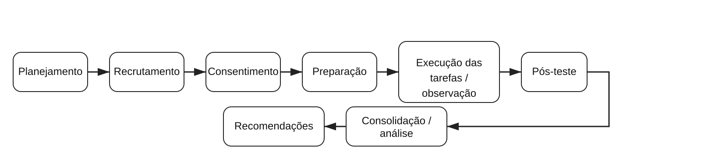

# Entrega 14 — Avaliação de usabilidade por observação de usuários

**Data:** 25/11/2026   
**Status:** 🟩 concluída  
**Responsabilidade:** solução consolidada por equipe. O número de participantes finais observados deve ser igual ao número de integrantes, conforme o modelo da disciplina; recomenda-se que cada integrante seja responsável por conduzir/analisar ao menos um participante.

## Objetivo da atividade

Observar usuários representativos realizando tarefas reais ou realisticamente simuladas para identificar problemas de eficácia, eficiência, compreensão e satisfação que não podem ser inferidos apenas por inspeção.

> **Participantes finais não devem ser membros da equipe.** Um integrante pode participar do teste piloto apenas para validar roteiro/equipamentos, sem contar na amostra final.

O teste avalia a **interação com o protótipo do AlertaNY**, e não o desempenho do modelo de aprendizado de máquina do TCC. Os níveis e probabilidades de risco exibidos no protótipo do Figma são **dados simulados**.

## A. Fluxograma do processo — equipe

O fluxograma deve representar, no mínimo: planejamento → recrutamento → consentimento → preparação → execução das tarefas/observação → pós-teste → consolidação/análise → recomendações.

## B. Procedimento de preparação e execução — equipe

### Passo 1 — Objetivos e versão avaliada

**Versão/commit/Figma:** [Alerta — Protótipo (Entrega 11)](https://www.figma.com/design/MfjRPAeQJQGr757eIRJWuL/Alerta-%E2%80%94-Prot%C3%B3tipo--Entrega-11-?node-id=0-1&t=9sixWQc0QlDyxIwL-1), fluxo PF01/T01 (consulta de risco de uma região)  
**Metas de usabilidade relacionadas:** MU01, MU02, MU03, MU06 e MU07 (Entrega 8). MU04 e MU05 não se aplicam porque os fluxos T02 e T03 não fazem parte deste teste.

### Passo 2 — Participantes

| ID | Perfil | Critérios que justificam participação | Integrante responsável |
|---|---|---|---|
| U01 | Estudante universitária que se desloca diariamente | Se desloca todos os dias, usa apps de clima/mapa, mas com pouca frequência, e já passou por alagamento. Perfil compatível com a persona P01. Não integra a equipe e não conhecia o protótipo. | Henrique Babler |
| U02 | Estudante de cursinho, com deslocamentos curtos e pouca exposição a alagamentos | Realiza deslocamentos frequentes, geralmente em trajetos curtos feitos a pé ou de carro. Utiliza pouco aplicativos de clima e possui pouca experiência com situações de alagamento. Não integra a equipe e não conhecia o protótipo antes do teste. | Eric Song Watanabe |
| U03 | Pessoa que trabalha diariamente e percorre percursos que tem risco de alagamento | Realiza deslocamentos por regiões de alagamento quase todos os dias da semana de carro. Utiliza principalmente o aplicativo de clima tempo e leva em consideração noticiários e alertas da Prefeitura de São Paulo. Não faz parte da equipe e não tinha conhecimento prévio do assunto. | Rafael Iamashita Becsei |

### Passo 3 — Consentimento e privacidade

- Termo/registro de consentimento: [Termo de consentimento](../instrumentos/termo_consentimento_modelo.md). U01, U02 e U03 deram consentimento verbal no início da sessão remota, depois que o termo foi lido para eles.
- Gravação de tela/áudio/vídeo: **não**. Os registros foram feitos apenas por anotações do avaliador.
- Forma de anonimização: IDs `U01`, `U02`... O nome dos participantes não aparece no repositório.
- Local e período de armazenamento: anotações guardadas pelos integrantes da equipe até o fim das entregas da disciplina e descartadas depois, conforme orientação docente.

### Passo 4 — Teste piloto

**Data:** 25/11/2026  
**O que foi validado:** clareza do roteiro, entendimento das instruções, sequência das tarefas, funcionamento do protótipo e forma de registro das observações e dos tempos.  
**Mudanças após piloto:** não foram necessárias alterações relevantes. O roteiro e as tarefas foram considerados compreensíveis e adequados para a aplicação com os participantes finais.

### Passo 5 — Tarefas

| ID | Cenário/instrução apresentada | Critério de sucesso | Métricas | Ligação com modelo |
|---|---|---|---|---|
| UT01 | Você está se preparando para realizar um deslocamento e gostaria de verificar se uma região de seu interesse apresenta risco de alagamento. Utilize a interface para consultar as informações disponíveis e entender a situação da região. | Localizar a região, acessar as informações de risco e explicar o que entendeu, sem ajuda | sucesso, tempo, erros, ajudas, satisfação | T01/OA01 — MU01, MU02 |
| UT02 | Você gostaria de verificar a situação de uma outra região da cidade. Utilize a interface para localizar essa região e consultar as informações de risco disponíveis. | Localizar outra região e identificar o risco apresentado, sem ajuda | sucesso, tempo, erros, ajudas | T01/OA01 — MU01, MU02 |
| UT03 | Após consultar uma região, você gostaria de entender melhor a situação apresentada. Explore as informações disponíveis e explique com suas próprias palavras o que elas indicam sobre o risco de alagamento naquele local. | Explicar corretamente o risco, sem confundir estimativa com ocorrência confirmada | sucesso, tempo, interpretação | T01/OA01 — MU03, MU07 |
| UT04 | Você gostaria de obter mais informações sobre as condições da região que está consultando para compreender melhor a situação. Explore as informações adicionais disponibilizadas pela interface. | Localizar as informações complementares e explicar como ajudam a entender a situação | sucesso, tempo, erros, ajudas | T01/OA01 — MU01, MU02 |

### Passo 6 — Protocolo do moderador

1. Receber o participante e explicar que **o produto está sendo avaliado, não a pessoa**.
2. Obter o consentimento do participante.
3. Aplicar o perfil pré-teste mínimo necessário.
4. Ler as instruções padronizadas de cada tarefa.
5. Observar sem ensinar o caminho e registrar separadamente eventuais pedidos de ajuda.
6. Após cada tarefa, registrar o grau de satisfação em escala de 1 a 5.
7. Realizar uma breve entrevista pós-teste.
8. Encerrar a sessão e explicar como os dados serão utilizados.

## C. Resultados — por participante

### U01 — Estudante universitária, se desloca diariamente, já passou por alagamento

**Data:** 25/11/2026  **Modalidade:** remota (videochamada)  **Dispositivo:** computador com navegador  **Gravação:** não

**Perfil pré-teste:** estudante universitária que se desloca diariamente, usa apps de clima/mapa, mas com pouca frequência, e já passou por situação de alagamento.

| Tarefa | Grau de sucesso | Erros | Tipos de erro/dificuldade | Ajudas | Tempo | Satisfação | Evidência/observação |
|---|---|---:|---|---:|---|---|---|
| UT01 | total | 0 | nenhum observado | 0 | < 00:30 | 4 (geral) | Consultou a região e entendeu o risco sem hesitar |
| UT02 | total | 0 | nenhum observado | 0 | < 00:30 | 4 (geral) | Encontrou outra região e consultou o risco sem dificuldade |
| UT03 | total | 0 | nenhum observado | 0 | < 00:30 | 4 (geral) | Explicou o risco com as próprias palavras, sem confundir estimativa com ocorrência confirmada |
| UT04 | total | 0 | nenhum observado | 0 | < 00:30 | 4 (geral) | Encontrou as informações complementares sem ajuda |

> Os tempos foram registrados como faixa (menos de 30 segundos por tarefa), não como valor exato. A satisfação foi uma única nota de facilidade (escala de 1 a 5) dada ao final da sessão.

**Link da gravação (se autorizado):** não se aplica (sessão sem gravação)  
**Resposta pós-teste:** a participante disse que as informações estavam claras e não apontou dificuldades nem sugestões relevantes. Deu nota 4 de 5 para a facilidade de uso.

### U02 — Estudante de cursinho, com deslocamentos curtos e pouca exposição a alagamentos

**Data:** 25/11/2026  **Modalidade:** pessoalmente (mesmo ambiente)  **Dispositivo:** computador com navegador  **Gravação:** não

**Perfil pré-teste:** estudante de cursinho que realiza deslocamentos frequentes, geralmente em trajetos curtos feitos a pé ou de carro. Utiliza pouco aplicativos de clima e tem pouca experiência com situações de alagamento no dia a dia.

| Tarefa | Grau de sucesso | Erros | Tipos de erro/dificuldade | Ajudas | Tempo | Satisfação | Evidência/observação |
|---|---|---:|---|---:|---|---:|---|
| UT01 | total | 0 | nenhum observado | 0 | 00:09,15 | 5 | Concluiu a consulta da região rapidamente, sem hesitação, erros ou necessidade de ajuda. Demonstrou compreender com facilidade o caminho necessário para realizar a consulta. |
| UT02 | total | 0 | nenhum observado | 0 | 00:07,76 | 5 | Localizou e consultou outra região sem dificuldade, erros ou necessidade de ajuda. Realizou a tarefa de forma direta e com segurança. |
| UT03 | total | 0 | nenhum observado | 0 | 00:18,91 | 5 | Conseguiu interpretar corretamente as informações apresentadas e explicar a situação com suas próprias palavras, sem confundir a estimativa de risco com uma ocorrência confirmada de alagamento. |
| UT04 | total | 0 | dificuldade leve de localização das informações complementares | 0 | 01:03,21 | 4 | Encontrou as informações complementares e conseguiu compreender seu conteúdo sem ajuda. Entretanto, precisou navegar por várias telas e explorar diferentes opções até localizar todas as informações adicionais, o que aumentou consideravelmente o tempo de execução em comparação com as demais tarefas. |

### U03 — Trabalhador que realiza deslocamentos diários por regiões com risco de alagamento

**Data:** 25/11/2026  **Modalidade:** remota (videochamada)  **Dispositivo:** computador com navegador  **Gravação:** não

**Perfil pré-teste:** trabalhador que realiza deslocamentos frequentes de carro por regiões de São Paulo que podem apresentar alagamentos. Utiliza principalmente aplicativos de previsão do tempo e acompanha notícias e alertas da Prefeitura para se informar sobre as condições das vias antes de sair.

| Tarefa | Grau de sucesso | Erros | Tipos de erro/dificuldade | Ajudas | Tempo | Satisfação | Evidência/observação |
|---|---|---:|---|---:|---|---:|---|
| UT01 | total | 0 | Pequena hesitação inicial ao localizar a região no mapa | 0 | 00:16,42 | 5 | Localizou a região que pretendia consultar após observar brevemente o mapa. Identificou o nível de risco apresentado e demonstrou compreender a informação sem precisar de ajuda. |
| UT02 | total | 0 | Nenhum observado | 0 | 00:12,37 | 5 | Encontrou outra região com rapidez, buscando comparar as condições com o local consultado anteriormente. Realizou a consulta de forma independente e sem dificuldades. |
| UT03 | total | 0 | Leve dúvida inicial sobre o significado de um indicador apresentado | 0 | 00:31,54 | 4 | Interpretou corretamente o risco apresentado após observar os indicadores por alguns instantes. Demonstrou compreender que as informações representam uma estimativa de risco e não necessariamente uma ocorrência confirmada de alagamento. |
| UT04 | total | 0 | Dificuldade moderada para localizar as informações complementares | 0 | 00:48,67 | 4 | Conseguiu localizar e compreender as informações adicionais, mas precisou explorar diferentes elementos da interface até encontrá-las. Considerou que esses dados poderiam estar mais evidentes durante a consulta. |

## D. Consolidação por tarefa

> Resultado parcial, só com U01 (n = 1). Atualizar quando U02–U04 forem registrados.
> 
| Tarefa | Taxa de sucesso | Tempo típico | Erros recorrentes | Satisfação | Meta atendida? | Problemas prioritários |
|---|---:|---|---|---|---|---|
| UT01 | 3/3 (100%) | < 30 s | nenhum | 4–5 | sim (MU01, MU02) — parcial | pequena hesitação inicial na localização da região no mapa |
| UT02 | 3/3 (100%) | < 30 s | nenhum | 4–5 | sim (MU01, MU02) — parcial | nenhum até o momento |
| UT03 | 3/3 (100%) | < 30 s | nenhum | 4–5 | sim (MU03, MU07) — parcial | leve dúvida inicial sobre o significado de um indicador |
| UT04 | 3/3 (100%) | variável; U02 levou 01:03,21 e U03 levou 00:48,67 | nenhum erro recorrente | 4 | sim (MU01, MU02) — parcial | localização das informações complementares exigiu maior exploração por U02 e U03 |

**Satisfação geral (MU06, meta ≥ 4,0):** 4,0 com U01. Atende à meta, mas no limite.

## E. Achados e recomendações

| ID | Achado | Evidência (quant. + qual.) | Impacto | Recomendação | Artefatos a revisar |
|---|---|---|---|---|---|
| AU01 | O fluxo principal de consulta de risco foi concluído sem erros nem ajuda pelos três participantes | U01, U02 e U03 concluíram as 4 tarefas com sucesso total, sem erros ou necessidade de ajuda | Positivo: o fluxo principal mostrou-se compreensível para os participantes, permitindo a realização das tarefas de forma independente | Manter a estrutura do fluxo e verificar se o resultado se repete com U04 | — |
| AU02 | A satisfação permaneceu igual ou superior à meta definida | U01 deu nota geral 4/5. U02 deu notas 5/5 em UT01–UT03 e 4/5 em UT04. U03 atribuiu notas 5/5 em UT01–UT02 e 4/5 em UT03–UT04 | Positivo: os participantes demonstraram uma percepção favorável da facilidade de uso, embora tenham sido observadas pequenas dificuldades em tarefas específicas | Confirmar a satisfação com U04 e investigar eventuais notas inferiores a 5 | Roteiro de pós-teste |
| AU03 | A localização das informações complementares exigiu maior exploração por U02 e U03 | U02 concluiu UT04 com sucesso, sem erros ou ajuda, mas levou 01:03,21 e precisou navegar por várias telas. U03 também concluiu a tarefa sem ajuda, levando 00:48,67, e relatou que as informações poderiam estar mais evidentes | Médio: não impediu a conclusão da tarefa, mas indica menor eficiência e dificuldade de localização das informações complementares | Avaliar se as informações complementares podem ficar mais visíveis ou ser acessadas de forma mais direta | Protótipo / fluxo T01 |

## F. Comparação com a avaliação heurística

| Problema | Detectado na heurística? | Detectado por usuários? | O que aprendemos |
|---|---|---|---|
| H1 — possível dúvida entre “MONITORAMENTO AO VIVO” e “DADOS DEMONSTRATIVOS” | sim | não (U01, U02 e U03) | Até o momento, a inconsistência identificada na inspeção não impediu a realização das tarefas nem foi mencionada espontaneamente pelos participantes. |
| H4 — nomenclatura diferente entre “Encerrar consulta” e “Encerrar” | sim | não (U01, U02 e U03) | A diferença de nomenclatura não gerou dificuldade observável durante as sessões realizadas, mas continua sendo uma inconsistência da interface. |
| H5 — possibilidade de consultar antes da validação completa de um destino | sim | não (U01, U02 e U03) | Nenhum dos participantes encontrou esse problema durante as tarefas. A violação continua válida como problema potencial identificado pela inspeção, mesmo sem ter aparecido nas sessões realizadas até o momento. |

## G. Conclusão

1. Quais metas de usabilidade foram atingidas?
2. Quais problemas foram recorrentes e com quais perfis/tarefas?
3. O que surpreendeu a equipe?
4. Quais mudanças são prioritárias?
5. Que limitações do teste impedem generalizações amplas?

A avaliação de usabilidade indicou que as principais metas relacionadas à consulta e interpretação dos riscos de alagamento foram alcançadas pelos participantes U01, U02 e U03. Os participantes conseguiram realizar as tarefas propostas sem erros ou necessidade de ajuda do moderador, demonstrando que o fluxo principal da interface é compreensível e permite consultar diferentes regiões, interpretar os indicadores de risco e comparar informações.

A avaliação também identificou que a localização de informações complementares exigiu maior exploração da interface por parte de alguns participantes, especialmente durante a tarefa UT04. Além disso, foram observadas pequenas hesitações iniciais na localização de regiões no mapa e na interpretação dos indicadores de risco, embora essas dificuldades não tenham impedido a conclusão das tarefas.

De forma geral, os resultados indicaram uma percepção positiva de usabilidade, com níveis de satisfação entre 4 e 5 na escala utilizada. Como principal melhoria, recomenda-se tornar as informações complementares mais visíveis e acessíveis, reduzindo a necessidade de exploração da interface para encontrá-las.

Entretanto, os resultados devem ser interpretados considerando as limitações da avaliação, como o número reduzido de participantes, a diversidade limitada dos perfis avaliados e o caráter exploratório do teste. Dessa forma, os resultados permitem identificar aspectos positivos e oportunidades de melhoria, mas não permitem generalizar conclusões para todos os usuários do sistema.

## Checklist

- [ ] Número de participantes finais atende ao enunciado. *(1 de 4)*
- [x] Participantes são representativos do público e não são membros da equipe.
- [ ] Se foram usados participantes proxy, a justificativa e a limitação estão explícitas.
- [x] O teste avalia a interação; não confunde usabilidade do protótipo com desempenho técnico do TCC.
- [x] Tarefas administrativas/analíticas usadas no teste são rastreáveis a objetivos e cenários.
- [x] Há consentimento e anonimização.
- [ ] Foi realizado teste piloto.
- [x] Tarefas têm critérios de sucesso definidos antes do teste.
- [x] Moderadores não ensinaram o caminho durante a tarefa.
- [x] Resultados estão separados por usuário e por tarefa.
- [x] Foram registrados sucesso, erros, ajudas, tempo e satisfação quando aplicáveis.
- [ ] Conclusão combina evidência quantitativa e qualitativa.
- [ ] Achados geram recomendações e atualização da rastreabilidade.
